

  <a href="images/stream.png">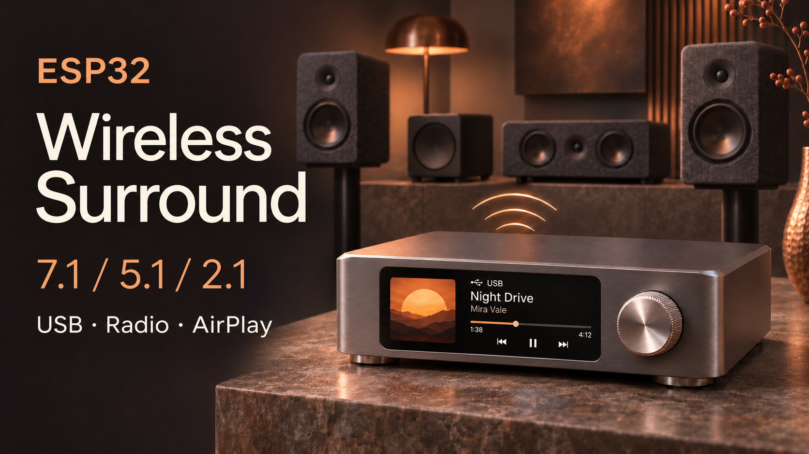</a>

# Gallery

**From an ESP32 AirPlay receiver to a wireless surround streamer.** One
Gateway, now also on the ESP32-P4, plays AirPlay, web radio and music from
a USB stick to up to eight wireless speakers, 7.1, 5.1 or stereo with a
subwoofer, every speaker its own channel.

Click an image to open it full size. Back to the [README](README.md).

*The picture above is an illustration. A display and an enclosure for the
Gateway are planned. Today the Gateway is a bare board, and everything is
controlled from its web page.*

## The system

<table>
  <tr>
    <td align="center" width="50%">
      
       <b>7.1 around the listener:</b> one Gateway, one ESP32-S3 board in every speaker
    </td>
    <td align="center" width="50%">
      
       <b>No cables between the speakers:</b> the Gateway feeds them all over Wi-Fi
    </td>
  </tr>
</table>

## The Gateway's speakers page

<table>
  <tr>
    <td align="center" colspan="2">
      <a href="images/speakers-page-airplay.png">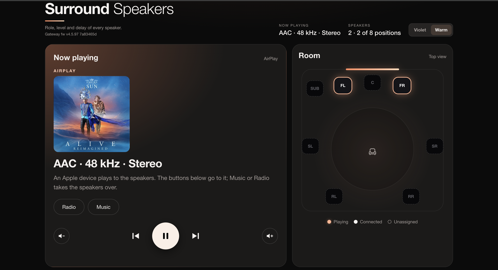</a>
       <b>AirPlay plays:</b> the sender's artwork (ESP32-P4 Gateway), the format, play/pause, skip and volume that go to the Apple device, and the room map with the speakers that play
    </td>
  </tr>
  <tr>
    <td align="center" colspan="2">
      <a href="images/speakers-page.png">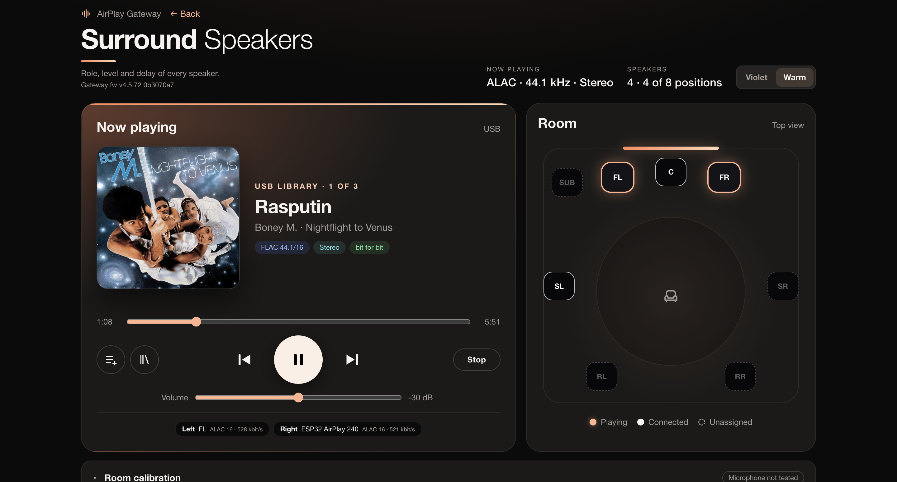</a>
       <b>Music from the USB stick:</b> cover, title and album, bit for bit to the front pair
    </td>
  </tr>
  <tr>
    <td align="center" width="50%">
      <a href="images/speakers-page-tiles.png">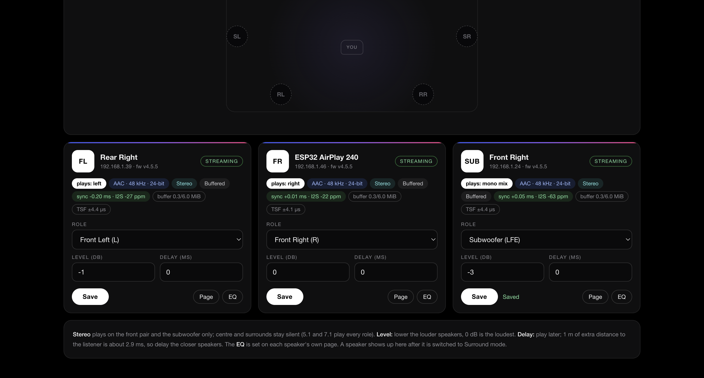</a>
       <b>One tile per speaker:</b> role, level, delay and live sync
    </td>
    <td align="center" width="50%">
      <a href="images/player-library.png">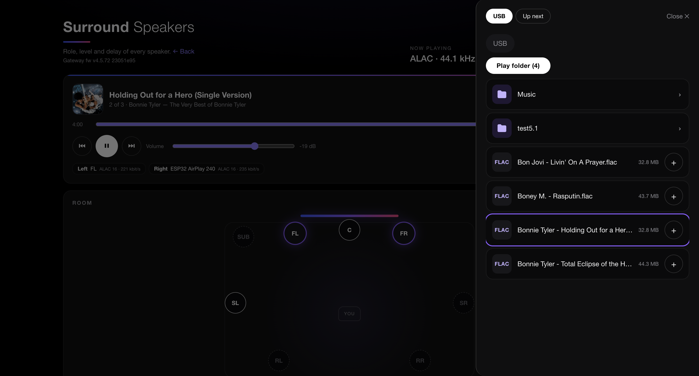</a>
       <b>The USB player's Library:</b> the stick's folders and files, <b>Play folder</b>, <b>+</b> to the queue
    </td>
  </tr>
  <tr>
    <td align="center" width="50%">
      <a href="images/player-bar.png">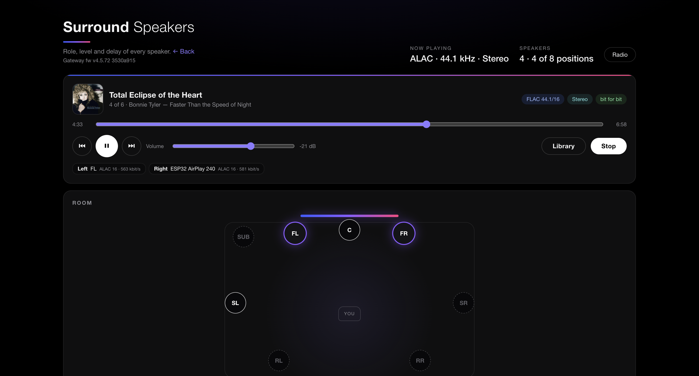</a>
       <b>Violet theme:</b> the player with its format chips (<i>FLAC 44.1/16 · bit for bit</i>) and the ALAC stream each speaker gets
    </td>
    <td align="center" width="50%">
      <a href="images/speakers-page-room.png">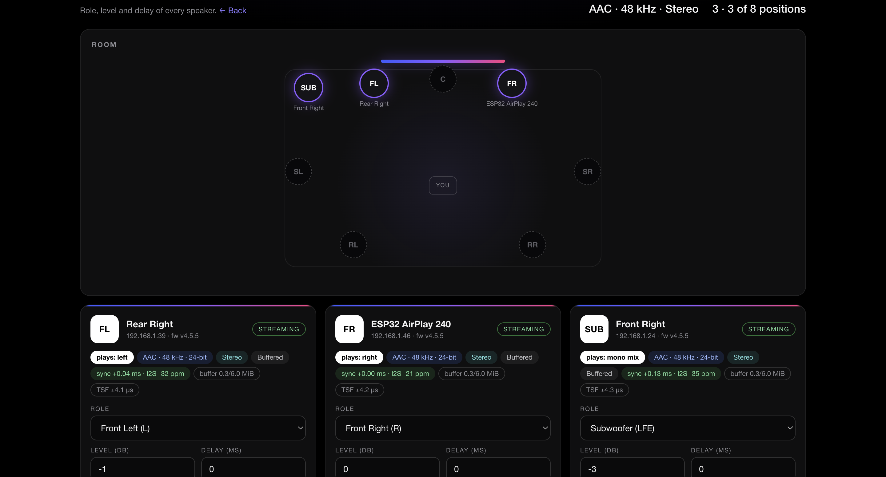</a>
       <b>Live status of every speaker:</b> what it plays, sync, I2S correction, buffer fill and clock quality
    </td>
  </tr>
</table>

## Room calibration and Room EQ

<table>
  <tr>
    <td align="center" colspan="2">
      <a href="images/speakers-page-calibration-5.png">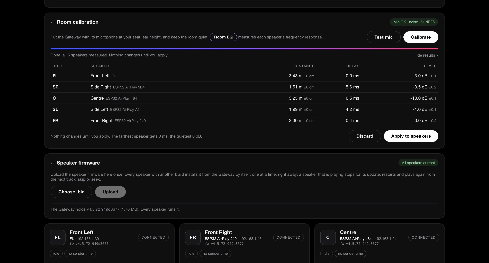</a>
       <b>Room calibration:</b> five speakers measured from the seat with the Gateway's microphone, distance, delay and level each
    </td>
  </tr>
  <tr>
    <td align="center" width="50%">
      <a href="images/roomeq-page.png">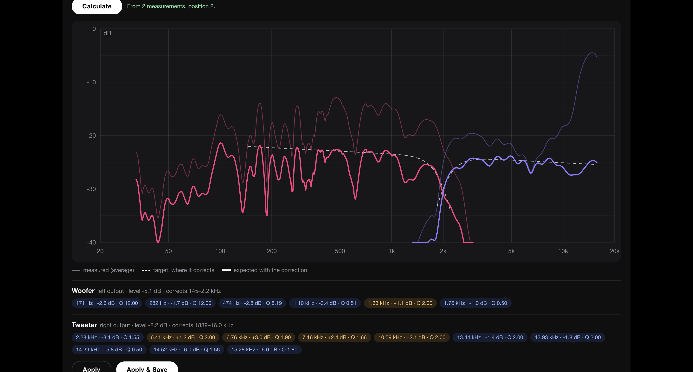</a>
       <b>Room EQ:</b> a 2-way speaker's response, its target and the filters for its woofer and tweeter
    </td>
    <td align="center" width="50%">
      <a href="images/speakers-page-calibration.png">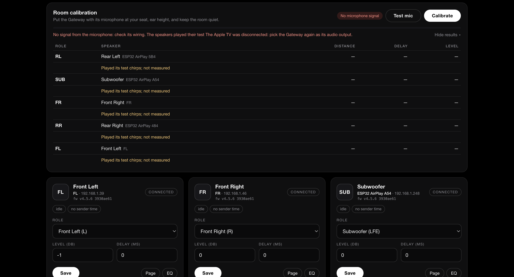</a>
       <b>Without a microphone:</b> every speaker still plays its chirps, so you hear that each one works
    </td>
  </tr>
</table>

## Apple Home

<table>
  <tr>
    <td align="center" width="50%">
      <a href="images/homekit-gateway.jpg">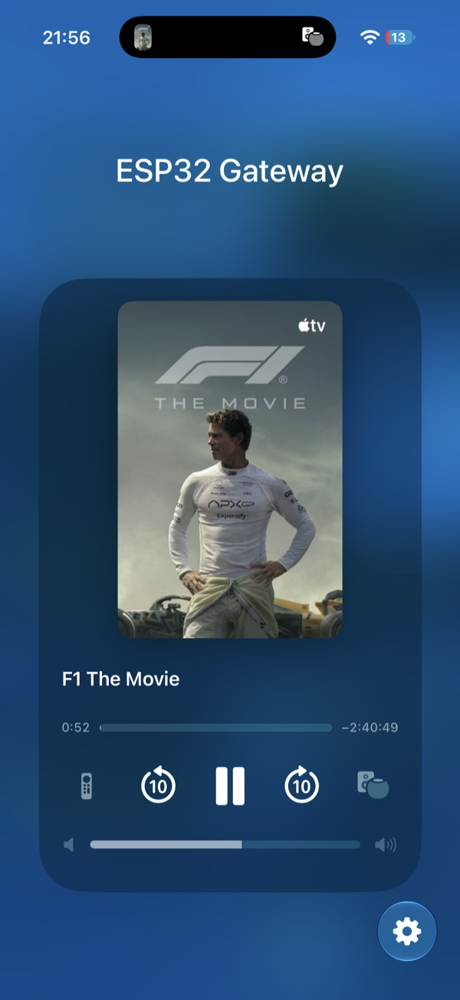</a>
       <b>The whole system as one speaker</b> in Apple Home
    </td>
    <td align="center" width="50%">
      <a href="images/homekit-player.jpg">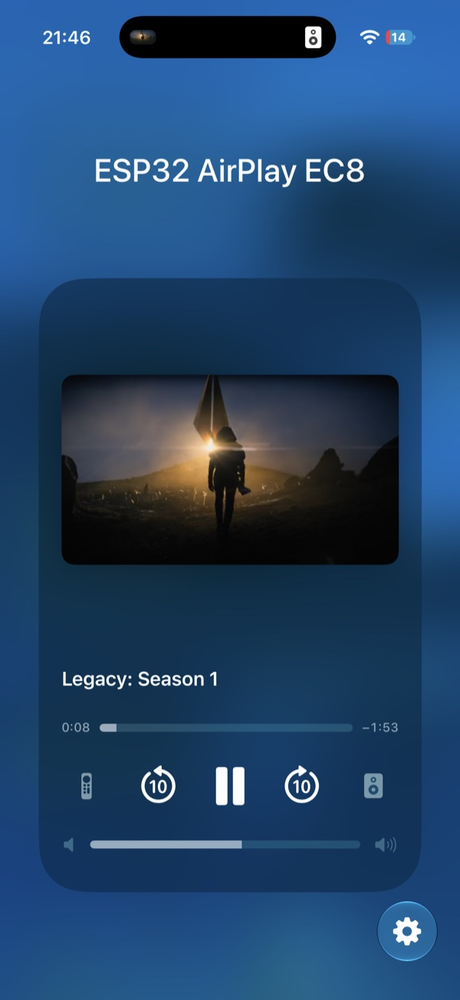</a>
       <b>Artwork and playback controls</b> from the Home app
    </td>
  </tr>
</table>

## Building a speaker

<table>
  <tr>
    <td align="center" width="50%">
      <a href="images/wiring-max98357a.png">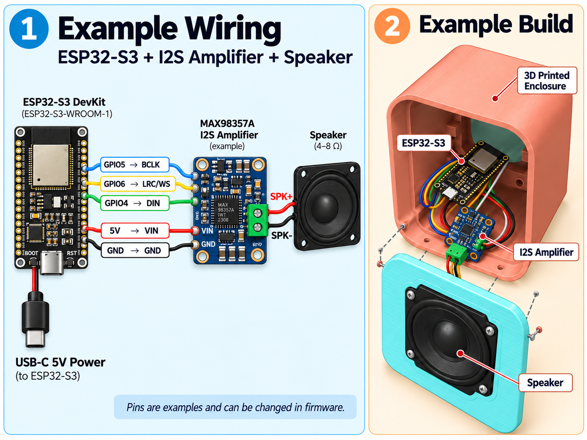</a>
       <b>The simplest speaker:</b> ESP32-S3 + MAX98357A I2S amplifier + one driver
    </td>
    <td align="center" width="50%">
      <a href="images/wiring-pcm5102a-2way.jpg">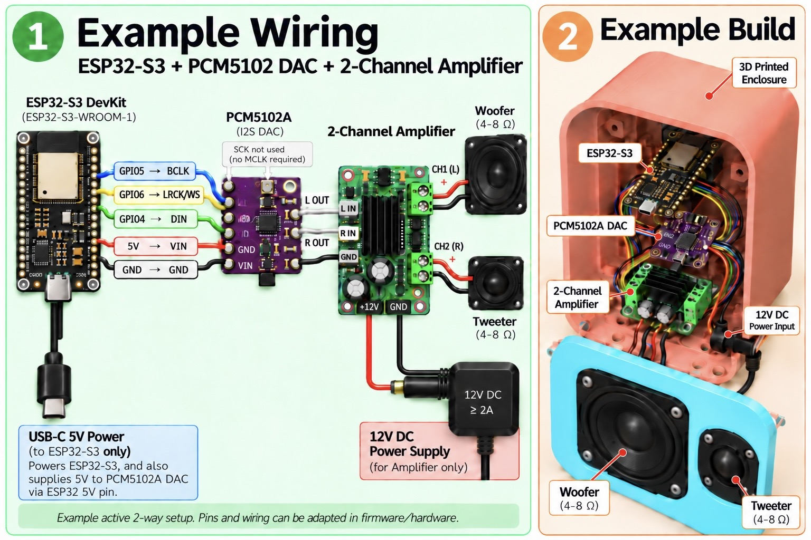</a>
       <b>An active 2-way speaker:</b> ESP32-S3 + PCM5102A DAC + 2-channel amplifier, bi-amp woofer and tweeter
    </td>
  </tr>
</table>

Wiring is in [docs/hardware.md](docs/hardware.md), building and flashing in
[docs/install.md](docs/install.md).
