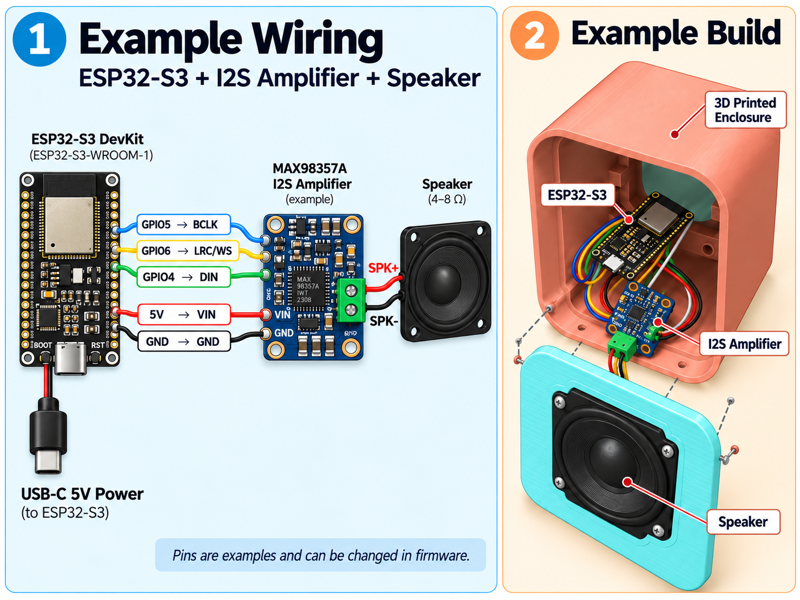
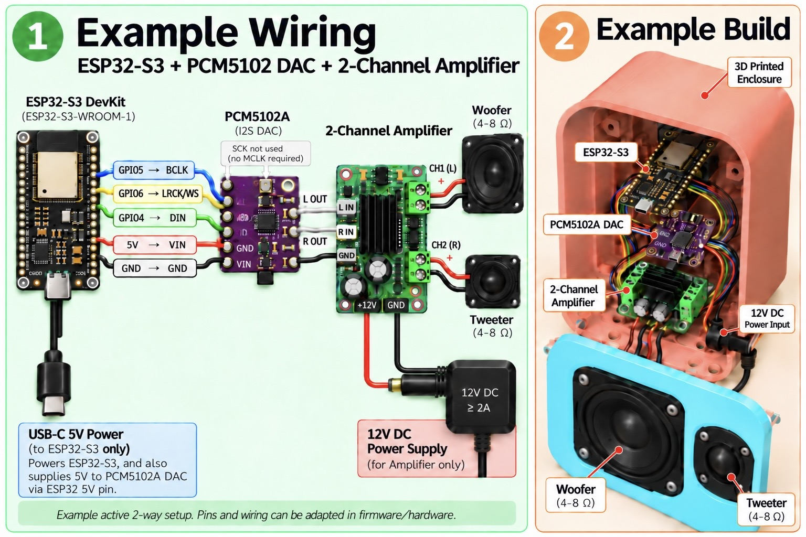
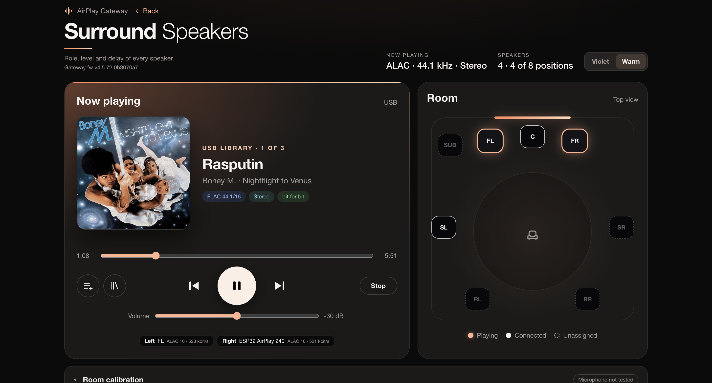
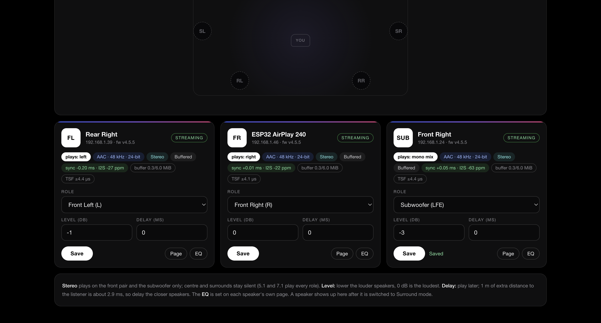
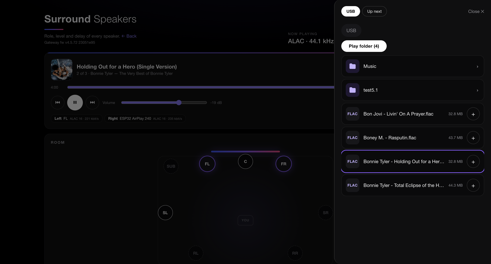
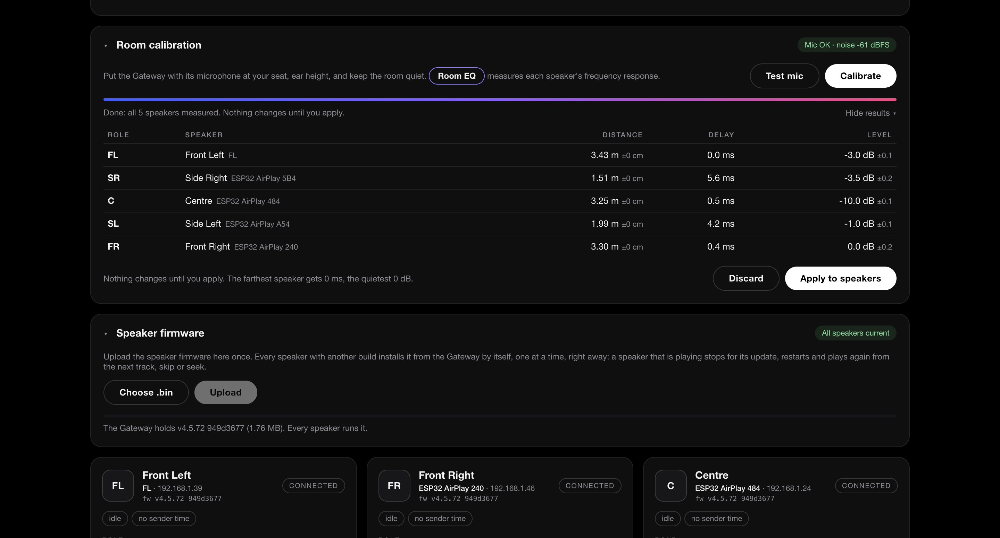
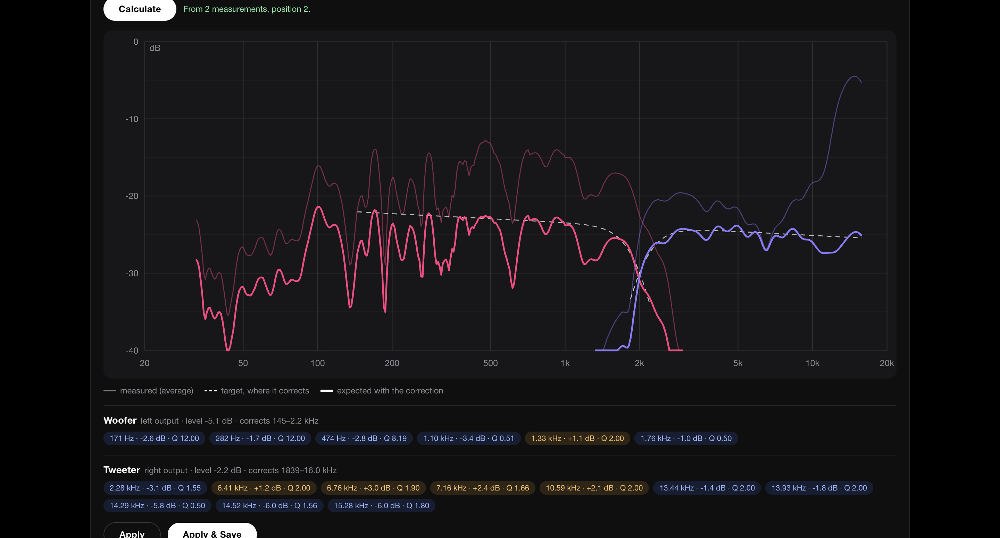
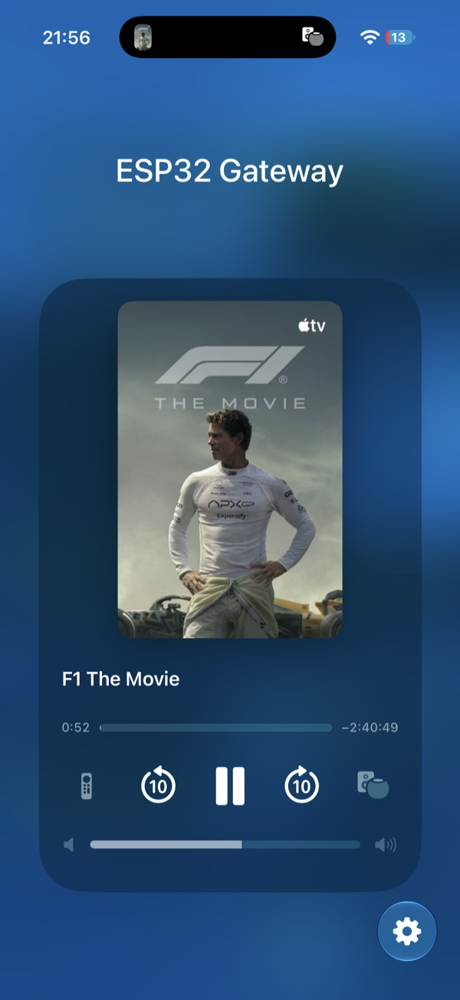
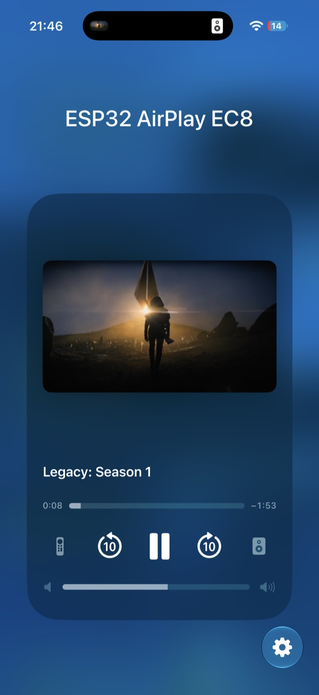
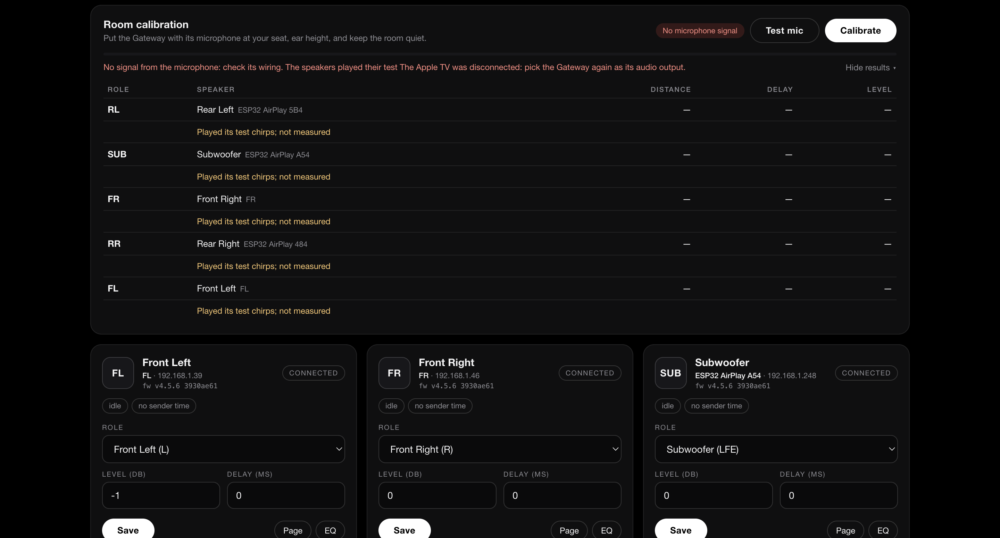

<p align="center">
  <b>Enjoying this project?</b> It is built and tested in my free time. A small
  donation helps buy test hardware and keeps the development going. Thank you! ❤️
  <br><br>
  <a href="https://www.paypal.com/donate/?business=VGY3ZM78NAL78&no_recurring=0&currency_code=EUR"></a>
</p>

<p align="center">
  <a href="images/airplay-surround-dark.png"></a>
</p>

# ESP32 AirPlay 2 Surround Gateway

**Wireless 5.1 / 7.1 surround sound from an Apple TV, built from low-cost
ESP32 boards: one Gateway (an ESP32-S3, or an ESP32-P4 for the most
features), and one ESP32-S3 per speaker.**

The Apple TV sees **one AirPlay 2 speaker: the Gateway**. The Gateway takes
the complete surround stream and passes it on, unchanged, to up to **eight
speaker boards** over your Wi-Fi. Every speaker decodes **only its own
channel** (Front Left, Centre, Subwoofer, Rear Right, …) and plays it through
any amplifier and speaker you like. All speakers share one clock taken from
the Wi-Fi access point itself, so they play each sample at the same moment.
No cables between the speakers, no AV receiver, one web page for the whole
system.

- 🎬 **5.1 and 7.1 AAC** (Apple Music Dolby Atmos, films and series from the
  Apple TV apps).
- 🎵 **Stereo** too: ALAC 44.1 kHz/16-bit and **lossless 48 kHz/24-bit**, AAC
  44.1 / 48 kHz, from any AirPlay 2 sender. A stereo song plays on the front
  pair and the subwoofer, as on an AV receiver.
- 📡 **One AirPlay target.** You pick the Gateway, not eight speakers. Pairing,
  RTSP and the Apple TV's clock are handled once, by the Gateway.
- 🏠 **Apple Home (HomeKit)** pairing, artwork, playback and volume controls
  for the whole surround system as one speaker.
- ⏱️ **Microsecond clock alignment** between speakers through the access
  point's beacon timer (TSF). No extra hardware, no cables.
- 🎤 **Room calibration** with an optional INMP441 microphone on the
  Gateway (or the ESP32-P4 board's own microphone): distance, delay and
  level of every speaker measured from your seat, applied with one click.
- 📈 **Room EQ** with the same microphone: each speaker's frequency
  response measured from your seat and corrected with its own EQ, with
  settings like REW's.
- 📻 **Web radio** on the Gateway: stations of your country, a search, your
  favourites or any stream address (MP3 or AAC over HTTP / HTTPS), played on
  all speakers like an AirPlay stream. AirPlay always takes over.
- 💾 **USB player** on the Gateway (experimental): FLAC,
  WAV, ALAC, AAC and MP3 from a USB drive, **bit for bit** to the speakers,
  5.1 / 7.1 files each channel on its own speaker, gapless, with tags,
  covers and m3u playlists ([USB player](#usb-player-experimental)).
- 🎛️ **One page for all speakers**: role, level and delay of every speaker,
  and a live view of what each one plays. Each speaker keeps its own
  2 × 24-band parametric EQ, mono or **bi-amp** (woofer + tweeter through a
  Linkwitz-Riley crossover), loudness and latency settings.
- 🔀 **Format changes on the fly**: the Apple TV can switch between stereo and
  surround from track to track; the speakers follow without reconnecting.
- ⚡ About **a third of one CPU core** per speaker for 7.1, thanks to a patched
  Fraunhofer FDK AAC decoder that synthesises just one channel.
- 🔗 **Speakers belong to the system**: a speaker is not an AirPlay
  receiver of its own and never shows up on an iPhone; it just follows the
  Gateway. (A board that is its own AirPlay receiver is the `standalone`
  branch.)
- 🚀 **Two Gateway boards, one code**: an ESP32-S3, the same board as the
  speakers, or a **DFRobot FireBeetle 2 ESP32-P4**, which does the most:
  twice the relay buffer, a fast USB port for heavy 5.1 / 7.1 WAV files,
  quick cover thumbnails and a microphone on the board
  ([S3 or P4](#esp32-s3-or-esp32-p4)). The chip is picked with
  `idf.py set-target`.

> [!NOTE]
> **The project is under active development.** A Gateway and five speakers
> (front pair, centre, side pair) play 5.1 and 7.1 from an Apple TV and
> stereo from an iPhone, each speaker its own channel, audibly in sync.
> Features, defaults and wiring may still change, and this README is updated
> with every change. See [Limitations](#limitations).

> [!IMPORTANT]
> **16 MB flash modules (ESP32-S3 N16R8).** The 8 MB flash of the N8R8
> boards is nearly full: the Gateway keeps a copy of the speaker firmware to
> update the speakers, and that copy has only about 110 KB of room left. A
> board with 16 MB can already use its full flash
> ([16 MB flash](#16-mb-flash)); new features will need it. **If you buy
> boards now, buy N16R8.** 8 MB boards build and update as before. The
> ESP32-P4 Gateway has 16 MB anyway.
>
> **Planned:**
> - 🔊 **USB sound card** support.
> - 📺 **DLNA**: play to the system from DLNA / UPnP apps, not only AirPlay.

## Contents

- [Gallery](#gallery)
- [Apple Home (HomeKit)](#apple-home-homekit)
- [How it works](#how-it-works)
- [What you need](#what-you-need)
- [Assembly and wiring](#assembly-and-wiring)
- [Installation](#installation)
- [First start](#first-start)
- [Settings](#settings)
- [USB player (experimental)](#usb-player-experimental)
- [Technical details](#technical-details)
- [Measuring sync](#measuring-sync)
- [Limitations](#limitations)
- [Troubleshooting and logs](#troubleshooting-and-logs)
- [Licenses and credits](#licenses-and-credits)

## Gallery

Click an image to open it full size.

<table>
  <tr>
    <td align="center" width="50%">
      <a href="images/wiring-max98357a.png"></a>
      <br><sub><b>Simplest speaker:</b> ESP32-S3 + MAX98357A I2S amplifier + one speaker</sub>
    </td>
    <td align="center" width="50%">
      <a href="images/wiring-pcm5102a-2way.jpg"></a>
      <br><sub><b>Active 2-way speaker:</b> ESP32-S3 + PCM5102A DAC + 2-channel amplifier, woofer + tweeter</sub>
    </td>
  </tr>
  <tr>
    <td align="center" colspan="2">
      <a href="images/airplay-surround-light.png"></a>
      <br><sub>One board in every speaker, all fed wirelessly through the Gateway</sub>
    </td>
  </tr>
  <tr>
    <td align="center" colspan="2">
      <a href="images/speakers-page.png"></a>
      <br><sub><b>Gateway speakers page:</b> what plays now, here an album from the USB stick bit for bit on the front pair, and the room map with the positions that play</sub>
    </td>
  </tr>
  <tr>
    <td align="center" width="50%">
      <a href="images/speakers-page-tiles.png"></a>
      <br><sub>One tile per speaker: role, level, delay and live sync</sub>
    </td>
    <td align="center" width="50%">
      <a href="images/player-library.png"></a>
      <br><sub><b>USB player:</b> the stick's folders and files, <b>Play folder</b>, <b>+</b> to the queue (<a href="#usb-player-experimental">more</a>)</sub>
    </td>
  </tr>
  <tr>
    <td align="center" colspan="2">
      <a href="images/speakers-page-calibration-5.png"></a>
      <br><sub><b>Room calibration:</b> five speakers measured from the seat with the Gateway's microphone, distance, delay and level each (<a href="#room-calibration">more</a>)</sub>
    </td>
  </tr>
  <tr>
    <td align="center" colspan="2">
      <a href="images/roomeq-page.png"></a>
      <br><sub><b>Room EQ:</b> a 2-way speaker measured with the Gateway's microphone, and the filters that correct its woofer and tweeter (<a href="#room-eq">more</a>)</sub>
    </td>
  </tr>
</table>

## Apple Home (HomeKit)

Add the Gateway as a speaker in **Apple Home** to see artwork for the current
music or video and control playback and volume. The surround system appears
as **one accessory**, with every speaker keeping its assigned channel.

HomeKit support, setup code, manufacturer and artwork advertising can be
configured under **AirPlay Receiver** in `idf.py menuconfig`.

<table>
  <tr>
    <td align="center" width="50%">
      <a href="images/homekit-gateway.jpg"></a>
      <br><sub>The Gateway in Apple Home</sub>
    </td>
    <td align="center" width="50%">
      <a href="images/homekit-player.jpg"></a>
      <br><sub>Artwork and playback controls</sub>
    </td>
  </tr>
</table>

## How it works

The Apple TV sends surround sound over AirPlay 2 only to a receiver that says
it accepts it. The Gateway says so, receives the whole multichannel stream
and shares it with the speakers:

1. **The Gateway is the only AirPlay receiver.** It announces 5.1 and 7.1, so
   the Apple TV sends it the full multichannel stream. mDNS, HAP pairing,
   RTSP and the Apple TV's PTP clock all run there.
2. **It forwards, it does not decode.** Every instruction from the Apple TV
   (format, key, start, flush, pause, volume, timing) is passed to the
   speakers over a small control protocol, and every encrypted audio packet
   is copied byte for byte to each speaker. The Gateway reads the stream into
   a 4 MiB buffer (8 MiB on the ESP32-P4) and sends each speaker from it, so
   at a track change the
   old track is dropped from the buffer at once instead of being sent only
   to be thrown away.
3. **Every speaker decodes only its own channel.** One ESP32-S3 cannot decode
   all eight channels in real time, and it does not need to. A speaker is
   not an AirPlay receiver: it finds the Gateway by mDNS, decrypts the stream
   with the key the Gateway passed on and plays its channel
   on **both outputs** of its DAC or amplifier (L = R), so you can drive one
   speaker or a subwoofer amplifier, or, in **bi-amp** mode, the woofer on one
   output and the tweeter on the other through its crossover.
4. **One two-way Apple clock for all.** The Gateway measures both directions
   of the PTP path with Sync / Follow_Up and Delay_Req / Delay_Resp, then
   publishes one smooth clock line. Every board on the same access point
   shares its beacon timer (TSF). Eight times a second the Gateway tells the
   speakers "the Apple TV's time P is TSF T". Each speaker converts T to its
   own clock and plays every sample at the moment the Apple TV scheduled it.
   (On the ESP32-P4 the Wi-Fi radio is the board's ESP32-C6: a firmware of
   this project on the C6, installed by the Gateway itself, marks the TSF
   with a pulse on a wire that the P4 timestamps in hardware.)

You choose each speaker's role (Front Left, Centre, Subwoofer, …) on the
Gateway's page, even while music is playing. Start with two or three
speakers and add the rest later.

```
                       ┌─────────────────────────────┐
   Apple TV ──AirPlay──►  Gateway (ESP32-S3 or -P4)   │
   (PTP clock)         │  pairing · RTSP · PTP        │
                       │  no decoder, no audio output │
                       └─────┬──────────────┬─────────┘
              control + time │              │ the same audio packets,
              (TCP, port 7100)              │ unchanged, to every speaker
         ┌──────────┬────────┴─┬────────────┴┬────────────┐
         ▼          ▼          ▼             ▼            ▼
       ESP32      ESP32      ESP32         ESP32        ESP32    (… up to 8)
      Front L    Front R    Centre       Subwoofer    Rear L/R
         │          │          │             │            │
        amp        amp        amp           amp          amp
         │          │          │             │            │
      speaker    speaker    speaker      subwoofer     speaker
```

### Sync, as measured

| What | Measured |
|---|---|
| TSF reading jitter per board | ~4.5 µs rms, averaged by a 64-point line fit |
| Clock difference speaker ↔ speaker | a few µs (from the fits; scope test pending) |
| Playout error of each speaker | within ±0.4 ms, corrected slowly by the I2S servo |
| Speaker ↔ speaker in practice | 0.1–0.3 ms, about 3–10 cm of sound travel |
| Transport delay of the time messages | 3–60 ms, does not matter by design |

The time messages carry a TSF timestamp rather than "now", so their travel
time over Wi-Fi is not added to the speaker's clock offset. TSF reading and
fit errors still matter. Speaker playout logs measure following the Gateway
line; they do not measure the acoustic offset to a HomePod.

In a captured **v4.5.33** cold start the Apple clock became ready **80 ms**
after the master was identified, before audio stream SETUP. The speaker
reported its first audio **172 ms after the anchor**, and **223 ms** on a
later start. These are observed starts, not guaranteed latency on every
network.

### What each speaker plays

| Source | Front L / R | Centre | Subwoofer | Side / Rear | Mono mix |
|---|---|---|---|---|---|
| **7.1** (Apple Music Dolby Atmos) | own channel | own channel | LFE channel | own channel | all except LFE |
| **5.1** (films, series) | own channel | own channel | LFE channel | Side L/R; Rear plays Side | all except LFE |
| **Stereo** (music, YouTube) | left / right | silent | mix of L and R | silent | mix of L and R |

The subwoofer plays below its **Crossover** set on the speakers page (80,
100, 120 or 150 Hz, 120 Hz by default, or Off when its amplifier has its own),
the stereo mix and the LFE channel alike. Do not add a low-pass on its own EQ
page as well, or the bass is cut twice.

## What you need

### The Gateway

| Part | Notes |
|---|---|
| **One ESP32-S3 board**, the same type as the speakers (N8R8, or N16R8: see the note at the top), with a **UART port** besides its native USB port (DevKitC boards have both) | It has no audio output: no DAC, no amplifier, no wiring. A USB supply is all it needs. It is flashed and logs over its UART port; the native USB port takes the [USB player](#usb-player-experimental)'s drive. |
| *Or:* **a DFRobot FireBeetle 2 ESP32-P4** (16 MB flash, 32 MB PSRAM, Wi-Fi through its ESP32-C6) | The Gateway with the most features (see below). Built with `idf.py set-target esp32p4` ([Boards](#boards), [bring-up](docs/p4-gateway-bringup.md)). The speakers stay ESP32-S3. |
| **A place with a good signal** | It receives the stream from the Apple TV and sends it again to every speaker, so it carries the most Wi-Fi traffic. Near the access point is best. |
| *Optional:* **a USB stick** | Music for the [USB player](#usb-player-experimental): FAT32. On the S3 it goes on the native USB port, which needs 5 V from the board; on the P4 on its high-speed USB port. |
| *Optional:* **INMP441 I2S microphone** | For [room calibration](#room-calibration): VDD → 3V3, GND and L/R → GND, SCK → GPIO 5, WS → GPIO 6 (GPIO 52 on the P4), SD → GPIO 4 (changeable in `menuconfig`). The FireBeetle 2 ESP32-P4 has a PDM microphone on the board, used by default. |

#### ESP32-S3 or ESP32-P4

Both run the same firmware, built for their chip. The **ESP32-P4 supports
the most features**; the S3 does everything the speakers need, with the
limits below.

| | ESP32-S3 (N8R8 / N16R8) | ESP32-P4 (FireBeetle 2) |
|---|---|---|
| CPU, memory | 2 cores at 240 MHz, 8 MB PSRAM | 2 cores at 360 MHz, 32 MB PSRAM |
| Wi-Fi | its own, 2.4 GHz | the board's ESP32-C6, 2.4 GHz; the Gateway installs the C6's firmware itself |
| Relay buffer (AirPlay music and films) | 4 MiB | 8 MiB |
| USB port for the player | full speed, about **8.4 Mbit/s** measured: a **5.1 / 7.1 WAV** is too heavy and stops every few seconds to buffer; FLAC of the same file plays | **high speed** (USB 2.0), its own port: no bitrate warning |
| 7.1 at 24-bit from the USB player | a dense film mix is at the limit of the CPU and stops now and then; 16-bit plays | more CPU to spare |
| AirPlay artwork on the Now playing card | — (the picture would take up to 2 MB of the memory the relay needs; Apple Home still shows its own) | yes |
| Covers of USB music | sent to the page as they are in the file | turned into small thumbnails by the P4's JPEG hardware and kept on the stick (folder `.airplay-covers-v1`), so the page shows them quickly |
| Player start | 2 s | 1 s |
| Calibration microphone | INMP441 | INMP441, or the PDM microphone on the board |
| Console, flashing | its UART port (the native USB port is the player's) | UART0, 115200 baud |
| Flash | 8 MB, or 16 MB ([16 MB flash](#16-mb-flash)) | 16 MB, with 6 MB firmware slots |

The heavy-file limits of the S3 are measured; the P4's high-speed port has
not yet been measured with a heavy 7.1 WAV.

### Per speaker (one set for every position)

| Part | Notes |
|---|---|
| **ESP32-S3 board with 8 MB flash and 8 MB PSRAM** (N8R8), e.g. ESP32-S3-DevKitC-1 N8R8, or with 16 MB flash (N16R8, see the note at the top) | PSRAM is required: the stream buffer alone takes 6 MB. Boards without PSRAM (or with 2 MB) will not work. |
| **Audio output**, one of: | |
| &nbsp;&nbsp;• an **I2S amplifier** such as **MAX98357A** | Simplest: digital in, speaker out, about 3 W. Good for small satellites and surrounds. |
| &nbsp;&nbsp;• an **I2S DAC** such as **PCM5102A** + **any analogue amplifier** | Any size: mini (PAM8403, 2 × 3 W), medium or powerful (TPA3110 / TPA3116, TDA7498, a plate amplifier for a subwoofer…), **one- or two-channel**. |
| **Speaker(s)**, 4–8 Ω | One full-range driver, or a woofer + tweeter pair (see [Option B](#option-b--dac--any-amplifier)). |
| **Power supply** | 5 V USB (≥ 1 A) for the ESP32-S3; a separate supply for a larger amplifier (e.g. 12 V ≥ 2 A, as your amplifier requires). |
| **Enclosure** | 3D-printed, wooden or an existing speaker box. |
| Jumper wires or a small PCB | 5 wires for the I2S connection. |

### Number of boards

| System | Boards | Positions |
|---|---|---|
| 5.1 | 1 Gateway + 6 speakers | Front L, Front R, Centre, Subwoofer, Side L, Side R |
| 7.1 | 1 Gateway + 8 speakers | the 5.1 positions + Rear L, Rear R |
| Start small | 1 Gateway + 2–3 speakers | e.g. Front L + Front R (+ Centre) |

A channel without a speaker is simply not played. The **centre carries most
of the dialogue**, so build it early.

### Sender and network

- An **Apple TV** for 5.1 / 7.1 (surround is sent only by the Apple TV; an
  iPhone, iPad or Mac sends stereo, which the speakers play as well).
- A **2.4 GHz Wi-Fi** network with good coverage at every speaker (the
  ESP32-S3 and the P4 board's ESP32-C6 have no 5 GHz radio).
- **All boards on the same access point.** The shared clock is that access
  point's beacon timer: each access point, and each node of a mesh system,
  has its own. A speaker on another access point logs a warning and stays
  silent.

## Assembly and wiring

The Gateway needs no wiring (only the optional calibration microphone, see
[What you need](#the-gateway)). Everything below is for the speakers.

> [!NOTE]
> The GPIOs below are the defaults and can be changed in `menuconfig`
> (see [Installation](#installation)). Wiring options may be extended in
> future versions; this section will be updated.

### Option A — I2S amplifier (MAX98357A)

<a href="images/wiring-max98357a.png"></a>

| ESP32-S3 | MAX98357A |
|---|---|
| GPIO 5 | BCLK |
| GPIO 6 | LRC (WS) |
| GPIO 4 | DIN |
| 5V | VIN |
| GND | GND |

- Speaker to **SPK+ / SPK−** (4–8 Ω).
- Leave **SD** and **GAIN** unconnected (default: (L+R)/2 output, 9 dB gain).
  Because both I2S slots carry the same channel, the result is that channel
  at full level.
- At full volume the amplifier draws up to ~1 A from 5 V: use a good USB
  supply and short power wires.

<br clear="right">

### Option B — DAC + any amplifier

<a href="images/wiring-pcm5102a-2way.jpg"></a>

| ESP32-S3 | PCM5102A |
|---|---|
| GPIO 5 | BCK |
| GPIO 6 | LCK (LRCK / WS) |
| GPIO 4 | DIN |
| 5V | VIN |
| GND | GND |
| — | SCK: not used (connect to GND, or close the module's SCK bridge) |

On the common purple PCM5102A module check the solder jumpers on the back:
**FLT = L, DEMP = L, XSMT = H** (otherwise the DAC stays muted), **FMT = L**
(I2S).

The DAC's **L OUT** and **R OUT** carry the same speaker channel, which lets
you use **any amplifier, small or powerful, one- or two-channel**:

| Amplifier | Connection | Setup on the speaker's EQ page |
|---|---|---|
| **One channel** (mono amp, a single side of a stereo amp, a subwoofer plate amp) | L OUT → amp input | nothing; a subwoofer's low-pass is its **Crossover** on the Gateway's speakers page |
| **Two channels, one full-range speaker** | L OUT → amp, use one channel | nothing |
| **Two channels, active 2-way (woofer + tweeter)** | L OUT → CH1 → **woofer**, R OUT → CH2 → **tweeter** | **Bi-amp** mode, with its crossover |
| **Powered speaker / active subwoofer** | L/R OUT → its line input | nothing |

**Active 2-way speaker** (bi-amp):

1. Open `http://<speaker-ip>/eq` and tick **Enable EQ and preamp**.
2. Switch the output mode to **Bi-amp** and choose which output drives the
   tweeter (the other one drives the woofer).
3. Set the **crossover**: frequency 800–8000 Hz (2500 Hz by default) and
   slope **LR2**, **LR4** (24 dB/oct, the default) or **LR8**
   (48 dB/oct). The tweeter's output stays silent whenever its high-pass
   cannot run.
4. Per output: a **level** (tweeters are usually louder: turn it down until
   both drivers sound balanced), a **Delay** of up to 2 ms and **Invert
   polarity**, to make the two drivers add up at the crossover; then up to
   24 bands each to correct the driver, or let [Room EQ](#room-eq) do it.
5. **Apply & Save**: the change is live and stored, no restart needed. A
   change of layout fades out and back in (about 25 ms).

> [!WARNING]
> Always set the tweeter's high-pass **before** playing loud. Full-range
> bass destroys a tweeter in seconds. The per-output **Mute** buttons on the
> EQ page help while setting up.

**Power:** the ESP32-S3 and the DAC run from USB 5 V; a larger amplifier gets
its own supply (e.g. 12 V ≥ 2 A). Connect the grounds of the DAC and the
amplifier (the signal ground), and keep the amplifier's power wires away
from the I2S wires.

<br clear="right">

### Optional extras (speakers)

| Function | Default GPIO | Notes |
|---|---|---|
| Amplifier enable / standby | 21 | switches the amplifier on while audio plays; active high or low |
| WS2812 RGB VU LED | 38 | the on-board LED of many DevKitC boards |
| Wired latency measurement (ADC loopback) | 7 | DAC output → coupling capacitor + bias divider → ADC pin |
| Sync test pulse (also on the Gateway) | 9 | for an oscilloscope, see [Measuring sync](#measuring-sync) |

## Installation

### 1. Install ESP-IDF

The firmware is built with **ESP-IDF v6.1**. Follow Espressif's
[installation guide](https://docs.espressif.com/projects/esp-idf/en/latest/esp32s3/get-started/index.html),
then open a terminal with the ESP-IDF environment loaded
(`source ~/esp-idf/export.sh`, or the path where you installed it).

### 2. Get the code

The Gateway is the **`main` branch** of the surround repository (the
earlier design, where every board is its own AirPlay receiver, is the
`standalone` branch):

```bash
git clone https://github.com/Kristian8606/esp32-airplay2-surround.git
cd esp32-airplay2-surround
```

### 3. Two projects, one code

| Folder | Builds | Firmware file |
|---|---|---|
| the repository folder | the **Gateway** (ESP32-S3 or ESP32-P4) | `build/airplay-gateway_<version>.bin` |
| `speaker/` | the **speakers** | `speaker/build/airplay-speaker_<version>.bin` |

| Code | Where |
|---|---|
| the Gateway's own (proxy, relays, speaker registry, speakers page); its AirPlay receiver (mDNS, pairing, RTSP) is `ap2_core` from [esp-airplay2-core](https://github.com/Kristian8606/esp-airplay2-core) | `main/` |
| the speaker's own (audio engine, link to the Gateway, EQ page) and FDK AAC | `speaker/main/`, `speaker/components/` |
| shared (web server, clock, sync protocol) | `common/`, `web/`, and the components in `components/` |
| menuconfig options of both | `components/airplay_options/` |

Both use the shared settings in `sdkconfig.defaults`; the Gateway adds
`sdkconfig.defaults.gateway`, and ESP-IDF adds `sdkconfig.defaults.esp32s3`
or `sdkconfig.defaults.esp32p4` for the chip. Each is an ordinary ESP-IDF
project: go into its folder and run `idf.py` as usual. The ESP32-C6
firmware of the P4 board is in `coprocessor/c6/`; the Gateway carries a
built copy and installs it on the C6 by itself.

### 4. Configure (optional)

Run `idf.py menuconfig` in the folder of the firmware you configure (the
repository folder for the Gateway, `speaker/` for the speakers). Both show
the same menus; some options matter for one firmware only:

| Menu | What you can set | For |
|---|---|---|
| **Surround Build Role** | the role (set by the folder: leave it); the Gateway board (it sets the default pins); a fixed Gateway address for networks that filter mDNS; the sync test pulse; the calibration microphone (INMP441 or PDM) and its pins | both |
| **AirPlay Receiver** | setup Wi-Fi name and password; HomeKit, setup code, manufacturer, artwork; playback buttons (for AirPlay and the USB player) and AirPlay model (the icon senders show) | Wi-Fi both, the rest Gateway |
| **Multichannel Experiment** | 5.1 / 7.1 on or off, default speaker position | both |
| **I2S Playout** | BCLK / LRCK / DATA / MCLK GPIOs, output latency of your DAC, wired latency test; web admin password | speakers (password both) |
| **Amplifier Power Control** | amplifier enable GPIO and level | speakers |
| **RGB Audio/VU LED** | LED on/off and GPIO | both |
| **USB Player (experimental)** | player streams (speakers), the Gateway's player and its USB drive; all on by default | both |
| **AirPlay Logs and Diagnostics** | log detail | both |

Every speaker runs the same firmware: its role is set later on the Gateway's
page.

#### 16 MB flash

By default both firmwares are built for **8 MB** flash (`partitions.csv`).
A board with **16 MB** (N16R8) uses all of it with `partitions_16mb.csv`, two settings next to each other in menuconfig (ESP-IDF
does not tie the partition table to the flash size):

1. `idf.py menuconfig` → **Serial flasher config → Flash size** → **16 MB**.
2. **Partition Table → Custom partition CSV file** →
   `partitions_16mb.csv` (in `speaker/`: `../partitions_16mb.csv`).
3. `idf.py build flash` **over a cable, once** (the Gateway over its UART
   port): a partition table reaches the
   board only so, not with an update over Wi-Fi. Afterwards updates work
   over Wi-Fi as before.

| Partition | 8 MB | 16 MB |
|---|---|---|
| nvs (settings, Wi-Fi, HomeKit), otadata, phy | as is | the same place and size, so the settings stay |
| ota_0, ota_1 (the firmware, twice for updates) | 3 MB each | the same |
| storage (the speaker firmware the Gateway hands out) | 1.9 MB | 3 MB, as large as a speaker's own slot |
| userdata (for later features) | — | 6.9 MB |

The 16 MB table does not fit an 8 MB flash: ESP-IDF stops the build. A
16 MB flash with the 8 MB table builds and runs, with a warning that the
rest is unused. The Gateway matters most (it keeps the speaker firmware);
speakers can stay on the 8 MB table, their firmware fits their slot.

#### Boards

The chip is chosen the usual ESP-IDF way, with `idf.py set-target`; the
flash size in menuconfig.

| Board | Chip | Flash |
|---|---|---|
| ESP32-S3 N8R8 (8 MB flash, 8 MB PSRAM), the smallest supported | `esp32s3`, the default | the default |
| ESP32-S3 N16R8 (16 MB flash, 8 MB PSRAM) | `esp32s3` | [16 MB flash](#16-mb-flash) |
| DFRobot FireBeetle 2 ESP32-P4 with its ESP32-C6, Gateway only | `esp32p4` | set by the target: 16 MB, `partitions_esp32p4.csv` |

```bash
idf.py set-target esp32p4
idf.py -p /dev/cu.usbserial-0001 build flash monitor
```

`set-target` applies `sdkconfig.defaults.<chip>` (for the P4: Wi-Fi through
the C6, the board's pins, an 8 MiB relay buffer; see
[bring-up](docs/p4-gateway-bringup.md)). It starts the settings again from
the defaults: what you changed in menuconfig is kept only in `sdkconfig.old`.
To keep a P4 and an S3 Gateway side by side, give one its own build folder
and settings file:

```bash
idf.py -B build_p4 -D SDKCONFIG=sdkconfig.p4 set-target esp32p4
idf.py -B build_p4 -D SDKCONFIG=sdkconfig.p4 -p PORT build flash monitor
```

### 5. Build and flash

Connect a speaker over its USB port, the Gateway over its UART port.

**Speakers** (repeat for every speaker):

```bash
cd speaker
idf.py -p /dev/cu.usbmodem101 build flash monitor
```

**Gateway**, from the repository folder, over its **UART** port (the native
USB port is the [USB player](#usb-player-experimental)'s drive port):

```bash
idf.py -p /dev/cu.usbserial-0001 build flash monitor
```

For an **ESP32-P4** Gateway run `idf.py set-target esp32p4` once first
([Boards](#boards)); it is flashed and logs over UART0 (115200 baud).

On macOS list the ports with `ls /dev/cu.*` (a speaker's USB port is a
`usbmodem`, a UART port a `usbserial` or `wchusbserial`); on Windows the port
is `COMx`, on Linux `/dev/ttyACM0` (USB) or `/dev/ttyUSB0` (UART). A
speaker's log goes to its USB port, the Gateway's to its UART port, so
`idf.py monitor` shows it, and every board's to its `/logs` page.

### 6. Updates

Later versions are installed **over Wi-Fi**:

- **Gateway:** on its main page, **Firmware Update** → choose
  `build/airplay-gateway_<version>.bin` → **Upload Firmware**.
- **Speakers, all at once:** on the Gateway's **speakers page**, panel
  **Speaker firmware** → **Choose .bin** →
  `speaker/build/airplay-speaker_<version>.bin` → **Upload**. The Gateway
  keeps it in its otherwise unused `storage` partition (1.9 MB, 3 MB with
  [16 MB flash](#16-mb-flash), 3.9 MB on the ESP32-P4) and every
  speaker with another build installs it by itself: one at a time and right
  away, also a speaker that was switched off and comes back later. A speaker
  that is playing stops its stream for the update (the others play on),
  checks size and SHA-256 and restarts into the new firmware at once; in a
  buffered stream (music, films) it plays again from the next track, skip or
  seek, in a realtime stream at once. Nothing waits for the playback to end;
  only a running room calibration holds the update back. Each tile shows
  `will update`, `updating…` or `update failed` (after three tries). If a
  speaker restarts and does not come back with the new build within
  3 minutes, the update **stops** there (`update stopped`)
  instead of going on to the next speaker; check that speaker, then upload the
  firmware again to continue. A new speaker firmware that cannot reach the
  Gateway (crashes at boot, no link) goes back to the previous one at its next
  restart (app rollback). The rollback needs the bootloader of v4.5.11 or
  later: flash every speaker once over USB (`idf.py flash` in `speaker/`).
- **One speaker by hand:** its own main page, **Firmware Update**, as for the
  Gateway.

The web interface is part of the firmware and is updated with it.

> [!IMPORTANT]
> **Speakers older than v4.5.9 cannot update from the Gateway** and need this
> once by hand on their own page. From v4.5.9 on the Gateway also updates
> speakers whose control protocol differs from its own (`protocol version …,
> Gateway speaks …` in its log), so a new Gateway brings the speakers up to it.
> A speaker image larger than the `storage` partition is refused on upload.

## First start

1. **Connect every board to Wi-Fi.** A new board opens the access point
   **`ESP32-AirPlay-Setup`**. Join it with a phone or laptop; the setup page
   opens by itself (or go to `http://192.168.4.1/`). Choose your network,
   enter the password, **Connect to WiFi**.
2. **Name the boards.** Find each IP address in your router (or the serial
   log), open `http://<board-ip>/` and set its name (**AirPlay Device Name**
   on the Gateway, **Speaker Name** on a speaker). The
   Gateway's name is what the Apple TV shows; clear speaker names
   (*Front Left*, *Centre*, …) make the speakers page easy to read.
3. **Speakers connect by themselves.** A speaker finds the Gateway on the
   network and shows up on the Gateway's speakers page; there is nothing to
   switch on.
4. **Give every speaker its role.** Open the Gateway's page
   `http://<gateway-ip>/speakers` (or **Open Speakers** on its main page),
   pick a role, level and delay for each speaker, **Save**.
5. **Choose the Gateway on the Apple TV.** Open Control Center, select the
   **AirPlay / audio output** icon and tick **only the Gateway**. The speakers
   are not listed there; they follow the Gateway.
6. **Play** something in surround (Apple Music Dolby Atmos or a film). The
   speakers page shows what every speaker plays right now, e.g.
   *AAC · 48 kHz · 24-bit · 7.1 · plays: Front Left*.

> [!TIP]
> A speaker that joins or restarts during a film stays silent until the next
> **skip or seek** (the Apple TV then restarts the stream at a point every
> speaker can start from). During screen mirroring it joins at once.

### Speaker positions

| Position | Where to put it | Notes |
|---|---|---|
| Front Left / Right (L / R) | ~30° left / right of the screen | main pair; music and effects |
| Centre (C) | above or below the screen | most of the dialogue |
| Subwoofer (LFE) | anywhere low, often near a corner | the low-frequency effects channel; with stereo, the L+R mix |
| Side Left / Right (Ls / Rs) | beside the listener, ~90–110° | the surround pair of 5.1 |
| Rear Left / Right (Lrs / Rrs) | behind the listener, ~135–150° | 7.1 only; with a 5.1 stream they play Side L / R |
| Mono mix | anywhere | every channel except LFE in one speaker; uses the most CPU |

> [!IMPORTANT]
> With 5.1 / 7.1 the **Subwoofer** plays only the LFE channel (the extra bass
> effects of films), **not** the bass of the other speakers. There is no bass
> management, so the front speakers should reproduce reasonable bass on their
> own. With music the LFE channel is often silent; with films it is busy.

## Settings

Everything is configured in the browser. Every page comes in two colour
themes, **Warm** (the default) and **Violet**: the switch on the main page
and on the speakers page changes them, and the browser remembers the
choice.

### Gateway: main page (`http://<gateway-ip>/`)

| Card | What it does |
|---|---|
| **Surround Speakers** | opens the speakers page below |
| **Playback** | play/pause, next, previous and volume of the current AirPlay sender |
| **WiFi Network** | scan and change the network |
| **Device Settings** | the AirPlay name the Apple TV shows |
| **Firmware Update** | OTA update with a `.bin` file |
| **System** | IP, MAC, memory, firmware, uptime, reset reason, Wi-Fi signal and channel; restart |
| **System Logs / WiFi Speedtest** | links to the pages below |

The Gateway has no audio output, so it has no EQ or latency cards.

### Gateway: speakers page (`/speakers`)

<a href="images/speakers-page.png"></a>

At the top, **Now playing**: what the speakers play and where it comes
from. An AirPlay stream shows its format (and on an ESP32-P4 Gateway its
artwork), with play/pause,
skip and volume buttons that go to the Apple device; the **Music** and
**Radio** buttons
start the [USB player](#usb-player-experimental) or the web radio, which
then fill the card. Beside it, a **room map** seen from above: the screen at
the top, you in the middle and all eight positions around you. An empty
position is dashed, a position with a speaker is outlined, and a speaker
that is playing glows. Two speakers on the same position are marked orange.
Click a position to jump to its speaker. Above both: what is playing now
(`AAC · 48 kHz · Stereo`), how many positions are taken and the colour
switch.

<a href="images/speakers-page-tiles.png"></a>

Below it, one tile per connected speaker, side by side:

| Field | What it does |
|---|---|
| **Role** | which channel it plays: Front Left … Rear Right, or Mono mix |
| **Level (dB)** | trim from −30 to 0 dB; turn the louder speakers down, the quietest stays at 0 dB |
| **Delay (ms)** | 0–50 ms; about **2.9 ms per metre** a speaker is closer to the listener than the farthest one |
| **Crossover (low-pass)** | subwoofer only: Off, 80, 100, 120 (default) or 150 Hz, a 24 dB/oct Linkwitz-Riley low-pass for everything it plays |
| **LFE gain (5.1/7.1)** | subwoofer only: 0, +5 or +10 dB on the LFE channel of surround streams |
| **Live status** | coloured tags: format, rate and bits (`AAC · 48 kHz · 24-bit`), layout (`7.1`, `5.1`, `Stereo`), the channel actually played, buffered or realtime stream, playout sync and I2S correction, buffer fill, TSF quality |
| **Links** | the speaker's own page and its **EQ** |

Every speaker keeps its settings in its own flash and applies a change at
once, also while playing. A warning shows when two speakers have the same
role.

**Web radio.** The **Radio** button in the Now playing card opens the
stations: **Favourites**, your **country** (the browser's own at first, any
other to choose), **Search** and **URL** for any stream address. The station
lists come from [Radio Browser](https://www.radio-browser.info), straight
from your browser; the Gateway keeps only the favourites and the volume
(one volume for the radio and the USB player, kept over a restart).
While the radio plays, the Now playing card shows the station, the song
title, the format (`MP3 128 → ALAC 44.1/16`), the volume, **Stop** and your
favourite stations in a row, one tap to switch.
The Gateway reads the station (MP3 or AAC, HTTP or HTTPS), encodes it to
ALAC (48 kHz streams at 48 kHz / 24-bit, others at their own rate, 16-bit)
and plays it to the speakers as a buffered sender of its own, so they play
it like music from an iPhone (the front pair and the subwoofer). A station
started while AirPlay plays disconnects the AirPlay sender first; an AirPlay
sender that connects stops the radio. HLS streams are not supported yet.

### Speaker: main page (`http://<speaker-ip>/`)

| Card | What it does |
|---|---|
| **Surround Speaker** | a reminder that role, level and delay are set on the Gateway's page |
| **WiFi Network / Device Settings** | network, and the speaker's name shown on the Gateway's page |
| **Output Latency** | delay of your hardware after the ESP (DAC, DSP), so all speakers stay in sync; *Measure* runs a wired loopback test |
| **Firmware Update / System** | OTA update, board status, restart |
| **Audio EQ / System Logs / WiFi Speedtest** | links to the pages below |

### Speaker: Audio EQ page (`/eq`)

| Card | What it does |
|---|---|
| **Surround speaker (5.1 / 7.1)** | role of this speaker (the same setting as on the Gateway's page; a change here shows there too) |
| **Loudness** | ISO 226 loudness compensation: restores bass and treble at low volume |
| **Output mode** | **Mono**: both outputs play the speaker's channel full range. **Bi-amp**: one output the tweeter, the other the woofer, through an LR2 / LR4 / LR8 crossover at 800–8000 Hz, with a delay (up to 2 ms) and polarity per output (see [Option B](#option-b--dac--any-amplifier)). A subwoofer is Mono only. |
| **Output filters** | per output a chain of up to **24 biquad filters**: peak, low-pass, high-pass, band-pass, notch, low shelf, high shelf; a curve and sliders with Hz / Q, a headroom check, a **preamp** and a **mute** button |
| **Apply & Save** | applies live and stores in flash |

### Room calibration

An optional **INMP441 microphone** on the Gateway (wiring in
[The Gateway](#the-gateway)), or on the ESP32-P4 board its own PDM
microphone (**Surround Build Role → Calibration microphone type**),
measures every speaker from your seat and
suggests its **delay** and **level**, in about 2 s per speaker:

1. Put the Gateway with its microphone at your listening seat, at ear
   height (a power bank will do). Keep the room quiet.
2. **Test mic** checks the microphone and shows the room noise; −60 dBFS
   or quieter is good. Music may keep playing meanwhile.
3. **Calibrate**: if the Apple TV is connected, it is disconnected for the
   measurement (the speakers can only chirp between streams); afterwards
   pick the Gateway again as its audio output. Each speaker in turn plays
   four short chirps (300 Hz–8 kHz, 20 ms; the subwoofer 30–150 Hz, 200 ms)
   through its own EQ, so a 2-way speaker's crossover protects the tweeter:
   at −30 dBFS first, then 6 dB louder (up to −12 dBFS) while the
   microphone does not hear them clearly, or a full-range speaker's level
   is not yet 10 dB above the room noise. You hear one to four rounds per
   speaker; the level they were played at is taken out, so a louder round
   does not make a speaker read louder.
4. The table shows every speaker's **distance**, suggested **delay** (the
   farthest gets 0 ms, the others 2.9 ms per metre they are closer) and
   **level** (the quietest gets 0 dB, the others are turned down to it).
   **Apply to speakers** saves them like a manual edit; **Discard** changes
   nothing. What was measured is applied; a speaker without a delay or a
   level keeps the one it has, and the message names it. Delays and levels
   compare speakers, so each needs at least two full-range speakers
   measured. A speaker left unchanged was set against another reference:
   measure again once it plays clearly.

| In the table | Meaning |
|---|---|
| **± cm** after a distance | how much the four chirps disagree; a few cm is normal |
| **± dB** after a level | the same for the level |
| *Level not repeatable (… dB over the chirps)* | the levels still differ by more than 2 dB at −12 dBFS, usually from room noise; measure again in quiet |
| *Too quiet for a level: … dB above the noise, 10 needed* | even at −12 dBFS the chirp is under 10 dB above the room noise; its delay is applied, its level stays. Turn its amplifier up or measure in quiet |
| *Not heard clearly* | the chirps did not stand out of the noise even at −12 dBFS, or fewer than three of the four agree on the travel time within 0.5 ms |
| *Clipped at … dBFS: move the microphone away from it* | the recording reached full scale, which makes the level read low; the run is not used and nothing louder is tried |
| *No sound at −12 dBFS: check its cable and amplifier* | at the loudest level the chirp's shape is not found and it is under 6 dB above the room noise: left unchanged |
| *No other level to compare with: level unchanged* | it is the only full-range speaker with a level |
| *Only … of 4 chirps placed in the recording* | the speaker's chirp times could not be placed on the recording (TSF or microphone timing); louder would not help, so it is not tried |
| *Hint: the chirp came back inverted* | + and − may be swapped (or a 2-way speaker's tweeter is wired so); only a hint, nothing is changed |
| *Subwoofer: level and delay by ear* | its low chirp gives a delay, but no level |

Two runs in a quiet room should agree within a few centimetres and about
0.5 dB; if they do not, measure again before applying.

How it measures:

- **Travel time without cables.** A speaker plays its chirps when it can
  and reports when each one left it, on the access point's TSF (its output
  latency included); the Gateway timestamps its recording on the same TSF.
  The difference is the sound's travel time.
- **The direct sound, not an echo.** The arrival is the first correlation
  peak within 12 dB of the strongest one: the direct sound always comes
  first, while a reflection off a wall can be louder.
- **One disturbed chirp is left out.** A chirp whose travel time is far
  from the others' (a door, a cough) does not count; three of the four
  must agree within 0.5 ms.
- **Level as the ear hears it:** the RMS of the chirp and the next 10 ms of
  the room (full-range speakers above 200 Hz), the median of the chirps,
  with the quiet room's noise in the same band taken out. It is used only
  10 dB or more above that noise.
- **Tested in a simulated room** (the real `gw_calib.c` on a computer, with
  noise, reflections, a 2-way crossover, a loose cable, a door slam and a
  clipping microphone): distances within 1 mm, trims within their 0.5 dB
  rounding, a reflection up to 12 dB louder than the direct sound ignored.
- **Every round is in the log** (`gw_calib`): level played, chirps found,
  travel time, level, dB above the noise, recording peak, match, and why
  the next round is louder or why it stops.

*No signal from the microphone: check its wiring* means the Gateway clocks
the microphone but reads a constant value: check VDD → 3V3, GND, L/R → GND
(otherwise it sends on the other channel), SD → GPIO 4, SCK → GPIO 5,
WS → GPIO 6 (GPIO 52 on the P4). Without a microphone signal the speakers still play their
chirps one after another (so you hear that each one works), and the panel
says nothing was measured.

<a href="images/speakers-page-calibration-5.png"></a>

*A run with the microphone: five speakers of a 5.1 setup measured, their
distances, delays and levels ready to apply.* Without a microphone signal:

<a href="images/speakers-page-calibration.png"></a>

### Room EQ

**Room EQ** (`/roomeq` on the Gateway, the button on the speakers page)
uses the same microphone to measure one speaker's **frequency response**
and correct it with the speaker's EQ:

- The speaker plays a 2.5 s sweep (30 Hz–21 kHz, the subwoofer
  15–400 Hz), at −30 dBFS first and louder until it is clear of the room
  noise. Several microphone positions are averaged.
- The browser computes the response: below 500 Hz the room as you hear it
  at the seat, above it mostly the speaker's own sound.
- It fits **peaking filters** to a target line, the way REW's EQ does:
  - **Target level** places the line (dB on the chart's scale, at 1 kHz).
    By default it is the speaker's own level between 200 Hz and 2 kHz,
    smoothed over one octave; type another value to move it. It is kept
    for each speaker in the browser.
  - Everything **above** the line is cut down to it.
  - **Below** it, a dip no deeper than **Individual max boost** is raised
    towards the line, and a deeper one is left as it is. **Overall max
    boost** limits all filters together (+3 dB by default): with
    a high individual and a low overall limit, deeper dips are raised
    partly. A narrow dip is never raised.
  - **Flatness target** (±1 to ±6 dB) sets how close it goes; a wider
    one gives fewer, broader filters.
  - **Match range** limits where filters may go; inside it, it corrects
    from where the curve first reaches the line to where it last does, so a
    speaker's own roll-off is never boosted; at most up to the
    microphone's limit (16 kHz for the INMP441), a subwoofer up to 300 Hz.
  - **Allow low shelf** / **Allow high shelf** (off by default) add a shelf
    at that end of the range when the curve stays above or below the line
    for at least half an octave there, as REW does.
  - How narrow a filter may be is set as in REW: **Allow narrow filters
    below 200 Hz** allows Q up to 10 there, Q 5 above; **Vary max Q above
    200 Hz** lets it fall from 10 at 200 Hz to 3 at 10 kHz instead. Without
    narrow filters Q is 5 at most. It may use all 24 bands of an output,
    but for the high- and low-pass bands it keeps (a bi-amp crossover is
    apart from them). Above 500 Hz it works on the speaker's own sound (a
    frequency-dependent window), not on the room's reflections there.
  - With a **bi-amp** speaker each driver (woofer, tweeter) gets its own
    filters through its crossover, and the tweeter's level is matched to
    the woofer's, raised by at most the overall max boost.
- The chart shows the measurement, the target and the expected result.
  **Apply** sends the filters to the speaker now, **Apply & Save** also
  keeps them after a restart. They replace the EQ bands and levels of its
  outputs; the high- and low-pass bands, crossover, polarity and delay
  stay as they are.
- After **Apply & Save** it offers a check: the speaker is measured again
  with its new EQ, at the same microphone position, and that curve is drawn
  over the one before, without calculating anything again. A bi-amp
  speaker is checked driver by driver and then with both together, which
  shows a dip or a peak at the crossover. Afterwards run
  **Calibrate** on the speakers page, as the correction changes the
  speaker's level.

<a href="images/roomeq-page.png"></a>

### Other pages (every board)

- **`/logs`**: live log of the board over WebSocket.
- **`/speedtest`**: ping, download and upload between the browser and the
  board, to check Wi-Fi at the speaker's (or the Gateway's) position.

**Security:** with a **Web UI admin password** set in `menuconfig`, firmware
updates, restart, Wi-Fi and name changes and the latency test require the
user `admin` and that password.

## USB player (experimental)

<table>
  <tr>
    <td width="50%"><a href="images/speakers-page.png"></a></td>
    <td width="50%"><a href="images/player-library.png"></a></td>
  </tr>
</table>

**Plug in a USB stick, open the page, press play.** No phone, no app, no
streaming service: the Gateway itself becomes a music player for the whole
surround system.

And it does not cut corners. A FLAC or WAV reaches every speaker **bit for
bit**, exactly as it is in the file: not squeezed into AAC on the way, as
many AirPlay streams are, and not mixed down. Every speaker gets **only its own channel**, so a 5.1
or 7.1 music file or film soundtrack plays the way it was mixed: centre in
the centre, surrounds around you, each from its own speaker. A stereo album
plays on the front pair with the subwoofer underneath, like on an AV
receiver.

**What you get**

- 🎵 **Lossless and then some:** FLAC, WAV and ALAC bit for bit, AAC and
  MP3 too. Hi-res files up to 192 kHz play as well (brought down to
  48 kHz / 24-bit, which the speakers play).
- 🖼️ **Covers and tags:** the album art, title, artist and album, from the
  file itself or a `cover.jpg` / `folder.jpg` next to it. Names in
  Cyrillic and any other script. The ESP32-P4 also makes small thumbnails
  of large covers and keeps them on the stick, so they show at once.
- 🔁 **Albums without gaps:** live albums and DJ mixes flow from track to
  track without a click or a pause.
- 📂 **A library on the page:** browse the stick's folders, play a whole
  folder, start from any song, add songs to the queue, see what comes next,
  or play your **m3u playlists**.
- ⏯️ **All the controls:** seek, pause, next, previous and volume (shared
  with the web radio and kept over a restart), from the page or the
  hardware buttons on the Gateway.
- 📊 **You see what plays where:** the format, a *bit for bit* badge, which
  speaker gets which channel, and the room map lighting up.
- 🔌 **Plug and play:** put the stick in and pull it out while the Gateway
  runs. AirPlay and the web radio still work as before; whoever starts
  playing takes the speakers.

**Which files**

| Plays | |
|---|---|
| FLAC, WAV, ALAC (`.m4a`) | lossless, bit for bit, 16 / 24-bit |
| AAC (`.m4a`, `.aac`), MP3 | including VBR and gapless albums |
| m3u / m3u8 playlists | from the stick or a web server |
| Mono, stereo, 5.1, 7.1 | 44.1 / 48 kHz, and hi-res 88.2 / 96 / 176.4 / 192 kHz |

Not played: 32-bit and floating-point WAV, Ogg, Opus, WMA and DSD. A file
the player cannot play just shows a message, and the next song starts.

**Which USB stick**

- **Any small USB 2.0 stick** is enough. On an **ESP32-S3** Gateway a USB 3
  stick works too but is not faster: the S3's USB port runs at USB 1.1
  speed (about 1 MB/s). The **ESP32-P4** has a high-speed USB 2.0 port.
- Format it **FAT32** with a **Master Boot Record** (on a Mac: Disk Utility →
  *MS-DOS (FAT)*, scheme *Master Boot Record*). exFAT, NTFS and APFS are
  not read.
- It is powered by the Gateway board, so pick one that draws little power;
  a hard disk needs a powered USB hub.
- **On an ESP32-S3, prefer FLAC to WAV.** FLAC is the same sound, bit for
  bit, at half the size. Stereo WAV plays fine, but a 5.1 / 7.1 WAV is too
  heavy for the S3's port and stops every few seconds to catch up (the
  player warns when it starts such a file). One command turns it into
  FLAC: `ffmpeg -i film.wav -c:a flac film.flac`.
- **7.1 at 24-bit is the S3's limit.** Eight channels of a dense film mix
  at 24-bit take more than the ESP32-S3 has to decode them and send every
  speaker its channel, so it stops now and then to catch up (5.1 at 24-bit
  plays fine). As a 16-bit FLAC the same 7.1 file plays without a stop:
  `ffmpeg -i film.wav -af aresample=osf=s16:dither_method=triangular -c:a flac film.flac`.
  The ESP32-P4 has a faster CPU and port for such files.
- On the ESP32-P4 the player writes cover thumbnails to the stick, in the
  folder `.airplay-covers-v1` (up to 128 of them); delete it any time.

The player can also play files from a web server on your network, through
the Gateway's `/api/player` (play, pause, seek, next, previous, queue,
volume, stop).

### Build

The player is **on by default** in both firmwares: a plain `idf.py build`
gives a Gateway with the player and the USB drive, and speakers that take
its streams. On an **ESP32-S3** the drive takes the Gateway's **native USB
port** (GPIO19/20), so the Gateway's **console, logs and flashing are on
its UART port** (UART0, GPIO43/44, 115200 baud; on a DevKitC the connector
marked *UART* or *COM*), or OTA from its page. The **ESP32-P4** has a
separate high-speed USB port for the drive. The speakers keep their USB
port as before.

To build a Gateway without the player (and with the console back on the
native USB port), turn off **USB Player (experimental) → Gateway player** in
`idf.py menuconfig`, and set **Component config → ESP System Settings →
Channel for console output** to **USB Serial/JTAG** (S3). The S3 Gateway
image with the player is about 2.1 MB and fits the 8 MB table (the P4's is
about 3.4 MB in a 6 MB slot); the speaker image with player streams still
fits the Gateway's copy of it.

> [!NOTE]
> An existing `sdkconfig` keeps the choices it already has: after an update
> from an older version, delete `sdkconfig` (or set the options above in
> `menuconfig`) to get the new defaults.

## Technical details

### Audio formats

The Gateway advertises these formats and the Apple TV chooses one per
stream; the speakers decode whatever the Gateway passes on:

| Transport | Codec | Rate | Channels | Frames / packet |
|---|---|---|---|---|
| Realtime UDP (type 96) | ALAC 16-bit | 44.1 kHz | 2 | 352 |
| Buffered TCP (type 103) | ALAC 16-bit | 44.1 kHz | 2 | 352 |
| Buffered TCP (type 103) | ALAC 24-bit (lossless) | 48 kHz | 2 | 352 |
| Buffered TCP (type 103) | AAC-LC | 44.1 / 48 kHz | 2 | 1024 |
| Buffered TCP (type 103) | AAC-LC | 48 kHz | **6 (5.1) / 8 (7.1)** | 1024 |

- **The Apple TV decides the format** from the formats the Gateway announces
  and, for each track, from what the content offers. An "Atmos" label in
  Apple Music does not guarantee a 7.1 stream; some tracks arrive as stereo.
  YouTube sends stereo only.
- **Format changes mid-stream.** Every audio packet carries its format in the
  RTP SSRC. A speaker switches codec, channels, bit depth or rate per packet,
  without a new SETUP. A codec or channel change at the same rate keeps the
  queued audio; a rate change (44.1 ↔ 48 kHz) restarts I2S at the right
  moment with a short gap, and the timeline stays continuous. AirPlay labels
  AAC "F24"; that is the stream profile, not the source's depth.

### Channels

5.1 and 7.1 arrive as AAC-LC with channel configuration 6 or 7. A speaker
reads the channel labels of every stream and finds its role **by name**, so
one setting works for 5.1 and 7.1 and survives format changes.

| Stream | Channel order (AAC elements) |
|---|---|
| 5.1 (config 6) | C · L R · Ls Rs · LFE |
| 7.1 (config 7) | C · L R · Ls Rs (side) · Lrs Rrs (rear) · LFE |

With 5.1 the Rear positions play Side L / R, so a 7.1 set of speakers also
works with 5.1 content.

> [!NOTE]
> **7.1 naming.** The names above follow Apple's 7.1 order (first pair
> front, second pair side, back pair rear). The ISO reading of configuration 7
> names the first pairs differently. A listening test with a 7.1 channel
> test signal is in progress; if Front and Side turn out swapped, a setting
> will be added and this README updated.

### Stereo sources

With a stereo stream every speaker decodes both channels and takes what its
role needs: **Front L / R** play left / right, **Subwoofer** and **Mono mix**
play (L + R) / 2, **Centre, Side and Rear** stay silent. 5.1 and 7.1 streams
are never touched by this.

### Decoding and signal path (on each speaker)

1. **AAC** is decoded with **Fraunhofer FDK AAC**, patched to synthesise
   only the selected channel: the bits of all channels are read, but only the
   element that holds the selected speaker is inverse quantised, filtered and
   transformed. Output is signed 32-bit, straight to float, without a 16-bit
   step. **ALAC** uses Espressif's decoder; 24-bit samples also go straight to
   float.
2. **DSP** in 32-bit float: stereo routing, EQ / crossover, loudness,
   volume (the Apple TV's volume, then the speaker's level trim).
3. **I2S** with 32-bit samples at the stream's rate: 44.1 or 48 kHz for
   stereo, 48 kHz for surround. The selected speaker goes to **both slots**
   (L = R), or in bi-amp mode its woofer and tweeter ways to their outputs.

### Synchronisation

The Apple TV schedules audio on its **PTP clock**. Audio packets carry RTP
sample positions, and an **anchor** associates an RTP position with an Apple
PTP time. The Gateway supplies that clock to every speaker; each speaker
uses its local representation to decide when a particular sample must play.

**Two-way measurement on the Gateway.** `apple_clock` owns UDP **319/320**
and runs the transport and clock core in one task. RTSP SETUP selects the
sender's IP address, and the sender's Announce names the grandmaster. Only
the grandmaster gives the time: the clock is measured at the device that
announces itself as that grandmaster (its port identity is the grandmaster
identity, seen within 5 s), and there is no time until one does. When the
sender is its own master, that is the sender. A sender that only relays a
HomePod master would add its
own error: an iPhone two steps from the master gave a line 5 ms off for 12 s
and 7 steps in ten minutes. Before SETUP the first Announce can prepare the
clock. Only the grandmaster the sender names is used; other HomePods cannot
replace it. The line is never published before an Announce has identified
the grandmaster.

Each complete exchange provides four timestamps:

| Timestamp | Event | Clock |
|---|---|---|
| `t1` | Apple sent Sync | Apple PTP |
| `t2` | Gateway received Sync | Gateway `esp_timer` |
| `t3` | Gateway sends Delay_Req | Gateway `esp_timer` |
| `t4` | Apple received Delay_Req | Apple PTP |

For the Apple timestamp encoding observed with these senders, corrections
are **added**: `t1 = preciseOrigin + Sync correction + Follow_Up correction`,
and `t4 = receiveTimestamp + Delay_Resp correction`. The receive and send
marks on the Gateway are software timestamps, not radio hardware timestamps.
The module matches peer, source/port identity, domain and sequence; only a
response addressed to its own requesting identity completes the exchange.

```
a = t1 - t2                         Apple - local - downlink delay
b = t4 - t3                         Apple - local + uplink delay
RTT = b - a                         downlink + uplink delay
offset = (a + b) / 2                 estimated Apple - local
```

Delay_Req follows a fresh Sync / Follow_Up pair when allowed by the sender's
requested interval, with a minimum interval of **125 ms** (at most 8/s).
There is one request in flight and a **1 s** timeout. Other HomePods are not
polled as extra peers.

**One start rule, gradual rate learning.** The same rules hold at a cold
boot, a stream after a pause, a new master or a step. The line is ready
whenever the fit holds a second whose best exchange has **RTT <= 10 ms**:
about one second after the first answer, from the best of the 5-8
exchanges of that second, on the remembered clock rate or zero rate after a
cold boot. The same published line then learns the rate and corrects phase
smoothly. Not lower than 10 ms: a stream's first ~30 s can keep the best
of each second near 4.6 ms, and in a host simulation of a cold boot
straight into that a 4 ms limit left no time, so no sound, for 30-38 s.

The rate memory holds four grandmaster identities in RAM. TEARDOWN leaves
the selected clock running between tracks. A ready line can therefore
already exist at the next SETUP. A second with RTT X can be up to X/2 off
from path asymmetry; in the simulation the start was 0.1-0.6 ms off (once
2.2 ms), the same for every speaker, and taken back by the calm correction.
Fast readiness is not a promise of immediate sub-0.1 ms accuracy or zero
time to audible output.

**Filtering and a continuous line.** Each roughly one-second bucket keeps
its exchange with the lowest RTT. Every second enters a weighted
least-squares line over up to **10 minutes**: its weight falls with how far
its RTT is above the **shortest RTT among the seconds in the line** (a
second at it counts fully, one several ms above it hardly at all), and a
second more than 40 ms above it is not used. While the Gateway relays audio
most seconds are a few ms above the minimum; a hard limit of minimum + 1 ms
took 0-4 of 10 seconds there. The minimum is taken from the line, not from
the last 60 s: on the board a pause before a stream let the good seconds
age out of 60 s, the stream's first 4.6 ms seconds counted fully and the
line swung by 1.8 ms. Negative RTT and RTT over 1 s are invalid. The rate is initially pulled towards the remembered
prior. Seconds are closed and fitted after each received batch, never
between receiving one packet and time-stamping the next.

The published line follows the estimated rate and removes phase error with
a **20 s time constant**, limiting the phase correction to **50 ppm** and
rate changes to **20 ppm/s**. Ordinary updates continue the previous line
at the update instant and change its future rate, so they do not step time.
If the estimate and the published line ever differ by more than **10 ms**,
the line starts again from the estimate as a new epoch.
A second more than 2 ms (plus half its RTT excess) from the estimate is
ignored. Five successive such seconds close to the minimum RTT, on the same
side and spanning at least 4 s, confirm a clock step and start a new epoch. A different
grandmaster also starts a new acquisition; a relay change carrying the same
grandmaster can preserve the line.

After **30 s without a valid two-way exchange**, the Gateway
withdraws time. Reacquisition retains the learned rate and remeasures phase
with a fresh RTT floor. There is **no one-way fallback**.

**Distributing the same line over TSF.**

1. Every board reads its own `esp_timer` together with the access point's
   **TSF**, then fits their relation over the last **64 readings** (about
   8 s at 125 ms intervals). This reduces reading jitter.
2. Every **125 ms** the Gateway sends **TIME**: Apple time P at TSF T, the
   rate relative to TSF, source/grandmaster identities, epoch and readiness.
   `sample_count` counts quality-checked two-way observations; the fitted
   seconds are counted separately. Realtime's four-observation qualification
   therefore does not wait for four sparse accepted seconds.
3. Each speaker maps T to its own local time, then converts the rate to its
   own clock. It uses the timestamped instant, rather than packet arrival,
   so TIME transport delay does not become a clock offset. All boards must
   use the **same BSSID**: another mesh node has a different TSF.
4. The audio engine maps the RTP anchor through this local clock, compensates
   for **output latency** and the speaker's configured **delay**, and plays
   the scheduled samples. Its existing I2S servo uses the line rate directly
   and steers the remaining phase back over about **10 s**, calculating and
   applying live clock corrections at most once per second. It logs
   `SERVO LINE: line ... ppm, sync ... ms -> I2S ... ppm`.

The Gateway has one clock implementation, the `apple_clock` component of
[esp-airplay2-core](https://github.com/Kristian8606/esp-airplay2-core). A speaker's
`common/network/ptp_clock.c` is only the external TIME state and conversion
interface for its audio engine; it has no PTP sockets or passive estimator.
The optional oscilloscope pulse on the Gateway reads the same published
Apple line. The algorithm is described in that component's `src/apple_clock_core.h`.

**Absolute accuracy.** Two-way timing cannot distinguish a permanent
uplink/downlink asymmetry from clock offset. The remaining error is half
the difference between those delays. `AIRPLAY_APPLE_CLOCK_ASYM_US` adds a
calibration offset (default 0; positive makes playback earlier). Measure
against a HomePod with a microphone before calibrating it. `ready=1`,
`locked=1` and a small internal speaker sync error do not establish the
acoustic accuracy to Apple by themselves.

**Wi-Fi dropouts.** During a stream a speaker carries the last line forward
for up to 30 s, and both sides wait 20 s (instead of 6 s) before giving up a
silent link. A buffered speaker can continue from its queued audio during a
short dropout. If the Gateway explicitly sends invalid TIME, the speaker
withdraws that external clock. After a lost stream a buffered late join
still waits for the next pause, seek or track FLUSH; this admission wait is
separate from Apple clock acquisition.

### Relaying the stream

| Stream | How the Gateway passes it on |
|---|---|
| **Buffered** (type 103: music, films) | one TCP connection per speaker, a copy of the sender's. The Gateway reads the sender whenever its 4 MiB PSRAM buffer (8 MiB on the ESP32-P4, which also tells the sender it can take 8 MiB instead of 6) has room and sends each speaker from it; when the buffer is full (a speaker keeps old audio longest), the sender waits. A speaker that takes no audio for a while (a Wi-Fi gap) is waited for and goes on without a gap; it is dropped from the stream only once its audio fills the buffer (less than 512 KiB free), and connected again 30 s later. Speakers keep up to ~90 s of compressed audio. Sending is paced at twice real time after a 2 s start: at full speed to every speaker at once it kept the Wi-Fi so busy that the sender's clock packets arrived late. At an immediate FLUSH (an iPhone's track change) each speaker's stream skips to the new track at its next frame boundary; read and sent at paced speed only to be dropped, the old track took 2-4 s per change. |
| **Realtime** (type 96: screen mirroring, system audio) | every UDP audio and sync packet is copied to each speaker's ports. A speaker that misses a packet asks the Gateway; several requests for the same packet reach the Apple TV once. |

A speaker that connects in the middle of a session gets the session's
settings replayed (format, key, volume, timing). With a buffered stream it
waits for the next flush (skip or seek), because it can only start decoding
at a point every speaker starts from; with a realtime stream it joins at
once.

### Performance and memory

| | Gateway | Speaker (one channel of 7.1) |
|---|---|---|
| CPU | relays AirPlay without decoding (not yet measured); decodes and encodes only for the web radio and the USB player | ~31–34 % of one core (measured on a rear speaker) |
| Audio buffer | 4 MiB relay buffer in PSRAM (8 MiB on the ESP32-P4) | 6 MB compressed stream buffer in PSRAM |
| Decode task stack | — | 20 KiB in PSRAM (deepest use ~11 KiB) |
| Free PSRAM during 7.1 | — | ~400 KiB |
| Firmware image | ~2.1 MB on the ESP32-S3, ~3.4 MB on the ESP32-P4 (web radio and USB player included) | ~1.86 MB (no AirPlay receiver code) |

| Board | Core 0 | Core 1 |
|---|---|---|
| Gateway | RTSP, PTP, web radio (decode, ALAC encode) | Wi-Fi, LwIP, buffered and realtime relays, speaker links |
| Speaker | AAC decoding | Wi-Fi, LwIP, stream reader, I2S playout, status / LED / log tasks |

The FDK changes (single-channel synthesis, 32-bit output, hardware bit
counting on the ESP32-S3, element skipping, smaller buffers, lazy limiter)
are listed in
[`speaker/components/fdk_aac/MODIFICATIONS.md`](speaker/components/fdk_aac/MODIFICATIONS.md).

### Under the hood

| Part | Where | What it does |
|---|---|---|
| AirPlay 2 core | `ap2_core` ([esp-airplay2-core](https://github.com/Kristian8606/esp-airplay2-core)) | pairing, plists, audio decryption, the FairPlay setup replies, the RTSP server (`rtsp` in the log) and the mDNS announcement (`mdns_airplay`), the last two Gateway only, under Apache-2.0 (the FairPlay tables excepted); both firmwares |
| Web server | `components/web_server` | the shared pages and APIs, captive portal (`web_server` in the log), under Apache-2.0; both firmwares |
| Settings | `components/settings` | device name, Wi-Fi networks, volume and the speaker settings in NVS, under Apache-2.0; both firmwares |
| Status LED | `components/led` | the AirPlay state and a level meter on the WS2812 LED (`led` in the log), under Apache-2.0; both firmwares |
| Helpers | `components/helpers` | session events, bound sockets, captive DNS (`dns_server` in the log), under Apache-2.0; both firmwares |
| Wi-Fi | `components/wifi` | station on a saved network, setup access point, host name (`wifi` in the log), under Apache-2.0; both firmwares |
| Live log, firmware update | `components/log_stream`, `components/ota` | the log on `/logs`; update from a `.bin` upload (`ota` in the log), under Apache-2.0; both firmwares |
| Web pages | `main/web_gateway.c`, `speaker/main/web_speaker.c`, `web/` | each firmware's own pages and APIs on top of the shared web server; `web/theme.css` holds the Warm and Violet colours of every page |
| Gateway proxy | `main/gw_proxy.c` | implements the audio engine API on the Gateway and forwards each call (`FWD …` in the log) |
| Speaker registry | `main/gw_speakers.c` | control link on port 7100 (`_apsurround._tcp`), late joins, settings, status, TIME messages, which speaker updates next |
| Speaker firmware | `main/gw_fw.c`, `speaker/main/spk_update.c` | the image in the Gateway's `storage` partition (`gw_fw`); download, check and install on the speaker (`spk_update`) |
| Buffered relay | `main/gw_relay.c` | reads the TCP audio stream into a buffer and copies it to every speaker; drops the old track at a FLUSH (`RELAY …`) |
| Realtime relay | `main/gw_rt_relay.c` | copies UDP audio and sync packets, passes retransmit requests on (`RT RELAY …`) |
| Apple clock | `apple_clock` ([esp-airplay2-core](https://github.com/Kristian8606/esp-airplay2-core)) | Gateway-only two-way PTP transport, RTT filtering, rate estimation and continuous published line (`apple_clock …`) |
| Time distribution | `common/surround/tsf_fit.c`, `main/gw_speakers.c`, `speaker/main/spk_time.c` | TSF fits on both sides; maps the same Apple line into TIME and each speaker's local clock |
| Speaker clock state | `common/network/ptp_clock.c` | external TIME state, rate carry and conversions for the audio engine; no PTP receiver |
| Speaker link | `speaker/main/spk_link.c` | finds the Gateway, runs every forwarded call locally (`CMD …`) |
| Protocol | `common/surround/surround_proto.h` | message types and payloads, versioned |
| Audio engine | `speaker/main/audio` | FIFO, FDK AAC / ALAC decode, PCM store, I2S playout and servo |
| Room calibration and Room EQ | `main/gw_calib.c`, `main/gw_mic.c`, `common/surround/cal_chirp.c`, `web/roomeq.html` | microphone capture, chirp search and level / delay suggestions; the sweeps of Room EQ, whose response and filters the browser computes (`gw_calib` in the log); the speaker side plays the chirps and sweeps (`ROOM CAL …`) |
| Web radio | `main/gw_radio.c`, `web/radio.js` | reads a station, decodes MP3 / AAC, encodes ALAC and sends it to the buffered relay like an Apple sender (`gw_radio` in the log); the stations panel and its Now playing card |
| USB player | `main/gw_player*.c`, `main/gw_usb.c`, `web/player.js` | reads a file (USB drive or HTTP), decodes it on core 0, encodes one ALAC lane per speaker on core 1 and sends them to the buffered relay in lane mode (`gw_player`, `gw_usb` in the log); the Library and its Now playing card. The speakers take the lanes with **Player streams** (`common/surround/surround_player_formats.h`) |
| Speaker EQ | `speaker/main/audio/audio_eq.c`, `web/eq.html` | 24 biquads per output, mono or bi-amp with a Linkwitz-Riley crossover, delay and polarity per output |
| AirPlay artwork (ESP32-P4) | `main/gw_airplay_artwork.c`, `main/ap2_artwork.patch` | keeps the picture the sender sends and serves it to the Now playing card; the patch is applied at build time to a copy of `ap2_core`'s RTSP reader, like `main/ap2_formats.patch` |
| Local volume | `main/gw_local_volume.c` | one saved volume for the web radio and the USB player; the hardware buttons change it while one of them plays |
| USB covers (ESP32-P4) | `main/gw_cover_thumbnail.c`, `main/gw_cover_cache.c` | thumbnails with the P4's JPEG and PPA hardware, kept on the stick |
| ESP32-C6 (ESP32-P4) | `coprocessor/c6/`, `main/gw_c6_fw.c`, `main/gw_c6_time.c`, `common/gw_c6/` | Wi-Fi through ESP-Hosted; the C6 firmware that sends the TSF and the PTP receive times, installed from the Gateway, and the P4 side that timestamps its pulse |

## Measuring sync

1. Enable **Surround Build Role → Sync test pulse** on the Gateway and on two
   speakers (GPIO 9 by default). Each board raises the pin for 10 ms at every
   whole second of the Apple TV's clock, as it sees it, and logs
   `PULSE … interrupt late avg … max …`.
2. Put the three pins on an oscilloscope, trigger on the Gateway, play
   anything. Gateway → speaker is a speaker's clock error; speaker →
   speaker is the difference the listener would hear before playback adds
   its own.
3. For the full chain give both speakers the role **Mono mix**, play a click
   track and compare the two DAC outputs:

   ```bash
   ffmpeg -f lavfi -i "aevalsrc='if(lt(mod(t,1),0.001),0.8*sin(2*PI*4000*t),0)':s=48000" -t 600 -ac 2 -c:a aac -b:a 256k clicks.m4a
   ```

## Limitations

- **Experimental.** Tested with one Apple TV and an iPhone, a Gateway and
  five speakers playing together: 5.1, 7.1 and stereo AAC, skip, seek,
  pause, volume, role and level changes while playing, a second sender
  taking over, web radio.
- **Room calibration** is tested with an INMP441 and up to six speakers.
  An echo more than 12 dB louder than the direct sound (a speaker behind an
  obstacle) still misleads its timing, and the subwoofer's level is left
  to the ear. Its delay includes its own crossover's delay and the
  microphone's low cut (about 1 ms in the simulation), so check it by ear.
- **Not yet tested:** realtime (screen mirroring, system audio) through the
  Gateway, the stereo routing to front pair and subwoofer, oscilloscope
  measurements, more than five speakers, a weak Wi-Fi signal.
- **Late joins:** a speaker that connects during a film waits for the next
  skip or seek; until then it stays silent.
- **One access point.** All boards must be associated with the same access
  point (on a mesh, the same node).
- **Playout servo:** each speaker holds its own playout within ±0.4 ms; two
  speakers differ by 0.1–0.3 ms. That is inaudible as an echo but could be
  tightened for a perfectly fixed stereo centre.
- **No bass management**: with 5.1 / 7.1 the Subwoofer plays only LFE.
- The **7.1 Front / Side naming** is not yet confirmed (see
  [Channels](#channels)).
- **Mono mix** decodes all channels and may not keep up with 7.1.
- A switch between 44.1 and 48 kHz has a short silence while I2S is
  reconfigured.
- **Rear and side channels are often nearly silent in music**; they come
  alive with films and Atmos mixes.
- **USB player** (experimental): on an ESP32-S3 Gateway a file heavier
  than about 5 Mbit/s (WAV 5.1 / 7.1) stops to buffer every few seconds,
  and so does a dense 7.1 film mix at 24-bit (CPU; 16-bit plays); the
  ESP32-P4 is not yet measured with such files. FAT32 only, one drive, hubs
  not yet tested; no shuffle or repeat, and the queue is not kept over a
  restart.
- **ESP32-P4 Gateway**: tested on the FireBeetle 2 with the same speakers;
  another P4 board needs its pins and the C6 wiring set in `menuconfig`
  ([bring-up](docs/p4-gateway-bringup.md)).
- A sender can postpone audio after AirPlay setup. Distinguish that from
  clock acquisition using `apple_clock` readiness and the speaker's
  `PLAYOUT START` / timing-watchdog logs; a long wait is not automatically
  a sender delay.

## Troubleshooting and logs

| Problem | Check |
|---|---|
| A speaker does not appear on `/speakers` | Same Wi-Fi as the Gateway; its log says `connected to Gateway …`. If mDNS is filtered, set **Surround Build Role → Gateway IPv4 address** on the speaker. |
| A speaker still shows up as an AirPlay speaker on an iPhone | It runs an old firmware from before the Gateway design: update it. |
| Which build does a speaker run? | Its tile shows `fw v4.5.5 7c5d1e74`: the version plus a code that changes with every build. A speaker on a different build than the others is marked; the Gateway's own is under the page title. |
| A speaker connects and drops again | `protocol version …, Gateway speaks …` in the Gateway log: update both to the same firmware. |
| A speaker is silent after joining | Wait for the next skip or seek (`speaker … joins at this FLUSH`). Then its role on `/speakers`, the **Mute** buttons on its EQ page, the PCM5102A **XSMT** jumper, the BCLK / LRCK / DATA wiring. |
| `no common TSF, no sender time` on a speaker | It is on another access point (or mesh node) than the Gateway. |
| `TIMING WATCHDOG ... reason=no-sender-time` | Check Gateway `apple_clock` readiness, Announce and Delay_Req/answered counters. Audio can already be buffered while the clock is acquiring. |
| No sound at all after a Gateway update or restart | The Apple TV dropped the session: select the Gateway again as the audio output. |
| The Apple TV sends stereo only | The track or app may only offer stereo (YouTube, some "Atmos" tracks); the speakers page shows the layout. |
| Subwoofer silent with surround music | Normal: most music has no LFE. Try a film. |
| Dropouts | Wi-Fi signal at that speaker and at the Gateway (`/speedtest`, RSSI on the main page). |
| One speaker early or late | Its **Delay** on `/speakers`; its **Output Latency** (DSP, external processors). |
| The USB stick is not seen | The Library says *no drive*: the native USB port gets no 5 V (on many DevKitC boards a solder bridge, see [the USB stick](#usb-player-experimental)). *Not FAT32*: format it FAT32 with a Master Boot Record. |
| A song from the stick stops every few seconds | `buffering: The file comes too slowly` in the Gateway log: on an ESP32-S3 a WAV 5.1 / 7.1 or a 7.1 at 24-bit is too heavy; convert it to FLAC (16-bit for 7.1), or use an ESP32-P4 Gateway. |
| No log or no flashing over the Gateway's USB port | An ESP32-S3 Gateway's console is on its **UART** port; the native USB port is the USB player's. The ESP32-P4's console is UART0 as well. |

Every board streams its log to `http://<board-ip>/logs`. Useful lines:

| Line | Where | Meaning |
|---|---|---|
| `FWD set_format AAC 48000 Hz …` | Gateway | an Apple TV instruction forwarded to the speakers |
| `RELAY rx … \| buffered … KiB, flushed … pkts, paced … ms \| … RELAY tx Front:live …` | Gateway | audio in from the sender and out to each speaker; how much waits in the buffer, frames dropped by a FLUSH, how long sending was held back |
| `RT RELAY data … pkts -> N speakers \| NACK …` | Gateway | realtime audio and retransmit requests |
| `control connection from …` / `speaker … joins at this FLUSH` | Gateway | a speaker connected / started playing |
| `two-way clock owns UDP 319/320 ...` | Gateway | the standalone Apple clock owns the PTP transport |
| `master ... announces itself from <ip>` | Gateway | a device that is its own PTP master talks to the Gateway |
| `master ...: new clock ..., measured at the master <ip> (the sender itself / the sender relays it, N steps)` | Gateway | which device gives the time; `waiting for it to announce itself` until the master talks to the Gateway |
| `line ready epoch 1: N exchanges, 1 fit points ...` | Gateway | the line started from the first second whose best exchange is fast |
| `apple_clock: ready epoch ... floor RTT ... seconds +N -M ... steps ... jumps ... Delay_Req ... answered ...` | Gateway | clock line, RTT floor, used/unused seconds, steps of Apple's clock, line restarts, exchange counters |
| `TIME apple_clock ready=1 epoch=... rate=... (TSF)` | Gateway | the published Apple line mapped onto TSF and sent to the speakers |
| `TIME tsf fit 64 samples ... rms ... locked=1` | speaker | local TSF fit quality and external clock state |
| `PLAYOUT START ... first audio N ms after anchor` | speaker | measured startup wait; the status task may print the event later |
| `ROLE: Surround speaker (follows the Gateway)` | speaker | boot banner of the speaker firmware |
| `connected to Gateway …` | speaker | the control link is up |
| `CMD start_buffered: ESP_OK, audio port …` | speaker | a forwarded instruction run locally |
| `sender time from the Gateway: gm=…` | speaker | the speaker has the Apple TV's clock |
| `audio_status: AAC \| 48000 Hz \| … sync=+0.06ms \| i2s=-51ppm …` | speaker | playback, its sync error and I2S correction |
| `NOW PLAYING \| AAC-LC \| 48000 Hz \| 24-bit (F24) \| 7.1 (8ch) \| Front Right (R)` | speaker | the channel actually played |
| `stereo sources: silent (role Centre (C))` | speaker | what this role plays from a stereo song |
| `MC CPU … avg …% of one core` | speaker | decoding time per frame |
| `gw_usb: drive mounted at /usb: 8.1 GB, …` | Gateway | the USB stick is in and read |
| `gw_player: track 2 of 5: usb:/Music/…` / `gapless on into track 3` | Gateway | the player's queue |
| `PLAYER playing … (1.18x real time) \| read … decode … encode … send …` | Gateway | the player keeps up when it runs above 1x; where the time goes |
| `PCM CRC-32 of 10 s from 0.000 s …` | Gateway | a checksum of the decoded samples, to compare with the file (bit for bit) |
| `PLAYING buffered ALAC … one channel (player lane, both slots)` | speaker | the speaker plays its own channel from the Gateway's player |

For deeper debugging enable **AirPlay Logs and Diagnostics → Log every RTSP
request and response** in `menuconfig` on the Gateway (verbose; turn it off
afterwards).

## Licenses and credits

- **This repository** is under the **Apache License 2.0**, Copyright 2026
  Kristian Dimitrov: [`LICENSE`](LICENSE), [`NOTICE`](NOTICE). The project
  has been rewritten in full; the components in `components/` carry their
  own copy of the license and a `NOTICE`. The exceptions are below.
- **AirPlay 2 protocol core** (`ap2_core`, `apple_clock`) comes from
  [esp-airplay2-core](https://github.com/Kristian8606/esp-airplay2-core)
  (Apache License 2.0) through the ESP-IDF component manager. Its
  **FairPlay setup replies** (`src/fairplay/fairplay_tables.c`) are fixed
  interop data from reverse engineering, not under the Apache License; see
  the [`NOTICE` of ap2_core](https://github.com/Kristian8606/esp-airplay2-core/blob/v1.0.0/components/ap2_core/NOTICE).
- **Fraunhofer FDK AAC** (`speaker/components/fdk_aac/fdk-aac`) is under the
  Fraunhofer FDK license, [`NOTICE`](speaker/components/fdk_aac/fdk-aac/NOTICE). The
  copy here is a **Third-Party Modified Version of the Fraunhofer FDK AAC
  Codec Library for Android**; the changes and their dates are listed in
  [`MODIFICATIONS.md`](speaker/components/fdk_aac/MODIFICATIONS.md). The license
  allows redistribution in source and binary form without copyright fees but
  **grants no patent rights**: AAC patent licenses are available through Via
  Licensing or the patent owners.
- Other components (ESP-IDF, `esp_audio_codec`, libsodium, mDNS, cJSON,
  led_strip, `usb` / `usb_host_msc` for the USB player's drive, and
  `esp_hosted` for the ESP32-P4's Wi-Fi through its C6) come through the
  ESP-IDF component manager under their own licenses.

Related projects by the same author: the `standalone` branch of
[esp32-airplay2-surround](https://github.com/Kristian8606/esp32-airplay2-surround),
where every board is its own AirPlay receiver playing one channel, and
[airplay-esp32](https://github.com/Kristian8606/airplay-esp32), a stereo
AirPlay 2 receiver for the ESP32-S3. AAC decoding through
[fdk-aac](https://github.com/mstorsjo/fdk-aac).

AirPlay, Apple TV and HomePod are trademarks of Apple Inc. This project is not
affiliated with or endorsed by Apple.

<p align="center">
  <br>
  If this project helped you build your surround system, please consider
  supporting it. 🙏
  <br><br>
  <a href="https://www.paypal.com/donate/?business=VGY3ZM78NAL78&no_recurring=0&currency_code=EUR"></a>
</p>
