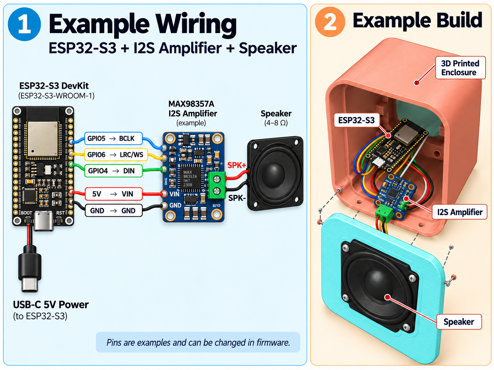
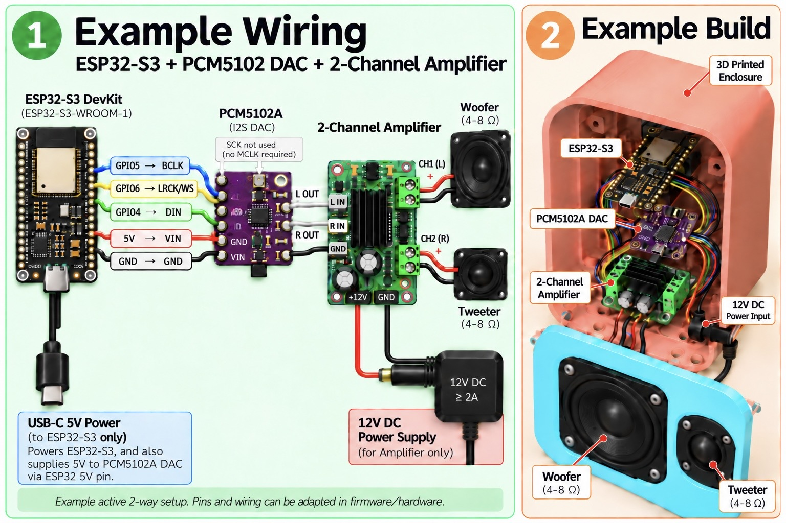

<p align="center">
  <b>Enjoying this project?</b> It is built and tested in my free time. A small
  donation helps buy test hardware and keeps the development going. Thank you! ❤️
  <br><br>
  <!-- DONATION LINK: replace the # in href="#" below with your donation link -->
  <a href="#"></a>
</p>

<p align="center">
  <a href="images/airplay-surround-dark.png"></a>
</p>

# ESP32 AirPlay 2 Surround 7.1

**Wireless 5.1 / 7.1 surround sound from an Apple TV, built from low-cost
ESP32-S3 boards: one board per speaker.**

Every board is a full **AirPlay 2 receiver**. It receives the complete
surround stream from the Apple TV, decodes **only its own channel**
(Front Left, Centre, Subwoofer, Rear Right, …) and plays it through any
amplifier and speaker you like. The Apple TV keeps all boards in sync
through AirPlay 2's **PTP clock**, the same way it drives its own HomePods.
No cables between the speakers, no AV receiver, no hub.

- 🎬 **5.1 and 7.1 AAC** (Apple Music Dolby Atmos, films and series from the
  Apple TV apps).
- 🎵 **Stereo** too: ALAC 44.1 kHz/16-bit and **lossless 48 kHz/24-bit**, AAC
  44.1 / 48 kHz. With a stereo source every board simply plays stereo.
- 🔀 **Format changes on the fly**: the Apple TV can switch between stereo and
  surround from track to track; the board follows without reconnecting.
- 🎛️ **Web interface** for everything: speaker position, 2 × 24-band
  parametric EQ / crossover, loudness, latency, Wi-Fi, firmware updates, live
  logs.
- ⚡ About **a third of one CPU core** for one speaker of 7.1, thanks to a
  patched Fraunhofer FDK AAC decoder that synthesises just one channel.

> [!NOTE]
> **The project is under active development.** Features, defaults and wiring
> may still change, and this README is updated with every change. Tested with
> an Apple TV; see [Limitations](#limitations).

## Contents

- [Gallery](#gallery)
- [How it works](#how-it-works)
- [What you need](#what-you-need)
- [Assembly and wiring](#assembly-and-wiring)
- [Installation](#installation)
- [First start](#first-start)
- [Settings](#settings)
- [Technical details](#technical-details)
- [Limitations](#limitations)
- [Troubleshooting and logs](#troubleshooting-and-logs)
- [Licenses and credits](#licenses-and-credits)

## Gallery

Click an image to open it full size.

<table>
  <tr>
    <td align="center" width="50%">
      <a href="images/wiring-max98357a.png"></a>
      <br><sub><b>Simplest build:</b> ESP32-S3 + MAX98357A I2S amplifier + one speaker</sub>
    </td>
    <td align="center" width="50%">
      <a href="images/wiring-pcm5102a-2way.jpg"></a>
      <br><sub><b>Active 2-way build:</b> ESP32-S3 + PCM5102A DAC + 2-channel amplifier, woofer + tweeter</sub>
    </td>
  </tr>
  <tr>
    <td align="center" colspan="2">
      <a href="images/airplay-surround-light.png"></a>
      <br><sub>One board in every speaker, all fed wirelessly by the Apple TV</sub>
    </td>
  </tr>
</table>

## How it works

The Apple TV can send surround sound over AirPlay 2, but only to receivers
that say they accept it. When it does, **every receiver in the group gets the
whole multichannel stream**, and all of them play each sample at the same
moment because they share one PTP clock.

This project builds on exactly that:

1. **Every board announces 5.1 and 7.1.** The Apple TV then sends the
   multichannel stream to all boards in the group.
2. **Every board decodes only its own channel.** One ESP32-S3 cannot decode
   all eight channels in real time, and it does not need to.
3. **Every board plays that channel on both outputs** of its DAC or amplifier
   (L = R), so you can drive one speaker, two drivers (woofer + tweeter) or a
   subwoofer amplifier.
4. **The boards never talk to each other.** Timing comes from the Apple TV,
   so adding a speaker is just adding one more board to the AirPlay group.

You choose each board's position (Front Left, Centre, Subwoofer, …) in its
web page, even while music is playing. Start with two or three speakers and
add the rest later.

```
                 Apple TV  (5.1 / 7.1 AAC over Wi-Fi, PTP clock)
                     │
   ┌─────────┬───────┼───────┬─────────┬─────────┐
   ▼         ▼       ▼       ▼         ▼         ▼
 ESP32     ESP32   ESP32   ESP32     ESP32     ESP32   (… up to 8)
 Front L   Centre  Front R  Sub      Side L    Side R
   │         │       │       │         │         │
  amp       amp     amp     amp       amp       amp
   │         │       │       │         │         │
 speaker  speaker speaker  subwoofer speaker  speaker
```

## What you need

### Per speaker (one set for every position)

| Part | Notes |
|---|---|
| **ESP32-S3 board with 8 MB flash and 8 MB PSRAM** (N8R8), e.g. ESP32-S3-DevKitC-1 N8R8 | PSRAM is required: the stream buffer alone takes 6 MB. Boards without PSRAM (or with 2 MB) will not work. |
| **Audio output**, one of: | |
| &nbsp;&nbsp;• an **I2S amplifier** such as **MAX98357A** | Simplest: digital in, speaker out, about 3 W. Good for small satellites and surrounds. |
| &nbsp;&nbsp;• an **I2S DAC** such as **PCM5102A** + **any analogue amplifier** | Any size: mini (PAM8403, 2 × 3 W), medium or powerful (TPA3110 / TPA3116, TDA7498, a plate amplifier for a subwoofer…), **one- or two-channel**. |
| **Speaker(s)**, 4–8 Ω | One full-range driver, or a woofer + tweeter pair (see [Option B](#option-b--dac--any-amplifier)). |
| **Power supply** | 5 V USB (≥ 1 A) for the ESP32-S3; a separate supply for a larger amplifier (e.g. 12 V ≥ 2 A, as your amplifier requires). |
| **Enclosure** | 3D-printed, wooden or an existing speaker box. |
| Jumper wires or a small PCB | 5 wires for the I2S connection. |

### Number of boards

| System | Boards | Positions |
|---|---|---|
| 5.1 | 6 | Front L, Front R, Centre, Subwoofer, Side L, Side R |
| 7.1 | 8 | the 5.1 positions + Rear L, Rear R |
| Start small | 2–3 | e.g. Front L + Front R (+ Centre) |

A channel without a board is simply not played. The **centre carries most of
the dialogue**, so build it early.

### Sender and network

- An **Apple TV** (surround is sent only by the Apple TV; an iPhone, iPad or
  Mac sends stereo to these boards).
- A **2.4 GHz Wi-Fi** network with good coverage at every speaker (the
  ESP32-S3 has no 5 GHz radio). Each board receives the full surround stream,
  so a solid signal matters more than with a single speaker.

## Assembly and wiring

> [!NOTE]
> The GPIOs below are the defaults and can be changed in `menuconfig`
> (see [Installation](#installation)). Wiring options may be extended in
> future versions; this section will be updated.

### Option A — I2S amplifier (MAX98357A)

<a href="images/wiring-max98357a.png"></a>

| ESP32-S3 | MAX98357A |
|---|---|
| GPIO 5 | BCLK |
| GPIO 6 | LRC (WS) |
| GPIO 4 | DIN |
| 5V | VIN |
| GND | GND |

- Speaker to **SPK+ / SPK−** (4–8 Ω).
- Leave **SD** and **GAIN** unconnected (default: (L+R)/2 output, 9 dB gain).
  Because both I2S slots carry the same channel, the result is that channel
  at full level.
- At full volume the amplifier draws up to ~1 A from 5 V: use a good USB
  supply and short power wires.

<br clear="right">

### Option B — DAC + any amplifier

<a href="images/wiring-pcm5102a-2way.jpg"></a>

| ESP32-S3 | PCM5102A |
|---|---|
| GPIO 5 | BCK |
| GPIO 6 | LCK (LRCK / WS) |
| GPIO 4 | DIN |
| 5V | VIN |
| GND | GND |
| — | SCK: not used (connect to GND, or close the module's SCK bridge) |

On the common purple PCM5102A module check the solder jumpers on the back:
**FLT = L, DEMP = L, XSMT = H** (otherwise the DAC stays muted), **FMT = L**
(I2S).

The DAC's **L OUT** and **R OUT** carry the same speaker channel, which lets
you use **any amplifier, small or powerful, one- or two-channel**:

| Amplifier | Connection | Setup on the EQ page |
|---|---|---|
| **One channel** (mono amp, a single side of a stereo amp, a subwoofer plate amp) | L OUT → amp input | nothing; for a subwoofer add a low-pass filter if the amp has none |
| **Two channels, one full-range speaker** | L OUT → amp, use one channel | nothing |
| **Two channels, active 2-way (woofer + tweeter)** | L OUT → CH1 → **woofer**, R OUT → CH2 → **tweeter** | a crossover: low-pass on the **Left output**, high-pass on the **Right output** |
| **Powered speaker / active subwoofer** | L/R OUT → its line input | nothing |

**Active 2-way crossover** (one example, adjust to your drivers):

1. Open `http://<board-ip>/eq` and tick **Enable EQ and preamp**.
2. **Left Output Filters** (woofer): two **LP** filters at the crossover
   frequency (e.g. 2500 Hz), **Q 0.707** each. Two stacked Butterworth
   filters make a 24 dB/oct Linkwitz-Riley slope.
3. **Right Output Filters** (tweeter): two **HP** filters at the same
   frequency, **Q 0.707** each.
4. Tweeters are usually louder: lower the **Right preamp** until both
   drivers sound balanced. Add peak or shelf filters to correct each
   driver's response.
5. **Apply & Save**: the change is live and stored, no restart needed.

> [!WARNING]
> Always set the tweeter's high-pass **before** playing loud. Full-range
> bass destroys a tweeter in seconds. The per-output **Mute** buttons on the
> EQ page help while setting up.

**Power:** the ESP32-S3 and the DAC run from USB 5 V; a larger amplifier gets
its own supply (e.g. 12 V ≥ 2 A). Connect the grounds of the DAC and the
amplifier (the signal ground), and keep the amplifier's power wires away
from the I2S wires.

<br clear="right">

### Optional extras

| Function | Default GPIO | Notes |
|---|---|---|
| Amplifier enable / standby | 21 | switches the amplifier on while AirPlay plays; active high or low |
| WS2812 RGB VU LED | 38 | the on-board LED of many DevKitC boards |
| Buttons: play/pause, next, previous, volume − / + | disabled | any free GPIO |
| Wired latency measurement (ADC loopback) | 7 | DAC output → coupling capacitor + bias divider → ADC pin |

## Installation

### 1. Install ESP-IDF

The firmware is built with **ESP-IDF v6.0.2**. Follow Espressif's
[installation guide](https://docs.espressif.com/projects/esp-idf/en/latest/esp32s3/get-started/index.html),
then open a terminal with the ESP-IDF environment loaded
(`source ~/esp-idf/export.sh`, or the path where you installed it).

### 2. Get the code

```bash
git clone https://github.com/Kristian8606/esp32-airplay2-surround.git
cd esp32-airplay2-surround
```

### 3. Configure (optional)

```bash
idf.py set-target esp32s3
idf.py menuconfig
```

| Menu | What you can set |
|---|---|
| **I2S Playout** | BCLK / LRCK / DATA / MCLK GPIOs, output latency of your DAC |
| **Multichannel Experiment** | surround on/off, default speaker position |
| **AirPlay Receiver** | setup Wi-Fi name and password, hardware buttons |
| **Amplifier Power Control** | amplifier enable GPIO and level |
| **RGB Audio/VU LED** | LED on/off and GPIO |
| **AirPlay Logs and Diagnostics** | log detail, web admin password |

The speaker position can also be changed later in the web page, so every
board can run the same firmware.

### 4. Build and flash

Connect the board over USB and run:

```bash
idf.py build
idf.py -p /dev/cu.usbmodem* flash monitor
```

On Windows the port is `COMx`, on Linux usually `/dev/ttyACM0`. Repeat the
flash step for every board.

### 5. Updates

Later versions can be installed **over Wi-Fi**: on the board's main page,
**Firmware Update** → choose `build/airplay-esp32_<version>.bin` →
**Upload Firmware**. The web interface is part of the firmware and is updated
with it.

## First start

1. **Connect to Wi-Fi.** A new board opens the access point
   **`ESP32-AirPlay-Setup`**. Join it with a phone or laptop; the setup page
   opens by itself (or go to `http://192.168.4.1/`). Choose your network,
   enter the password, **Connect to WiFi**.
2. **Name the board.** Find its IP address in your router (or the serial log),
   open `http://<board-ip>/` and set **AirPlay Device Name**, e.g.
   *Surround Front Left*. Clear names make the Apple TV list easy to read.
3. **Choose the position.** Open `http://<board-ip>/eq`, card
   **Surround speaker (5.1 / 7.1)**, pick the position. It is saved and
   applies immediately.
4. **Add the boards on the Apple TV.** Open Control Center on the Apple TV,
   select the **AirPlay / audio output** icon and **tick every board**. They
   now play together as one group.
5. **Play** something in surround (Apple Music Dolby Atmos or a film). Each
   board's EQ page shows what it is playing right now, e.g.
   *AAC-LC · 48 kHz · 7.1 · Front Left*.

> [!TIP]
> Other AirPlay speakers can stay in the group. In our tests the Apple TV
> still sends 5.1 / 7.1 to these boards when a HomePod is in the group too;
> it decides the format for each receiver separately.

### Speaker positions

| Position | Where to put it | Notes |
|---|---|---|
| Front Left / Right (L / R) | ~30° left / right of the screen | main pair; music and effects |
| Centre (C) | above or below the screen | most of the dialogue |
| Subwoofer (LFE) | anywhere low, often near a corner | only the low-frequency effects channel |
| Side Left / Right (Ls / Rs) | beside the listener, ~90–110° | the surround pair of 5.1 |
| Rear Left / Right (Lrs / Rrs) | behind the listener, ~135–150° | 7.1 only; with a 5.1 stream they play Side L / R |
| Mono mix | anywhere | every channel except LFE in one speaker; uses the most CPU |

> [!IMPORTANT]
> The **Subwoofer** position plays only the LFE channel (the extra bass
> effects of films), **not** the bass of the other speakers. There is no bass
> management, so the front speakers should reproduce reasonable bass on their
> own. With music the LFE channel is often silent; with films it is busy.

## Settings

Everything is configured in the browser at `http://<board-ip>/`.

### Main page

| Card | What it does |
|---|---|
| **Playback** | play/pause, next, previous and volume of the current AirPlay sender |
| **WiFi Network** | scan and change the network |
| **Device Settings** | the AirPlay name |
| **Output Latency** | delay of your hardware after the ESP (DAC, DSP), so all speakers stay in sync; *Measure* runs a wired loopback test |
| **Firmware Update** | OTA update with a `.bin` file |
| **System** | IP, MAC, memory, firmware, uptime, reset reason, Wi-Fi signal and channel; restart |
| **Audio EQ / System Logs / WiFi Speedtest** | links to the pages below |

### Audio EQ page (`/eq`)

| Card | What it does |
|---|---|
| **Surround speaker (5.1 / 7.1)** | position of this board; shows the current format and channel |
| **Source** | stereo / mono / left / right routing for stereo sources (no effect on surround: both outputs carry the chosen speaker) |
| **Loudness** | ISO 226 loudness compensation: restores bass and treble at low volume |
| **Left / Right Output Filters** | two independent chains of up to **24 biquad filters** each: peak, low-pass, high-pass, band-pass, notch, low shelf, high shelf; a **preamp** and a **mute** button per output |
| **Apply & Save** | applies live and stores in flash |

### Other pages

- **`/logs`**: live log of the board over WebSocket.
- **`/speedtest`**: ping, download and upload between the browser and the
  board, to check Wi-Fi at the speaker's position.

**Security:** with a **Web UI admin password** set in `menuconfig`, firmware
updates, restart, Wi-Fi and name changes and the latency test require the
user `admin` and that password.

## Technical details

### Audio formats

The receiver advertises these formats and the Apple TV chooses one per
stream:

| Transport | Codec | Rate | Channels | Frames / packet |
|---|---|---|---|---|
| Realtime UDP (type 96) | ALAC 16-bit | 44.1 kHz | 2 | 352 |
| Buffered TCP (type 103) | ALAC 16-bit | 44.1 kHz | 2 | 352 |
| Buffered TCP (type 103) | ALAC 24-bit (lossless) | 48 kHz | 2 | 352 |
| Buffered TCP (type 103) | AAC-LC | 44.1 / 48 kHz | 2 | 1024 |
| Buffered TCP (type 103) | AAC-LC | 48 kHz | **6 (5.1) / 8 (7.1)** | 1024 |

- **The Apple TV decides the format**, for each receiver from the formats
  it announces and, for each track, from what the content offers. A stereo
  speaker in the same group (e.g. a HomePod) does not stop these boards from
  getting 5.1 / 7.1.
  An "Atmos" label in Apple Music does not guarantee a 7.1 stream; some
  tracks arrive as stereo. YouTube sends stereo only.
- **Format changes mid-stream.** Every audio packet carries its format in the
  RTP SSRC. The board switches codec, channels, bit depth or rate per packet,
  without a new SETUP. A codec or channel change at the same rate keeps the
  queued audio; a rate change (44.1 ↔ 48 kHz) restarts I2S at the right
  moment with a short gap, and the timeline stays continuous.

### Channels

5.1 and 7.1 arrive as AAC-LC with channel configuration 6 or 7. The decoder
reads the channel labels of every stream and finds the selected speaker **by
name**, so one setting works for 5.1 and 7.1 and survives format changes.

| Stream | Channel order (AAC elements) |
|---|---|
| 5.1 (config 6) | C · L R · Ls Rs · LFE |
| 7.1 (config 7) | C · L R · Ls Rs (side) · Lrs Rrs (rear) · LFE |

With 5.1 the Rear positions play Side L / R, so a 7.1 set of boards also
works with 5.1 content.

> [!NOTE]
> **7.1 naming.** The names above follow Apple's 7.1 order (first pair
> front, second pair side, back pair rear). The ISO reading of configuration 7
> names the first pairs differently. A listening test with a 7.1 channel
> test signal is in progress; if Front and Side turn out swapped, a setting
> will be added and this README updated.

### Decoding and signal path

1. **AAC** is decoded with **Fraunhofer FDK AAC**, patched to synthesise
   only the selected channel: the bits of all channels are read, but only the
   element that holds the selected speaker is inverse quantised, filtered and
   transformed. Output is signed 32-bit, straight to float, without a 16-bit
   step. **ALAC** uses Espressif's decoder; 24-bit samples also go straight to
   float.
2. **DSP** in 32-bit float: EQ / crossover, loudness, volume.
3. **I2S** with 32-bit samples at the stream's rate: 44.1 or 48 kHz for
   stereo, 48 kHz for surround. The selected speaker goes to **both slots**
   (L = R).

### Synchronisation

Playback is scheduled from the Apple TV's **PTP clock**: each packet carries
an RTP timestamp, and the board plays every sample at the time the sender
asked for. The I2S clock is fine-tuned live to follow the sender, so the
boards stay together over hours. The **output latency** of your DAC or DSP
is taken into account, so the sound leaves every speaker at the same moment.

### Performance and memory

| | |
|---|---|
| CPU, one speaker of 7.1 | ~31–34 % of one core (measured on a rear speaker) |
| Decode task stack | 20 KiB in PSRAM (deepest use ~11 KiB) |
| Compressed stream buffer | 6 MB in PSRAM |
| Free PSRAM during 7.1 | ~400 KiB |

| Core 0 | Core 1 |
|---|---|
| AAC decoding, RTSP, PTP | Wi-Fi, LwIP, stream reader, I2S playout, status / LED / log tasks |

The FDK changes (single-channel synthesis, 32-bit output, hardware bit
counting on the ESP32-S3, element skipping, smaller buffers, lazy limiter)
are listed in
[`components/fdk_aac/MODIFICATIONS.md`](components/fdk_aac/MODIFICATIONS.md).

## Limitations

- **Experimental**, tested with one Apple TV. Multichannel has only been seen
  from the Apple TV; other Apple devices send stereo.
- **Rear and side channels are often nearly silent in music**; they come
  alive with films and Atmos mixes.
- **No bass management**: the Subwoofer position plays only LFE.
- The **7.1 Front / Side naming** is not yet confirmed (see
  [Channels](#channels)).
- **Mono mix** decodes all channels and may not keep up with 7.1.
- A switch between 44.1 and 48 kHz has a short silence while I2S is
  reconfigured.
- Some video apps take 20–30 s from the start of AirPlay to the first audio
  (seen with HBO); that is the sender.
- **Realtime ALAC** (screen mirroring, system audio) is less tested.

## Troubleshooting and logs

| Problem | Check |
|---|---|
| The Apple TV sends stereo only | The track or app may only offer stereo (YouTube, some "Atmos" tracks); check the format on the `/eq` page or in `NOW PLAYING`. |
| No sound from a board | Position on `/eq`; the **Mute** buttons; PCM5102A **XSMT** jumper; wiring of BCLK / LRCK / DATA. |
| Subwoofer silent with music | Normal: most music has no LFE. Try a film. |
| Dropouts | Wi-Fi signal at that speaker (`/speedtest`, RSSI on the main page). |
| One speaker early or late | **Output Latency** of that board (DSP, external processors). |

Useful lines in the serial log or at `http://<board-ip>/logs`:

| Line | Meaning |
|---|---|
| `NOW PLAYING \| AAC-LC \| 48000 Hz \| 24-bit (F24) \| 7.1 (8ch) \| Front Right (R)` | what the board plays right now |
| `NOW PLAYING \| ALAC \| 48000 Hz \| 24-bit \| stereo L/R` | a lossless stereo stream |
| `AUDIO FORMAT … -> …; SSRC …` | the sender changed the format mid-stream |
| `I2S RATE 44100 -> 48000 Hz` | the output clock changed |
| `MC: decoded channel N = back #0 -> Rear Left (Lrs)` | channel layout of the stream |
| `MC CPU … avg …% of one core` | decoding time per frame |
| `audio_status: … pcm=…ms` | decoded audio waiting for I2S; should stay near 850 ms |

For deeper debugging enable **AirPlay Logs and Diagnostics → Log every RTSP
request and response** in `menuconfig` (verbose; turn it off afterwards).

## Licenses and credits

- **Fraunhofer FDK AAC** (`components/fdk_aac/fdk-aac`) is under the
  Fraunhofer FDK license, [`NOTICE`](components/fdk_aac/fdk-aac/NOTICE). The
  copy here is a **Third-Party Modified Version of the Fraunhofer FDK AAC
  Codec Library for Android**; the changes and their dates are listed in
  [`MODIFICATIONS.md`](components/fdk_aac/MODIFICATIONS.md). The license
  allows redistribution in source and binary form without copyright fees but
  **grants no patent rights**: AAC patent licenses are available through Via
  Licensing or the patent owners.
- The **rest of this repository** has no license file yet, so no license is
  granted for it beyond viewing it on GitHub.
- Other components (ESP-IDF, `esp_audio_codec`, libsodium, mDNS, cJSON,
  led_strip) come through the ESP-IDF component manager under their own
  licenses.

Based on [airplay-esp32](https://github.com/rbouteiller/airplay-esp32.git),
the stereo AirPlay 2 receiver for the ESP32-S3. AAC decoding through
[fdk-aac](https://github.com/mstorsjo/fdk-aac).

AirPlay, Apple TV and HomePod are trademarks of Apple Inc. This project is not
affiliated with or endorsed by Apple.

<p align="center">
  <br>
  If this project helped you build your surround system, please consider
  supporting it. 🙏
  <br><br>
  <!-- DONATION LINK: replace the # in href="#" below with your donation link -->
  <a href="#"></a>
</p>
