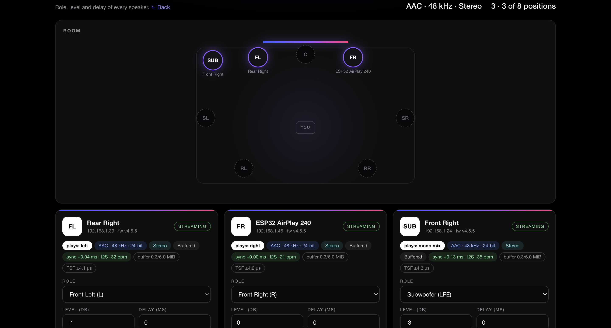
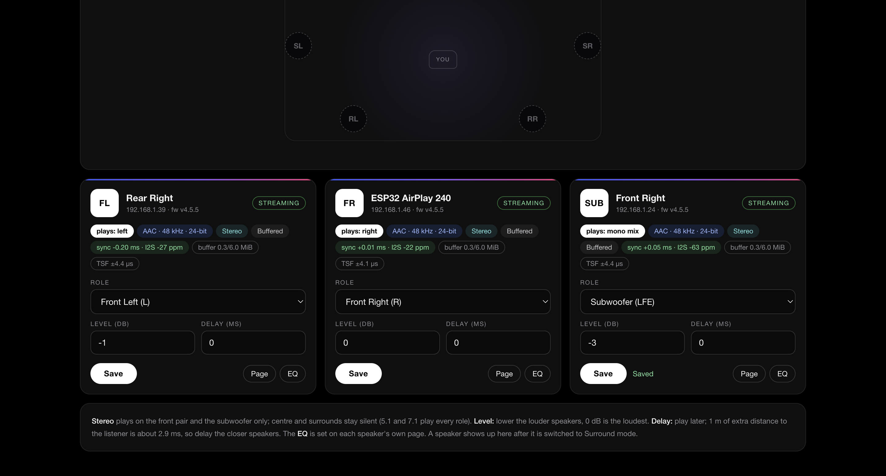
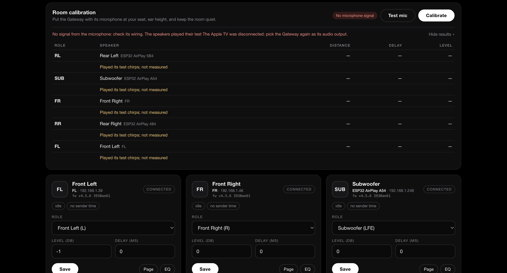

<p align="center">
  <b>Enjoying this project?</b> It is built and tested in my free time. A small
  donation helps buy test hardware and keeps the development going. Thank you! ❤️
  <br><br>
  <!-- DONATION LINK: replace the # in href="#" below with your donation link -->
  <a href="#"></a>
</p>

<p align="center">
  <a href="images/airplay-surround-dark.png"></a>
</p>

# ESP32 AirPlay 2 Surround Gateway

**Wireless 5.1 / 7.1 surround sound from an Apple TV, built from low-cost
ESP32-S3 boards: one Gateway, and one board per speaker.**

The Apple TV sees **one AirPlay 2 speaker: the Gateway**. The Gateway takes
the complete surround stream and passes it on, unchanged, to up to **eight
speaker boards** over your Wi-Fi. Every speaker decodes **only its own
channel** (Front Left, Centre, Subwoofer, Rear Right, …) and plays it through
any amplifier and speaker you like. All speakers share one clock taken from
the Wi-Fi access point itself, so they play each sample at the same moment.
No cables between the speakers, no AV receiver, one web page for the whole
system.

- 🎬 **5.1 and 7.1 AAC** (Apple Music Dolby Atmos, films and series from the
  Apple TV apps).
- 🎵 **Stereo** too: ALAC 44.1 kHz/16-bit and **lossless 48 kHz/24-bit**, AAC
  44.1 / 48 kHz, from any AirPlay 2 sender. A stereo song plays on the front
  pair and the subwoofer, as on an AV receiver.
- 📡 **One AirPlay target.** You pick the Gateway, not eight speakers. Pairing,
  RTSP and the Apple TV's clock are handled once, by the Gateway.
- ⏱️ **Microsecond clock alignment** between speakers through the access
  point's beacon timer (TSF). No extra hardware, no cables.
- 🎛️ **One page for all speakers**: role, level and delay of every speaker,
  and a live view of what each one plays. Each speaker keeps its own
  2 × 24-band parametric EQ / crossover, loudness and latency settings.
- 🔀 **Format changes on the fly**: the Apple TV can switch between stereo and
  surround from track to track; the speakers follow without reconnecting.
- ⚡ About **a third of one CPU core** per speaker for 7.1, thanks to a patched
  Fraunhofer FDK AAC decoder that synthesises just one channel.
- 🔗 **Speakers belong to the system**: a speaker is not an AirPlay
  receiver of its own and never shows up on an iPhone; it just follows the
  Gateway. (A board that is its own AirPlay receiver is the `main` branch.)

> [!NOTE]
> **The project is under active development.** A Gateway and two speakers
> play a 7.1 stream from an Apple TV, each its own channel, audibly in sync.
> Features, defaults and wiring may still change, and this README is updated
> with every change. See [Limitations](#limitations).

## Contents

- [Gallery](#gallery)
- [How it works](#how-it-works)
- [What you need](#what-you-need)
- [Assembly and wiring](#assembly-and-wiring)
- [Installation](#installation)
- [First start](#first-start)
- [Settings](#settings)
- [Technical details](#technical-details)
- [Measuring sync](#measuring-sync)
- [Limitations](#limitations)
- [Troubleshooting and logs](#troubleshooting-and-logs)
- [Licenses and credits](#licenses-and-credits)

## Gallery

Click an image to open it full size.

<table>
  <tr>
    <td align="center" width="50%">
      <a href="images/wiring-max98357a.png"></a>
      <br><sub><b>Simplest speaker:</b> ESP32-S3 + MAX98357A I2S amplifier + one speaker</sub>
    </td>
    <td align="center" width="50%">
      <a href="images/wiring-pcm5102a-2way.jpg"></a>
      <br><sub><b>Active 2-way speaker:</b> ESP32-S3 + PCM5102A DAC + 2-channel amplifier, woofer + tweeter</sub>
    </td>
  </tr>
  <tr>
    <td align="center" colspan="2">
      <a href="images/airplay-surround-light.png"></a>
      <br><sub>One board in every speaker, all fed wirelessly through the Gateway</sub>
    </td>
  </tr>
  <tr>
    <td align="center" width="50%">
      <a href="images/speakers-page-room.png"></a>
      <br><sub><b>Gateway speakers page:</b> the room map shows which positions play</sub>
    </td>
    <td align="center" width="50%">
      <a href="images/speakers-page-tiles.png"></a>
      <br><sub>One tile per speaker: role, level, delay and live sync</sub>
    </td>
  </tr>
</table>

## How it works

The Apple TV sends surround sound over AirPlay 2 only to a receiver that says
it accepts it. The Gateway says so, receives the whole multichannel stream
and shares it with the speakers:

1. **The Gateway is the only AirPlay receiver.** It announces 5.1 and 7.1, so
   the Apple TV sends it the full multichannel stream. mDNS, HAP pairing,
   RTSP and the Apple TV's PTP clock all run there.
2. **It forwards, it does not decode.** Every instruction from the Apple TV
   (format, key, start, flush, pause, volume, timing) is passed to the
   speakers over a small control protocol, and every encrypted audio packet
   is copied byte for byte to each speaker. The slowest speaker paces the
   stream through TCP, so the Gateway needs no audio buffer of its own.
3. **Every speaker decodes only its own channel.** One ESP32-S3 cannot decode
   all eight channels in real time, and it does not need to. A speaker is
   not an AirPlay receiver: it finds the Gateway by mDNS, decrypts the stream
   with the key the Gateway passed on and plays its channel
   on **both outputs** of its DAC or amplifier (L = R), so you can drive one
   speaker, two drivers (woofer + tweeter) or a subwoofer amplifier.
4. **One clock for all.** Every board on the same Wi-Fi access point keeps a
   copy of the access point's beacon timer (TSF). Eight times a second the
   Gateway tells the speakers "the Apple TV's time P is TSF T". Each speaker
   converts T to its own clock and plays every sample at the moment the
   Apple TV scheduled it.

You choose each speaker's role (Front Left, Centre, Subwoofer, …) on the
Gateway's page, even while music is playing. Start with two or three
speakers and add the rest later.

```
                       ┌─────────────────────────────┐
   Apple TV ──AirPlay──►  Gateway (ESP32-S3)          │
   (PTP clock)         │  pairing · RTSP · PTP        │
                       │  no decoder, no audio output │
                       └─────┬──────────────┬─────────┘
              control + time │              │ the same audio packets,
              (TCP, port 7100)              │ unchanged, to every speaker
         ┌──────────┬────────┴─┬────────────┴┬────────────┐
         ▼          ▼          ▼             ▼            ▼
       ESP32      ESP32      ESP32         ESP32        ESP32    (… up to 8)
      Front L    Front R    Centre       Subwoofer    Rear L/R
         │          │          │             │            │
        amp        amp        amp           amp          amp
         │          │          │             │            │
      speaker    speaker    speaker      subwoofer     speaker
```

### Sync, as measured

| What | Measured |
|---|---|
| TSF reading jitter per board | ~4.5 µs rms, averaged by a 64-point line fit |
| Clock difference speaker ↔ speaker | a few µs (from the fits; scope test pending) |
| Playout error of each speaker | within ±0.4 ms, corrected slowly by the I2S servo |
| Speaker ↔ speaker in practice | 0.1–0.3 ms, about 3–10 cm of sound travel |
| Transport delay of the time messages | 3–60 ms, does not matter by design |

The time messages carry a TSF timestamp rather than "now", so how long they
take over Wi-Fi does not enter the result.

### What each speaker plays

| Source | Front L / R | Centre | Subwoofer | Side / Rear | Mono mix |
|---|---|---|---|---|---|
| **7.1** (Apple Music Dolby Atmos) | own channel | own channel | LFE channel | own channel | all except LFE |
| **5.1** (films, series) | own channel | own channel | LFE channel | Side L/R; Rear plays Side | all except LFE |
| **Stereo** (music, YouTube) | left / right | silent | mix of L and R | silent | mix of L and R |

With stereo the subwoofer gets the full-range mix; a low-pass on its EQ page
(or the subwoofer amplifier's own crossover) keeps the bass.

## What you need

### The Gateway

| Part | Notes |
|---|---|
| **One ESP32-S3 board**, the same type as the speakers (N8R8) | It has no audio output: no DAC, no amplifier, no wiring. A USB supply is all it needs. |
| **A place with a good signal** | It receives the stream from the Apple TV and sends it again to every speaker, so it carries the most Wi-Fi traffic. Near the access point is best. |
| *Optional:* **INMP441 I2S microphone** | For [room calibration](#room-calibration): VDD → 3V3, GND and L/R → GND, SCK → GPIO 5, WS → GPIO 6, SD → GPIO 4 (changeable in `menuconfig`). |

### Per speaker (one set for every position)

| Part | Notes |
|---|---|
| **ESP32-S3 board with 8 MB flash and 8 MB PSRAM** (N8R8), e.g. ESP32-S3-DevKitC-1 N8R8 | PSRAM is required: the stream buffer alone takes 6 MB. Boards without PSRAM (or with 2 MB) will not work. |
| **Audio output**, one of: | |
| &nbsp;&nbsp;• an **I2S amplifier** such as **MAX98357A** | Simplest: digital in, speaker out, about 3 W. Good for small satellites and surrounds. |
| &nbsp;&nbsp;• an **I2S DAC** such as **PCM5102A** + **any analogue amplifier** | Any size: mini (PAM8403, 2 × 3 W), medium or powerful (TPA3110 / TPA3116, TDA7498, a plate amplifier for a subwoofer…), **one- or two-channel**. |
| **Speaker(s)**, 4–8 Ω | One full-range driver, or a woofer + tweeter pair (see [Option B](#option-b--dac--any-amplifier)). |
| **Power supply** | 5 V USB (≥ 1 A) for the ESP32-S3; a separate supply for a larger amplifier (e.g. 12 V ≥ 2 A, as your amplifier requires). |
| **Enclosure** | 3D-printed, wooden or an existing speaker box. |
| Jumper wires or a small PCB | 5 wires for the I2S connection. |

### Number of boards

| System | Boards | Positions |
|---|---|---|
| 5.1 | 1 Gateway + 6 speakers | Front L, Front R, Centre, Subwoofer, Side L, Side R |
| 7.1 | 1 Gateway + 8 speakers | the 5.1 positions + Rear L, Rear R |
| Start small | 1 Gateway + 2–3 speakers | e.g. Front L + Front R (+ Centre) |

A channel without a speaker is simply not played. The **centre carries most
of the dialogue**, so build it early.

### Sender and network

- An **Apple TV** for 5.1 / 7.1 (surround is sent only by the Apple TV; an
  iPhone, iPad or Mac sends stereo, which the speakers play as well).
- A **2.4 GHz Wi-Fi** network with good coverage at every speaker (the
  ESP32-S3 has no 5 GHz radio).
- **All boards on the same access point.** The shared clock is that access
  point's beacon timer: each access point, and each node of a mesh system,
  has its own. A speaker on another access point logs a warning and stays
  silent.

## Assembly and wiring

The Gateway needs no wiring (only the optional calibration microphone, see
[What you need](#the-gateway)). Everything below is for the speakers.

> [!NOTE]
> The GPIOs below are the defaults and can be changed in `menuconfig`
> (see [Installation](#installation)). Wiring options may be extended in
> future versions; this section will be updated.

### Option A — I2S amplifier (MAX98357A)

<a href="images/wiring-max98357a.png"></a>

| ESP32-S3 | MAX98357A |
|---|---|
| GPIO 5 | BCLK |
| GPIO 6 | LRC (WS) |
| GPIO 4 | DIN |
| 5V | VIN |
| GND | GND |

- Speaker to **SPK+ / SPK−** (4–8 Ω).
- Leave **SD** and **GAIN** unconnected (default: (L+R)/2 output, 9 dB gain).
  Because both I2S slots carry the same channel, the result is that channel
  at full level.
- At full volume the amplifier draws up to ~1 A from 5 V: use a good USB
  supply and short power wires.

<br clear="right">

### Option B — DAC + any amplifier

<a href="images/wiring-pcm5102a-2way.jpg"></a>

| ESP32-S3 | PCM5102A |
|---|---|
| GPIO 5 | BCK |
| GPIO 6 | LCK (LRCK / WS) |
| GPIO 4 | DIN |
| 5V | VIN |
| GND | GND |
| — | SCK: not used (connect to GND, or close the module's SCK bridge) |

On the common purple PCM5102A module check the solder jumpers on the back:
**FLT = L, DEMP = L, XSMT = H** (otherwise the DAC stays muted), **FMT = L**
(I2S).

The DAC's **L OUT** and **R OUT** carry the same speaker channel, which lets
you use **any amplifier, small or powerful, one- or two-channel**:

| Amplifier | Connection | Setup on the speaker's EQ page |
|---|---|---|
| **One channel** (mono amp, a single side of a stereo amp, a subwoofer plate amp) | L OUT → amp input | nothing; for a subwoofer add a low-pass filter if the amp has none |
| **Two channels, one full-range speaker** | L OUT → amp, use one channel | nothing |
| **Two channels, active 2-way (woofer + tweeter)** | L OUT → CH1 → **woofer**, R OUT → CH2 → **tweeter** | a crossover: low-pass on the **Left output**, high-pass on the **Right output** |
| **Powered speaker / active subwoofer** | L/R OUT → its line input | nothing |

**Active 2-way crossover** (one example, adjust to your drivers):

1. Open `http://<speaker-ip>/eq` and tick **Enable EQ and preamp**.
2. **Left Output Filters** (woofer): two **LP** filters at the crossover
   frequency (e.g. 2500 Hz), **Q 0.707** each. Two stacked Butterworth
   filters make a 24 dB/oct Linkwitz-Riley slope.
3. **Right Output Filters** (tweeter): two **HP** filters at the same
   frequency, **Q 0.707** each.
4. Tweeters are usually louder: lower the **Right preamp** until both
   drivers sound balanced. Add peak or shelf filters to correct each
   driver's response.
5. **Apply & Save**: the change is live and stored, no restart needed.

> [!WARNING]
> Always set the tweeter's high-pass **before** playing loud. Full-range
> bass destroys a tweeter in seconds. The per-output **Mute** buttons on the
> EQ page help while setting up.

**Power:** the ESP32-S3 and the DAC run from USB 5 V; a larger amplifier gets
its own supply (e.g. 12 V ≥ 2 A). Connect the grounds of the DAC and the
amplifier (the signal ground), and keep the amplifier's power wires away
from the I2S wires.

<br clear="right">

### Optional extras (speakers)

| Function | Default GPIO | Notes |
|---|---|---|
| Amplifier enable / standby | 21 | switches the amplifier on while audio plays; active high or low |
| WS2812 RGB VU LED | 38 | the on-board LED of many DevKitC boards |
| Wired latency measurement (ADC loopback) | 7 | DAC output → coupling capacitor + bias divider → ADC pin |
| Sync test pulse (also on the Gateway) | 9 | for an oscilloscope, see [Measuring sync](#measuring-sync) |

## Installation

### 1. Install ESP-IDF

The firmware is built with **ESP-IDF v6.0.2**. Follow Espressif's
[installation guide](https://docs.espressif.com/projects/esp-idf/en/latest/esp32s3/get-started/index.html),
then open a terminal with the ESP-IDF environment loaded
(`source ~/esp-idf/export.sh`, or the path where you installed it).

### 2. Get the code

The Gateway lives on the **`gateway` branch** of the surround repository
(the `main` branch is the earlier design, where every board is its own
AirPlay receiver):

```bash
git clone -b gateway https://github.com/Kristian8606/esp32-airplay2-surround.git
cd esp32-airplay2-surround
```

### 3. Two projects, one code

| Folder | Builds | Firmware file |
|---|---|---|
| the repository folder | the **Gateway** | `build/airplay-gateway_<version>.bin` |
| `speaker/` | the **speakers** | `speaker/build/airplay-speaker_<version>.bin` |

| Code | Where |
|---|---|
| the Gateway's own (AirPlay receiver: mDNS, pairing, RTSP; proxy, relays, speaker registry, speakers page) | `main/` |
| the speaker's own (audio engine, link to the Gateway, EQ page) and FDK AAC | `speaker/main/`, `speaker/components/` |
| shared (Wi-Fi, web server, settings, OTA, logs, clock, sync protocol) | `common/`, `data/www/` |
| menuconfig options of both | `components/airplay_options/` |

Both use the shared settings in `sdkconfig.defaults`; the Gateway adds
`sdkconfig.defaults.gateway`. Each is an ordinary ESP-IDF project: go into
its folder and run `idf.py` as usual.

### 4. Configure (optional)

Run `idf.py menuconfig` in the folder of the firmware you configure (the
repository folder for the Gateway, `speaker/` for the speakers). Both show
the same menus; some options matter for one firmware only:

| Menu | What you can set | For |
|---|---|---|
| **Surround Build Role** | the role (set by the folder: leave it); a fixed Gateway address for networks that filter mDNS; the sync test pulse | both |
| **AirPlay Receiver** | setup Wi-Fi name and password; playback buttons and AirPlay model (the icon senders show) | Wi-Fi both, the rest Gateway |
| **Multichannel Experiment** | 5.1 / 7.1 on or off, default speaker position | both |
| **I2S Playout** | BCLK / LRCK / DATA / MCLK GPIOs, output latency of your DAC, wired latency test; web admin password | speakers (password both) |
| **Amplifier Power Control** | amplifier enable GPIO and level | speakers |
| **RGB Audio/VU LED** | LED on/off and GPIO | both |
| **AirPlay Logs and Diagnostics** | log detail | both |

Every speaker runs the same firmware: its role is set later on the Gateway's
page.

### 5. Build and flash

Connect a board over USB.

**Speakers** (repeat for every speaker):

```bash
cd speaker
idf.py -p /dev/cu.usbmodem101 build flash monitor
```

**Gateway**, from the repository folder:

```bash
idf.py -p /dev/cu.usbmodem101 build flash monitor
```

On macOS list the ports with `ls /dev/cu.*`; on Windows the port is `COMx`,
on Linux usually `/dev/ttyACM0`. Every board's log goes to its USB port
(USB Serial/JTAG, so `idf.py monitor` shows it) and to its `/logs` page.

### 6. Updates

Later versions can be installed **over Wi-Fi**: on the board's main page,
**Firmware Update** → choose `speaker/build/airplay-speaker_<version>.bin`
for a speaker or `build/airplay-gateway_<version>.bin` for the Gateway →
**Upload Firmware**. The web interface is part of the firmware and is updated
with it.

> [!IMPORTANT]
> **Update the Gateway and all speakers together.** The control protocol is
> versioned; a speaker with an older firmware is refused by the Gateway
> (`protocol version …, Gateway speaks …` in its log) until it is updated.

## First start

1. **Connect every board to Wi-Fi.** A new board opens the access point
   **`ESP32-AirPlay-Setup`**. Join it with a phone or laptop; the setup page
   opens by itself (or go to `http://192.168.4.1/`). Choose your network,
   enter the password, **Connect to WiFi**.
2. **Name the boards.** Find each IP address in your router (or the serial
   log), open `http://<board-ip>/` and set its name (**AirPlay Device Name**
   on the Gateway, **Speaker Name** on a speaker). The
   Gateway's name is what the Apple TV shows; clear speaker names
   (*Front Left*, *Centre*, …) make the speakers page easy to read.
3. **Speakers connect by themselves.** A speaker finds the Gateway on the
   network and shows up on the Gateway's speakers page; there is nothing to
   switch on.
4. **Give every speaker its role.** Open the Gateway's page
   `http://<gateway-ip>/speakers` (or **Open Speakers** on its main page),
   pick a role, level and delay for each speaker, **Save**.
5. **Choose the Gateway on the Apple TV.** Open Control Center, select the
   **AirPlay / audio output** icon and tick **only the Gateway**. The speakers
   are not listed there; they follow the Gateway.
6. **Play** something in surround (Apple Music Dolby Atmos or a film). The
   speakers page shows what every speaker plays right now, e.g.
   *AAC · 48 kHz · 24-bit · 7.1 · plays: Front Left*.

> [!TIP]
> A speaker that joins or restarts during a film stays silent until the next
> **skip or seek** (the Apple TV then restarts the stream at a point every
> speaker can start from). During screen mirroring it joins at once.

### Speaker positions

| Position | Where to put it | Notes |
|---|---|---|
| Front Left / Right (L / R) | ~30° left / right of the screen | main pair; music and effects |
| Centre (C) | above or below the screen | most of the dialogue |
| Subwoofer (LFE) | anywhere low, often near a corner | the low-frequency effects channel; with stereo, the L+R mix |
| Side Left / Right (Ls / Rs) | beside the listener, ~90–110° | the surround pair of 5.1 |
| Rear Left / Right (Lrs / Rrs) | behind the listener, ~135–150° | 7.1 only; with a 5.1 stream they play Side L / R |
| Mono mix | anywhere | every channel except LFE in one speaker; uses the most CPU |

> [!IMPORTANT]
> With 5.1 / 7.1 the **Subwoofer** plays only the LFE channel (the extra bass
> effects of films), **not** the bass of the other speakers. There is no bass
> management, so the front speakers should reproduce reasonable bass on their
> own. With music the LFE channel is often silent; with films it is busy.

## Settings

Everything is configured in the browser.

### Gateway: main page (`http://<gateway-ip>/`)

| Card | What it does |
|---|---|
| **Surround Speakers** | opens the speakers page below |
| **Playback** | play/pause, next, previous and volume of the current AirPlay sender |
| **WiFi Network** | scan and change the network |
| **Device Settings** | the AirPlay name the Apple TV shows |
| **Firmware Update** | OTA update with a `.bin` file |
| **System** | IP, MAC, memory, firmware, uptime, reset reason, Wi-Fi signal and channel; restart |
| **System Logs / WiFi Speedtest** | links to the pages below |

The Gateway has no audio output, so it has no EQ or latency cards.

### Gateway: speakers page (`/speakers`)

<a href="images/speakers-page-room.png"></a>

At the top, a **room map** seen from above: the screen at the top, you in
the middle and all eight positions around you. An empty position is dashed,
a position with a speaker is outlined, and a speaker that is playing glows.
Two speakers on the same position are marked orange. Click a position to
jump to its speaker. Above the map: what is playing now
(`AAC · 48 kHz · Stereo`) and how many positions are taken.

<a href="images/speakers-page-tiles.png"></a>

Below it, one tile per connected speaker, side by side:

| Field | What it does |
|---|---|
| **Role** | which channel it plays: Front Left … Rear Right, or Mono mix |
| **Level (dB)** | trim from −30 to 0 dB; turn the louder speakers down, the quietest stays at 0 dB |
| **Delay (ms)** | 0–50 ms; about **2.9 ms per metre** a speaker is closer to the listener than the farthest one |
| **Live status** | coloured tags: format, rate and bits (`AAC · 48 kHz · 24-bit`), layout (`7.1`, `5.1`, `Stereo`), the channel actually played, buffered or realtime stream, playout sync and I2S correction, buffer fill, TSF quality |
| **Links** | the speaker's own page and its **EQ** |

Every speaker keeps its settings in its own flash and applies a change at
once, also while playing. A warning shows when two speakers have the same
role.

### Speaker: main page (`http://<speaker-ip>/`)

| Card | What it does |
|---|---|
| **Surround Speaker** | a reminder that role, level and delay are set on the Gateway's page |
| **WiFi Network / Device Settings** | network, and the speaker's name shown on the Gateway's page |
| **Output Latency** | delay of your hardware after the ESP (DAC, DSP), so all speakers stay in sync; *Measure* runs a wired loopback test |
| **Firmware Update / System** | OTA update, board status, restart |
| **Audio EQ / System Logs / WiFi Speedtest** | links to the pages below |

### Speaker: Audio EQ page (`/eq`)

| Card | What it does |
|---|---|
| **Surround speaker (5.1 / 7.1)** | role of this speaker (the same setting as on the Gateway's page; a change here shows there too) |
| **Loudness** | ISO 226 loudness compensation: restores bass and treble at low volume |
| **Left / Right Output Filters** | two independent chains of up to **24 biquad filters** each: peak, low-pass, high-pass, band-pass, notch, low shelf, high shelf; a **preamp** and a **mute** button per output |
| **Apply & Save** | applies live and stores in flash |

### Room calibration

With an INMP441 microphone on the Gateway, the speakers page measures every
speaker from your seat and suggests its **delay** and **level**:

1. Put the Gateway with its microphone at your listening seat, at ear
   height, on a power bank if needed. Keep the room quiet.
2. If the Apple TV is connected, **Calibrate** disconnects it for the
   measurement (the speakers can only chirp between streams). Afterwards
   pick the Gateway again as its audio output.
3. **Test mic** checks the microphone and shows the room noise.
4. **Calibrate**: each speaker in turn plays four short chirps through its
   own EQ (a 2-way speaker's crossover protects the tweeter), quietly first
   and louder only if the microphone does not hear them clearly.
5. The table shows every speaker's distance, suggested delay (the farthest
   gets 0 ms) and level (the quietest gets 0 dB). **Apply to speakers**
   saves them like a manual edit; **Discard** changes nothing.

The microphone is checked first, while music may still play. Without a
microphone signal the speakers still play their chirps one after another
(so you hear that each one works), and the panel says nothing was measured.

<a href="images/speakers-page-calibration.png"></a>

How it measures: a speaker does not have to chirp at an exact moment. It
plays when it can and reports when each chirp left it, on the access point's
TSF (its output latency included); the Gateway finds the chirps in its
recording on the same TSF. The difference is the sound's travel time, with
no cable to any speaker. The subwoofer gets a low chirp and a delay, but its
level is left for you to set by ear.

### Other pages (every board)

- **`/logs`**: live log of the board over WebSocket.
- **`/speedtest`**: ping, download and upload between the browser and the
  board, to check Wi-Fi at the speaker's (or the Gateway's) position.

**Security:** with a **Web UI admin password** set in `menuconfig`, firmware
updates, restart, Wi-Fi and name changes and the latency test require the
user `admin` and that password.

## Technical details

### Audio formats

The Gateway advertises these formats and the Apple TV chooses one per
stream; the speakers decode whatever the Gateway passes on:

| Transport | Codec | Rate | Channels | Frames / packet |
|---|---|---|---|---|
| Realtime UDP (type 96) | ALAC 16-bit | 44.1 kHz | 2 | 352 |
| Buffered TCP (type 103) | ALAC 16-bit | 44.1 kHz | 2 | 352 |
| Buffered TCP (type 103) | ALAC 24-bit (lossless) | 48 kHz | 2 | 352 |
| Buffered TCP (type 103) | AAC-LC | 44.1 / 48 kHz | 2 | 1024 |
| Buffered TCP (type 103) | AAC-LC | 48 kHz | **6 (5.1) / 8 (7.1)** | 1024 |

- **The Apple TV decides the format** from the formats the Gateway announces
  and, for each track, from what the content offers. An "Atmos" label in
  Apple Music does not guarantee a 7.1 stream; some tracks arrive as stereo.
  YouTube sends stereo only.
- **Format changes mid-stream.** Every audio packet carries its format in the
  RTP SSRC. A speaker switches codec, channels, bit depth or rate per packet,
  without a new SETUP. A codec or channel change at the same rate keeps the
  queued audio; a rate change (44.1 ↔ 48 kHz) restarts I2S at the right
  moment with a short gap, and the timeline stays continuous. AirPlay labels
  AAC "F24"; that is the stream profile, not the source's depth.

### Channels

5.1 and 7.1 arrive as AAC-LC with channel configuration 6 or 7. A speaker
reads the channel labels of every stream and finds its role **by name**, so
one setting works for 5.1 and 7.1 and survives format changes.

| Stream | Channel order (AAC elements) |
|---|---|
| 5.1 (config 6) | C · L R · Ls Rs · LFE |
| 7.1 (config 7) | C · L R · Ls Rs (side) · Lrs Rrs (rear) · LFE |

With 5.1 the Rear positions play Side L / R, so a 7.1 set of speakers also
works with 5.1 content.

> [!NOTE]
> **7.1 naming.** The names above follow Apple's 7.1 order (first pair
> front, second pair side, back pair rear). The ISO reading of configuration 7
> names the first pairs differently. A listening test with a 7.1 channel
> test signal is in progress; if Front and Side turn out swapped, a setting
> will be added and this README updated.

### Stereo sources

With a stereo stream every speaker decodes both channels and takes what its
role needs: **Front L / R** play left / right, **Subwoofer** and **Mono mix**
play (L + R) / 2, **Centre, Side and Rear** stay silent. 5.1 and 7.1 streams
are never touched by this.

### Decoding and signal path (on each speaker)

1. **AAC** is decoded with **Fraunhofer FDK AAC**, patched to synthesise
   only the selected channel: the bits of all channels are read, but only the
   element that holds the selected speaker is inverse quantised, filtered and
   transformed. Output is signed 32-bit, straight to float, without a 16-bit
   step. **ALAC** uses Espressif's decoder; 24-bit samples also go straight to
   float.
2. **DSP** in 32-bit float: stereo routing, EQ / crossover, loudness,
   volume (the Apple TV's volume, then the speaker's level trim).
3. **I2S** with 32-bit samples at the stream's rate: 44.1 or 48 kHz for
   stereo, 48 kHz for surround. The selected speaker goes to **both slots**
   (L = R).

### Synchronisation

The Apple TV schedules every packet on its **PTP clock**: each packet
carries an RTP timestamp and an instruction says which PTP time belongs to
which timestamp. Only the Gateway takes part in PTP. The speakers get the
Apple TV's time through the access point:

1. Every Wi-Fi station keeps a copy of its access point's **TSF**, a
   microsecond timer carried in every beacon. Each board reads its TSF
   together with its own clock and fits a line through the last 64 such
   readings (outliers dropped), which averages out the reading jitter.
2. Eight times a second the Gateway sends **TIME**: the Apple TV's PTP time
   and the TSF at the same instant, with the clock's identity and state.
3. A speaker looks up its own local time at that TSF and gets the offset to
   the Apple TV's clock. Because the message names a TSF moment rather than
   "now", its delay over Wi-Fi does not matter.
4. From there each speaker runs the playback engine of an AirPlay 2
   receiver: it plays every sample at the scheduled time, minus its
   **output latency**, plus its **delay** from the speakers page, and tunes
   its I2S clock live to follow the Apple TV.

### Relaying the stream

| Stream | How the Gateway passes it on |
|---|---|
| **Buffered** (type 103: music, films) | one TCP connection per speaker, a copy of the Apple TV's. TCP backpressure makes the slowest speaker pace the Apple TV, so nobody falls behind and the Gateway keeps no buffer. Speakers keep up to ~90 s of compressed audio. The fill is paced at twice real time after a 2 s start: sent at full speed to every speaker at once, it kept the Wi-Fi so busy that the Apple TV's clock packets arrived late. |
| **Realtime** (type 96: screen mirroring, system audio) | every UDP audio and sync packet is copied to each speaker's ports. A speaker that misses a packet asks the Gateway; several requests for the same packet reach the Apple TV once. |

A speaker that connects in the middle of a session gets the session's
settings replayed (format, key, volume, timing). With a buffered stream it
waits for the next flush (skip or seek), because it can only start decoding
at a point every speaker starts from; with a realtime stream it joins at
once.

### Performance and memory

| | Gateway | Speaker (one channel of 7.1) |
|---|---|---|
| CPU | relays only, no decoding (not yet measured) | ~31–34 % of one core (measured on a rear speaker) |
| Audio buffer | none (TCP backpressure) | 6 MB compressed stream buffer in PSRAM |
| Decode task stack | — | 20 KiB in PSRAM (deepest use ~11 KiB) |
| Free PSRAM during 7.1 | — | ~400 KiB |
| Firmware image | ~1.26 MB | ~1.79 MB (no AirPlay receiver code) |

| Board | Core 0 | Core 1 |
|---|---|---|
| Gateway | RTSP, PTP | Wi-Fi, LwIP, buffered and realtime relays |
| Speaker | AAC decoding | Wi-Fi, LwIP, stream reader, I2S playout, status / LED / log tasks |

The FDK changes (single-channel synthesis, 32-bit output, hardware bit
counting on the ESP32-S3, element skipping, smaller buffers, lazy limiter)
are listed in
[`speaker/components/fdk_aac/MODIFICATIONS.md`](speaker/components/fdk_aac/MODIFICATIONS.md).

### Under the hood

| Part | Where | What it does |
|---|---|---|
| AirPlay receiver | `main/rtsp`, `main/hap`, `main/plist`, `main/mdns_airplay.c` | mDNS, pairing, RTSP; Gateway only (a speaker is not an AirPlay receiver) |
| Shared services | `common/network` | Wi-Fi, web server core, OTA, logs, the PTP clock (full on the Gateway, fed by the Gateway on a speaker) |
| Web pages | `main/web_gateway.c`, `speaker/main/web_speaker.c` | each firmware's own pages and APIs on top of the shared web server |
| Gateway proxy | `main/gw_proxy.c` | implements the audio engine API on the Gateway and forwards each call (`FWD …` in the log) |
| Speaker registry | `main/gw_speakers.c` | control link on port 7100 (`_apsurround._tcp`), late joins, settings, status, TIME messages |
| Buffered relay | `main/gw_relay.c` | copies the TCP audio stream to every speaker, paced by the slowest (`RELAY …`) |
| Realtime relay | `main/gw_rt_relay.c` | copies UDP audio and sync packets, passes retransmit requests on (`RT RELAY …`) |
| Time | `common/surround/tsf_fit.c`, `speaker/main/spk_time.c` | TSF line fits on both sides; feeds the speaker's clock (`TIME …`) |
| Speaker link | `speaker/main/spk_link.c` | finds the Gateway, runs every forwarded call locally (`CMD …`) |
| Protocol | `common/surround/surround_proto.h` | message types and payloads, versioned |
| Audio engine | `speaker/main/audio` | FIFO, FDK AAC / ALAC decode, PCM store, I2S playout and servo |
| Room calibration | `main/gw_calib.c`, `main/gw_mic.c`, `common/surround/cal_chirp.c` | microphone capture, chirp search, suggestions (`gw_calib` in the log); the speaker side plays the chirps (`ROOM CAL …`) |

## Measuring sync

1. Enable **Surround Build Role → Sync test pulse** on the Gateway and on two
   speakers (GPIO 9 by default). Each board raises the pin for 10 ms at every
   whole second of the Apple TV's clock, as it sees it, and logs
   `PULSE … interrupt late avg … max …`.
2. Put the three pins on an oscilloscope, trigger on the Gateway, play
   anything. Gateway → speaker is a speaker's clock error; speaker →
   speaker is the difference the listener would hear before playback adds
   its own.
3. For the full chain give both speakers the role **Mono mix**, play a click
   track and compare the two DAC outputs:

   ```bash
   ffmpeg -f lavfi -i "aevalsrc='if(lt(mod(t,1),0.001),0.8*sin(2*PI*4000*t),0)':s=48000" -t 600 -ac 2 -c:a aac -b:a 256k clicks.m4a
   ```

## Limitations

- **Experimental.** Tested with one Apple TV, a Gateway and two speakers
  playing together (three connected): 7.1 and stereo AAC, skip, seek, pause,
  volume, role and level changes while playing, a second sender taking over.
- **Room calibration** is written but not yet tested with a microphone.
- **Not yet tested:** realtime (screen mirroring, system audio) through the
  Gateway, the stereo routing to front pair and subwoofer, oscilloscope
  measurements, more than three speakers, a weak Wi-Fi signal.
- **Late joins:** a speaker that connects during a film waits for the next
  skip or seek; until then it stays silent.
- **One access point.** All boards must be associated with the same access
  point (on a mesh, the same node).
- **Playout servo:** each speaker holds its own playout within ±0.4 ms; two
  speakers differ by 0.1–0.3 ms. That is inaudible as an echo but could be
  tightened for a perfectly fixed stereo centre.
- **No bass management**: with 5.1 / 7.1 the Subwoofer plays only LFE.
- The **7.1 Front / Side naming** is not yet confirmed (see
  [Channels](#channels)).
- **Mono mix** decodes all channels and may not keep up with 7.1.
- A switch between 44.1 and 48 kHz has a short silence while I2S is
  reconfigured.
- **Rear and side channels are often nearly silent in music**; they come
  alive with films and Atmos mixes.
- Some video apps take 20–30 s from the start of AirPlay to the first audio
  (seen with HBO); that is the sender.

## Troubleshooting and logs

| Problem | Check |
|---|---|
| A speaker does not appear on `/speakers` | Same Wi-Fi as the Gateway; its log says `connected to Gateway …`. If mDNS is filtered, set **Surround Build Role → Gateway IPv4 address** on the speaker. |
| A speaker still shows up as an AirPlay speaker on an iPhone | It runs an old firmware from before the Gateway design: update it. |
| Which build does a speaker run? | Its tile shows `fw v4.5.5 7c5d1e74`: the version plus a code that changes with every build. A speaker on a different build than the others is marked; the Gateway's own is under the page title. |
| A speaker connects and drops again | `protocol version …, Gateway speaks …` in the Gateway log: update both to the same firmware. |
| A speaker is silent after joining | Wait for the next skip or seek (`speaker … joins at this FLUSH`). Then its role on `/speakers`, the **Mute** buttons on its EQ page, the PCM5102A **XSMT** jumper, the BCLK / LRCK / DATA wiring. |
| `no common TSF, no sender time` on a speaker | It is on another access point (or mesh node) than the Gateway. |
| No sound at all after a Gateway update or restart | The Apple TV dropped the session: select the Gateway again as the audio output. |
| The Apple TV sends stereo only | The track or app may only offer stereo (YouTube, some "Atmos" tracks); the speakers page shows the layout. |
| Subwoofer silent with surround music | Normal: most music has no LFE. Try a film. |
| Dropouts | Wi-Fi signal at that speaker and at the Gateway (`/speedtest`, RSSI on the main page). |
| One speaker early or late | Its **Delay** on `/speakers`; its **Output Latency** (DSP, external processors). |

Every board streams its log to `http://<board-ip>/logs`. Useful lines:

| Line | Where | Meaning |
|---|---|---|
| `FWD set_format AAC 48000 Hz …` | Gateway | an Apple TV instruction forwarded to the speakers |
| `RELAY rx … \| paced … ms \| … RELAY tx Front:live …` | Gateway | audio in from the Apple TV and out to each speaker; how long the fill was held back |
| `RT RELAY data … pkts -> N speakers \| NACK …` | Gateway | realtime audio and retransmit requests |
| `control connection from …` / `speaker … joins at this FLUSH` | Gateway | a speaker connected / started playing |
| `TIME tsf fit 64 samples -31.0 ppm rms 4.5 us … locked=1` | both | TSF fit quality and the Apple TV clock's state |
| `ROLE: Surround speaker (follows the Gateway)` | speaker | boot banner of the speaker firmware |
| `connected to Gateway …` | speaker | the control link is up |
| `CMD start_buffered: ESP_OK, audio port …` | speaker | a forwarded instruction run locally |
| `sender time from the Gateway: gm=…` | speaker | the speaker has the Apple TV's clock |
| `audio_status: AAC \| 48000 Hz \| … sync=+0.06ms \| i2s=-51ppm …` | speaker | playback, its sync error and I2S correction |
| `NOW PLAYING \| AAC-LC \| 48000 Hz \| 24-bit (F24) \| 7.1 (8ch) \| Front Right (R)` | speaker | the channel actually played |
| `stereo sources: silent (role Centre (C))` | speaker | what this role plays from a stereo song |
| `MC CPU … avg …% of one core` | speaker | decoding time per frame |

For deeper debugging enable **AirPlay Logs and Diagnostics → Log every RTSP
request and response** in `menuconfig` on the Gateway (verbose; turn it off
afterwards).

## Licenses and credits

- **Fraunhofer FDK AAC** (`speaker/components/fdk_aac/fdk-aac`) is under the
  Fraunhofer FDK license, [`NOTICE`](speaker/components/fdk_aac/fdk-aac/NOTICE). The
  copy here is a **Third-Party Modified Version of the Fraunhofer FDK AAC
  Codec Library for Android**; the changes and their dates are listed in
  [`MODIFICATIONS.md`](speaker/components/fdk_aac/MODIFICATIONS.md). The license
  allows redistribution in source and binary form without copyright fees but
  **grants no patent rights**: AAC patent licenses are available through Via
  Licensing or the patent owners.
- The **rest of this repository** has no license file yet, so no license is
  granted for it beyond viewing it on GitHub.
- Other components (ESP-IDF, `esp_audio_codec`, libsodium, mDNS, cJSON,
  led_strip) come through the ESP-IDF component manager under their own
  licenses.

Grows out of the `main` branch of
[esp32-airplay2-surround](https://github.com/Kristian8606/esp32-airplay2-surround),
where every board is its own AirPlay receiver playing one channel, and
[airplay-esp32](https://github.com/rbouteiller/airplay-esp32.git), the stereo
AirPlay 2 receiver for the ESP32-S3. AAC decoding through
[fdk-aac](https://github.com/mstorsjo/fdk-aac).

AirPlay, Apple TV and HomePod are trademarks of Apple Inc. This project is not
affiliated with or endorsed by Apple.

<p align="center">
  <br>
  If this project helped you build your surround system, please consider
  supporting it. 🙏
  <br><br>
  <!-- DONATION LINK: replace the # in href="#" below with your donation link -->
  <a href="#"></a>
</p>
