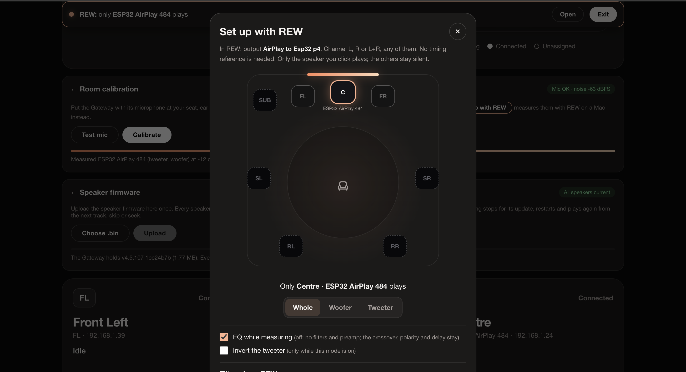
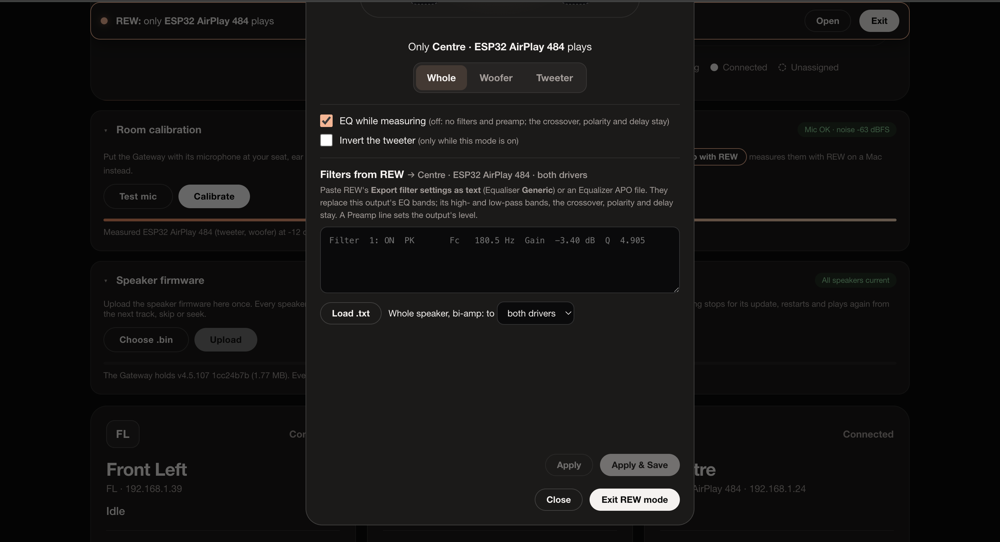

# Room calibration and Room EQ

[← Back to the README](../README.md)

## Room calibration

An optional **INMP441 microphone** on the Gateway (wiring in
[The Gateway](../README.md#the-gateway)), or on the ESP32-P4 board its own PDM
microphone (**Surround Build Role → Calibration microphone type**),
measures every speaker from your seat and
suggests its **delay** and **level**, in about 2 s per speaker:

1. Put the Gateway with its microphone at your listening seat, at ear
   height (a power bank will do). Keep the room quiet.
2. **Test mic** checks the microphone and shows the room noise; −60 dBFS
   or quieter is good. Music may keep playing meanwhile.
3. **Calibrate**: if the Apple TV is connected, it is disconnected for the
   measurement (the speakers can only chirp between streams); afterwards
   pick the Gateway again as its audio output. Each speaker in turn plays
   four short chirps (300 Hz–8 kHz, 20 ms; the subwoofer 30–150 Hz, 200 ms)
   through its own EQ, so a 2-way speaker's crossover protects the tweeter:
   at −30 dBFS first, then 6 dB louder (up to −12 dBFS) while the
   microphone does not hear them clearly, or a full-range speaker's level
   is not yet 10 dB above the room noise. You hear one to four rounds per
   speaker; the level they were played at is taken out, so a louder round
   does not make a speaker read louder.
4. The table shows every speaker's **distance**, suggested **delay** (the
   farthest gets 0 ms, the others 2.9 ms per metre they are closer) and
   **level** (the quietest gets 0 dB, the others are turned down to it).
   **Apply to speakers** saves them like a manual edit; **Discard** changes
   nothing. What was measured is applied; a speaker without a delay or a
   level keeps the one it has, and the message names it. Delays and levels
   compare speakers, so each needs at least two full-range speakers
   measured. A speaker left unchanged was set against another reference:
   measure again once it plays clearly.

| In the table | Meaning |
|---|---|
| **± cm** after a distance | how much the four chirps disagree; a few cm is normal |
| **± dB** after a level | the same for the level |
| *Level not repeatable (… dB over the chirps)* | the levels still differ by more than 2 dB at −12 dBFS, usually from room noise; measure again in quiet |
| *Too quiet for a level: … dB above the noise, 10 needed* | even at −12 dBFS the chirp is under 10 dB above the room noise; its delay is applied, its level stays. Turn its amplifier up or measure in quiet |
| *Not heard clearly* | the chirps did not stand out of the noise even at −12 dBFS, or fewer than three of the four agree on the travel time within 0.5 ms |
| *Clipped at … dBFS: move the microphone away from it* | the recording reached full scale, which makes the level read low; the run is not used and nothing louder is tried |
| *No sound at −12 dBFS: check its cable and amplifier* | at the loudest level the chirp's shape is not found and it is under 6 dB above the room noise: left unchanged |
| *No other level to compare with: level unchanged* | it is the only full-range speaker with a level |
| *Only … of 4 chirps placed in the recording* | the speaker's chirp times could not be placed on the recording (TSF or microphone timing); louder would not help, so it is not tried |
| *Hint: the chirp came back inverted* | + and − may be swapped (or a 2-way speaker's tweeter is wired so); only a hint, nothing is changed |
| *Subwoofer: level and delay by ear* | its low chirp gives a delay, but no level |

Two runs in a quiet room should agree within a few centimetres and about
0.5 dB; if they do not, measure again before applying.

How it measures:

- **Travel time without cables.** A speaker plays its chirps when it can
  and reports when each one left it, on the access point's TSF (its output
  latency included); the Gateway timestamps its recording on the same TSF.
  The difference is the sound's travel time.
- **The direct sound, not an echo.** The arrival is the first correlation
  peak within 12 dB of the strongest one: the direct sound always comes
  first, while a reflection off a wall can be louder.
- **One disturbed chirp is left out.** A chirp whose travel time is far
  from the others' (a door, a cough) does not count; three of the four
  must agree within 0.5 ms.
- **Level as the ear hears it:** the RMS of the chirp and the next 10 ms of
  the room (full-range speakers above 200 Hz), the median of the chirps,
  with the quiet room's noise in the same band taken out. It is used only
  10 dB or more above that noise.
- **Tested in a simulated room** (the real `gw_calib.c` on a computer, with
  noise, reflections, a 2-way crossover, a loose cable, a door slam and a
  clipping microphone): distances within 1 mm, trims within their 0.5 dB
  rounding, a reflection up to 12 dB louder than the direct sound ignored.
- **Every round is in the log** (`gw_calib`): level played, chirps found,
  travel time, level, dB above the noise, recording peak, match, and why
  the next round is louder or why it stops.

*No signal from the microphone: check its wiring* means the Gateway clocks
the microphone but reads a constant value: check VDD → 3V3, GND, L/R → GND
(otherwise it sends on the other channel), SD → GPIO 4, SCK → GPIO 5,
WS → GPIO 6 (GPIO 52 on the P4). Without a microphone signal the speakers still play their
chirps one after another (so you hear that each one works), and the panel
says nothing was measured.

<a href="../images/speakers-page-calibration-5.png"></a>

*A run with the microphone: five speakers of a 5.1 setup measured, their
distances, delays and levels ready to apply.* Without a microphone signal:

<a href="../images/speakers-page-calibration.png"></a>

## Room EQ

**Room EQ** (`/roomeq` on the Gateway, the button on the speakers page)
uses the same microphone to measure each speaker's **frequency response**
and correct it with the speaker's EQ. It works as
[REW](https://www.roomeqwizard.com) does: the same measurement, the same
smoothing, the same kind of target and filters.

It is one page that scrolls down through six steps; the bar of steps stays
at the top to jump between them.

### 1. Speaker

Choose the speaker in the menu (each shows its role, name and how many
measurements this browser keeps of it). Below it: whether it is bi-amp or a
subwoofer. Choose the **microphone
position** (1 is the main seat; measure two or three positions 40–60 cm
apart, they are averaged). A **bi-amp** speaker can be measured:

- **Each driver**: the tweeter, then the woofer, the other output silent;
- **Both together**: as it plays, through its crossover;
- **All three**: each driver and both together, in one run.

### 2. Settings

The settings of REW's measurement dialog:

| Setting | |
|---|---|
| **Start / End (Hz)** | the range to measure; the sweep runs from half the start to twice the end, as REW's (10 Hz – 21 kHz at most). A subwoofer starts at 15–300 Hz. |
| **Length** | 128k (2.7 s), **256k** (5.5 s, REW's default) or 512k (10.9 s) samples. Each doubling gives almost 3 dB less noise. |
| **Level (dBFS RMS)** | the sweep's RMS level, as REW states it (its peak is 3 dB higher); −18 dBFS by default. |
| **Repetitions** | 1, 2 or 4 sweeps, averaged as REW does (almost 3 dB less noise per doubling; one longer sweep is better than more of them). |
| **Speaker's limit** | the loudest this speaker may play, kept on the Gateway (−12 dBFS RMS until set). Neither a sweep nor the noise of Check levels is ever louder. |

**Check levels** first plays 3 s of pink noise at the level set, as REW
does. It shows the microphone's RMS level against REW's range (−30 to
−12 dBFS), the headroom to full scale (red under 6 dB), how far it is above
the room noise and, with an INMP441, an approximate SPL (REW aims at about
75 dB SPL at the seat). A measurement that clips stops with an error.

**Export for REW** saves the last measurement's impulse responses as WAV
files; REW opens them with **File → Import → Import impulse response**, to
compare its own analysis with this one.

### 3. Measurement

The graph as REW draws it: a log frequency scale with every line and
labels where they fit, dB on the left. Move over it for the frequency and
every curve's value; drag across it to zoom in, double-click (or tap twice)
for the whole range. **Smoothing** as REW's: **Var** by default (1/48 octave
below 100 Hz, 1/6 at 1 kHz, 1/3 above 10 kHz), Psy, ERB, 1/1 to 1/48
octave or none. **Window**: the room (500 ms, as REW) or the direct sound
(FDW). The tick boxes beside it choose what is shown and what the
correction uses. Measurements with the speaker's EQ on are dashed. The
measurements are kept in this browser only.

### 4. EQ

The correction is calculated as REW's EQ does, on the room's response
(500 ms) with Var smoothing; **Direct sound above 500 Hz** uses the
speaker's own sound up there instead.

- **Target type**, as REW's: **Full range** (an LF cutoff and slope; 0 for
  flat), **Bass limited** (the bass management high-pass, 80 Hz at
  12 dB/octave) or **Subwoofer** (20 Hz at 24 dB/octave, chosen by itself
  for the subwoofer), with REW's room curve on top (**HF fall**, **LF
  rise**). A bi-amp driver's target goes through its own crossover.
- **Target level**: by default the speaker's own level, as REW sets it;
  drag the dashed target line up or down on the graph, or type a level.
- **Filters**, as REW's filter tasks: individual and overall max boost,
  flatness target, narrow filters below 200 Hz, vary max Q above 200 Hz,
  low and high shelf, match range. Filters go where the curve is furthest
  from the target first, then their gain, Q and frequency are optimised;
  one under half the flatness target is dropped.
- The filters are a table as REW shows them (#, type, Fc, gain, Q). A
  ticked **Lock** keeps a filter as it is when you calculate again; the
  others fit around it. Each driver shows its expected deviation from the
  target.
- A bi-amp speaker is corrected **driver by driver** or as a **whole
  speaker** (the measurement of both together; the same filters on both
  outputs, ahead of the crossover).
- **Apply** sends the filters now, **Apply & Save** also keeps them after a
  restart. They replace the EQ bands and levels of the outputs; the high-
  and low-pass bands, crossover, polarity and delay stay.

### 5. Alignment (bi-amp)

**Measure for alignment** measures the woofer, the tweeter and both
together in one run, as the speaker plays now. Both drivers are placed on
one time base, each sweep from the time the speaker played it to a
fraction of a sample (it repeats within about ±5 µs from one microphone
position). The page tries every delay of the earlier driver from 0 to 2 ms
(0.01 ms steps) and both polarities of the tweeter, and keeps the sum
closest to both drivers in phase from half to twice the crossover
frequency. It shows both drivers, the sum now, the sum with the proposal and
the sum measured together, how much the sum loses at the crossover (for
example 19.9 dB → 0.1 dB), and the new delay and polarity of each output.
When the best polarity is not the usual one for the slope (LR2 inverted,
LR4 and LR8 not), a driver is probably wired the other way round. Nothing
changes until **Apply** or **Apply & Save**, which set only the delays and
the polarity.

### 6. Check

After **Apply & Save** the speaker is measured again with its new EQ, at
the same position and settings (a bi-amp speaker in one run, each driver
and both together), or later with **Measure the check**. The graph draws the
curve before, the target, the expected curve and the measured one. For each
driver: how far the measurement is from the target, and how far from what
was expected. More than 1 dB from the expected curve gives a warning: the
microphone moved, the room was noisier, or a setting changed. Afterwards
run **Calibrate** on the speakers page, as the correction changes the
speaker's level.

<a href="../images/roomeq-page.png"></a>

## Set up with REW

**Set up with REW** on the speakers page (next to the room map and next to
Room EQ) lets [REW](https://www.roomeqwizard.com) on a Mac measure the
speakers the usual way, through AirPlay to the Gateway, with your own
measurement microphone (a UMIK-1, for example). Only the speaker or driver
you click plays, and the filters REW makes for it go straight to that
speaker.

<a href="../images/rew-window.png"></a>

*The window over the speakers page: only the centre speaker (bi-amp) plays.
The bar at the top stays while the mode is on, also with the window closed.*

### What the window has

| Part | What it does |
|---|---|
| **The bar** *REW: only … plays* | at the top of `/speakers` and `/roomeq` while the mode is on: which speaker plays, which driver, EQ off or the tweeter flipped. **Open** brings the window back, **Exit** ends the mode. |
| **Hint** | the output to choose in REW: *AirPlay to* the Gateway's name |
| **Room map** | the same map as on the speakers page. Click a speaker: only it plays, lit, the others grey and silent (still in the stream and in sync). Click another: the mode moves to it at once. Click the lit one again: none plays. A mono-mix speaker is a button under the map. |
| **Whole / Woofer / Tweeter** | a bi-amp speaker only: both drivers through the crossover, or one of them, the other output silent |
| **EQ while measuring** | on: the speaker as it plays, with its EQ bands and levels. Off: without them, for a measurement to make new filters from. The crossover, polarity and delay always stay. |
| **Invert the tweeter** | a bi-amp speaker only: flips the tweeter while the mode is on, nothing saved. With both drivers playing it shows the dip at the crossover, which helps to find their delay with REW's RTA. |
| **Filters from REW** | REW's filters for the marked speaker or driver (below) |
| **Warnings** | a 5.1 or 7.1 stream (the speaker plays its own channel, not L+R), and clipping: samples above full scale, with the peak |
| **Close / Exit REW mode** | Close only hides the window, the mode stays on; Exit ends it |

### REW settings

- **macOS:** make the Gateway the sound output (Control Centre → Sound, or
  System Settings → Sound → Output), as for any AirPlay speaker. Keep the
  Mac's volume where it is during a measurement: it scales the level after
  the speaker's EQ.
- **REW → Preferences → Soundcard:** the output is the Gateway (or the
  default output, now the Gateway); the input is your measurement
  microphone, with its calibration file in **Preferences → Cal files**.
- **Channel:** L, R or L+R, any of them. Every speaker plays the stereo
  source as L+R, not halved, so L+R is 6 dB louder than one channel.
- **Level:** REW's usual sweep level is fine. If the window warns about
  clipping, turn the level down in REW or on the Mac.
- **Timing reference:** none needed. AirPlay delays the sound as it does
  with any AirPlay speaker, and REW finds the sweep in its recording.
- **EQ in REW:** **Equaliser: Generic**, peaking filters and shelves at
  their default slope, at most 24 for an output. Then **Export filter
  settings as text** and paste it in the window.

### Steps

1. In REW set the output and the microphone as above.
2. Open **Set up with REW** and click a speaker on the room map: only it
   plays, the others stay silent but in sync. Click another and the mode
   moves to it; click the marked one again and none plays. A bi-amp speaker
   gets **Whole / Woofer / Tweeter**.
3. Turn **EQ while measuring** off to measure the speaker for new
   filters, or leave it on to check the result. **Invert the tweeter**
   flips it only while the mode is on, to hear or measure the dip at the
   crossover.
4. Make the filters in REW and import them (below).
5. Closing the window keeps the mode on, so REW can measure with the window
   behind it. **Exit**, on the window or on the bar at the top of
   `/speakers` and `/roomeq`, ends it; so do 15 minutes without an action,
   a Gateway restart, and the web radio or the USB player starting.
   Nothing of the mode is saved: roles, EQ, polarity, loudness and LFE gain
   come back as they were.

A 5.1 or 7.1 stream plays each speaker's own channel, not L+R: play stereo
from REW. Calibration and Room EQ do not start while the mode is on.

A good order for a bi-amp speaker: the EQ of each driver (Woofer, then
Tweeter), then their delay and polarity (Room EQ's [Alignment](#5-alignment-bi-amp)
step, or by ear with **Invert the tweeter** and REW's RTA), then **Calibrate** on the speakers
page for level and delay against the other speakers.

### Filters from REW

<a href="../images/rew-filters.png"></a>

*The import for the centre speaker: paste REW's text or load its file,
choose where the filters go, check them, then Apply.*

REW's filters then go to the marked speaker from the same window:

- In REW's EQ window choose **Equaliser: Generic**, then **Export filter
  settings as text**. An Equalizer APO file (`Preamp:` and `Filter:`
  lines) works too.
- Paste the text or load the `.txt` file. The window shows the filters as
  REW wrote them, what the speaker will compute, and their curve, before
  anything is applied.
- The filters go to the marked speaker's EQ:
  - a **bi-amp** speaker: to the driver chosen in the window. With
    **Whole** (both drivers play through the crossover) you choose under
    the text: **both drivers** (the same filters on both outputs, ahead of
    the crossover, so they correct the whole speaker), the woofer or the
    tweeter;
  - a speaker with one full-range output pair: to both outputs.
- **Apply** plays them now and **Apply & Save** also keeps them, as in
  Room EQ. They replace that output's EQ bands; its high- and low-pass
  bands, the crossover, polarity and delay stay. A `Preamp` line sets the
  output's level (−24 to 0 dB); without one the level stays.
- After Apply, **EQ while measuring** is switched on, so the next REW
  measurement shows the result.

Which filters work (checked with REW 5.31.3: a measurement with the
imported filters on matches REW's prediction within 0.5 dB):

| REW / Equalizer APO | On the speaker |
|---|---|
| `PK`, `Modal`, `PEQ` (Q or BW Oct) | peaking filter. REW's Q is converted to the speaker's: same curve. |
| `LP`, `HP`, `LPQ`, `HPQ` | low- and high-pass, 12 dB/octave |
| `NO`, `BP` (with Q) | notch, band-pass |
| `LS`, `HS`, `LSC`/`HSC` at 12 dB/octave or Q 0.707, `LS 12dB`, `HS 12dB` | low and high shelf, 12 dB/octave |
| other shelves (6 dB/octave, another Q), `AP`, `IIR` and the rest | not supported: an error on that line |

An output takes 24 bands at most, the high- and low-pass bands it keeps
included. In REW, **Generic** with peaking filters (and shelves at their
default slope) is what fits.


## Measuring sync

1. Enable **Surround Build Role → Sync test pulse** on the Gateway and on two
   speakers (GPIO 9 by default). Each board raises the pin for 10 ms at every
   whole second of the Apple TV's clock, as it sees it, and logs
   `PULSE … interrupt late avg … max …`.
2. Put the three pins on an oscilloscope, trigger on the Gateway, play
   anything. Gateway → speaker is a speaker's clock error; speaker →
   speaker is the difference the listener would hear before playback adds
   its own.
3. For the full chain give both speakers the role **Mono mix**, play a click
   track and compare the two DAC outputs:

   ```bash
   ffmpeg -f lavfi -i "aevalsrc='if(lt(mod(t,1),0.001),0.8*sin(2*PI*4000*t),0)':s=48000" -t 600 -ac 2 -c:a aac -b:a 256k clicks.m4a
   ```
