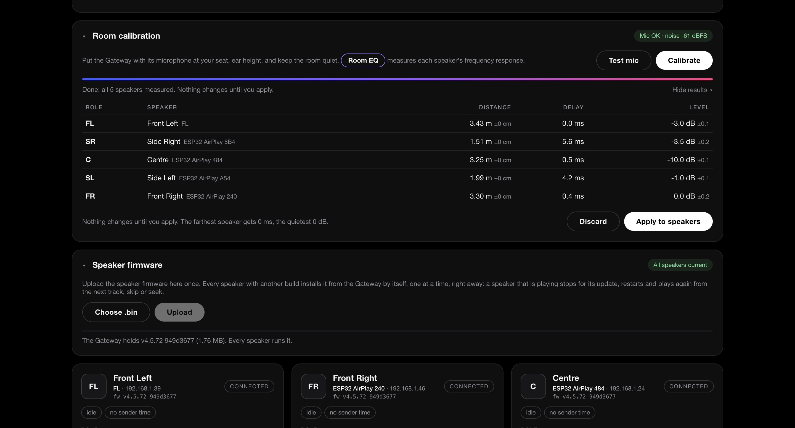
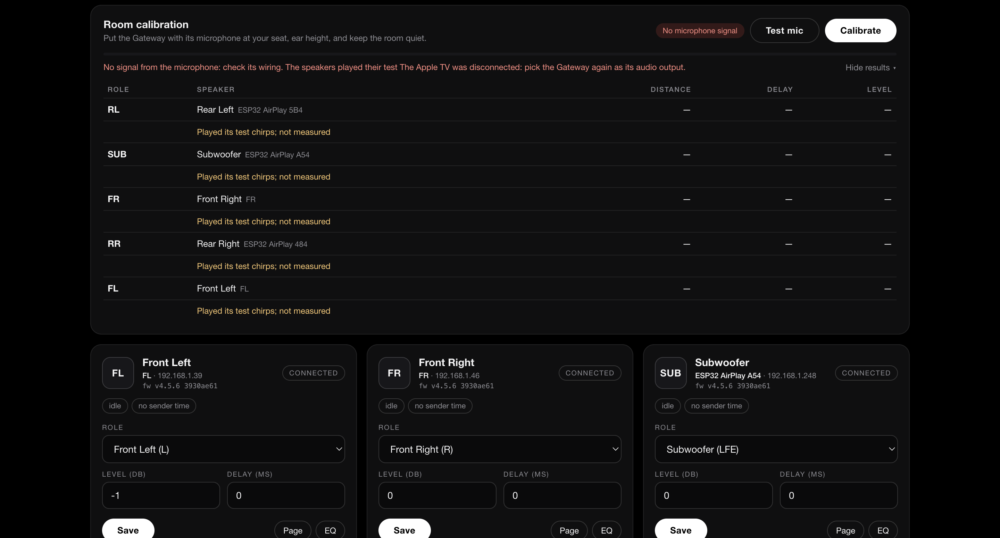
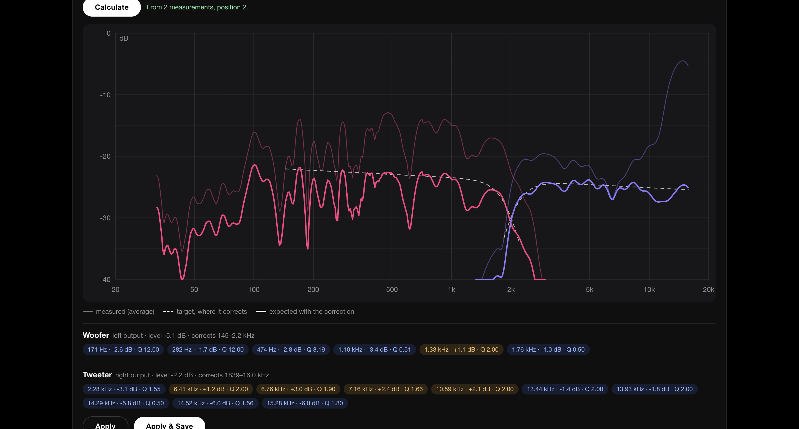

# Room calibration and Room EQ

[← Back to the README](../README.md)

## Room calibration

An optional **INMP441 microphone** on the Gateway (wiring in
[The Gateway](../README.md#the-gateway)), or on the ESP32-P4 board its own PDM
microphone (**Surround Build Role → Calibration microphone type**),
measures every speaker from your seat and
suggests its **delay** and **level**, in about 2 s per speaker:

1. Put the Gateway with its microphone at your listening seat, at ear
   height (a power bank will do). Keep the room quiet.
2. **Test mic** checks the microphone and shows the room noise; −60 dBFS
   or quieter is good. Music may keep playing meanwhile.
3. **Calibrate**: if the Apple TV is connected, it is disconnected for the
   measurement (the speakers can only chirp between streams); afterwards
   pick the Gateway again as its audio output. Each speaker in turn plays
   four short chirps (300 Hz–8 kHz, 20 ms; the subwoofer 30–150 Hz, 200 ms)
   through its own EQ, so a 2-way speaker's crossover protects the tweeter:
   at −30 dBFS first, then 6 dB louder (up to −12 dBFS) while the
   microphone does not hear them clearly, or a full-range speaker's level
   is not yet 10 dB above the room noise. You hear one to four rounds per
   speaker; the level they were played at is taken out, so a louder round
   does not make a speaker read louder.
4. The table shows every speaker's **distance**, suggested **delay** (the
   farthest gets 0 ms, the others 2.9 ms per metre they are closer) and
   **level** (the quietest gets 0 dB, the others are turned down to it).
   **Apply to speakers** saves them like a manual edit; **Discard** changes
   nothing. What was measured is applied; a speaker without a delay or a
   level keeps the one it has, and the message names it. Delays and levels
   compare speakers, so each needs at least two full-range speakers
   measured. A speaker left unchanged was set against another reference:
   measure again once it plays clearly.

| In the table | Meaning |
|---|---|
| **± cm** after a distance | how much the four chirps disagree; a few cm is normal |
| **± dB** after a level | the same for the level |
| *Level not repeatable (… dB over the chirps)* | the levels still differ by more than 2 dB at −12 dBFS, usually from room noise; measure again in quiet |
| *Too quiet for a level: … dB above the noise, 10 needed* | even at −12 dBFS the chirp is under 10 dB above the room noise; its delay is applied, its level stays. Turn its amplifier up or measure in quiet |
| *Not heard clearly* | the chirps did not stand out of the noise even at −12 dBFS, or fewer than three of the four agree on the travel time within 0.5 ms |
| *Clipped at … dBFS: move the microphone away from it* | the recording reached full scale, which makes the level read low; the run is not used and nothing louder is tried |
| *No sound at −12 dBFS: check its cable and amplifier* | at the loudest level the chirp's shape is not found and it is under 6 dB above the room noise: left unchanged |
| *No other level to compare with: level unchanged* | it is the only full-range speaker with a level |
| *Only … of 4 chirps placed in the recording* | the speaker's chirp times could not be placed on the recording (TSF or microphone timing); louder would not help, so it is not tried |
| *Hint: the chirp came back inverted* | + and − may be swapped (or a 2-way speaker's tweeter is wired so); only a hint, nothing is changed |
| *Subwoofer: level and delay by ear* | its low chirp gives a delay, but no level |

Two runs in a quiet room should agree within a few centimetres and about
0.5 dB; if they do not, measure again before applying.

How it measures:

- **Travel time without cables.** A speaker plays its chirps when it can
  and reports when each one left it, on the access point's TSF (its output
  latency included); the Gateway timestamps its recording on the same TSF.
  The difference is the sound's travel time.
- **The direct sound, not an echo.** The arrival is the first correlation
  peak within 12 dB of the strongest one: the direct sound always comes
  first, while a reflection off a wall can be louder.
- **One disturbed chirp is left out.** A chirp whose travel time is far
  from the others' (a door, a cough) does not count; three of the four
  must agree within 0.5 ms.
- **Level as the ear hears it:** the RMS of the chirp and the next 10 ms of
  the room (full-range speakers above 200 Hz), the median of the chirps,
  with the quiet room's noise in the same band taken out. It is used only
  10 dB or more above that noise.
- **Tested in a simulated room** (the real `gw_calib.c` on a computer, with
  noise, reflections, a 2-way crossover, a loose cable, a door slam and a
  clipping microphone): distances within 1 mm, trims within their 0.5 dB
  rounding, a reflection up to 12 dB louder than the direct sound ignored.
- **Every round is in the log** (`gw_calib`): level played, chirps found,
  travel time, level, dB above the noise, recording peak, match, and why
  the next round is louder or why it stops.

*No signal from the microphone: check its wiring* means the Gateway clocks
the microphone but reads a constant value: check VDD → 3V3, GND, L/R → GND
(otherwise it sends on the other channel), SD → GPIO 4, SCK → GPIO 5,
WS → GPIO 6 (GPIO 52 on the P4). Without a microphone signal the speakers still play their
chirps one after another (so you hear that each one works), and the panel
says nothing was measured.

<a href="../images/speakers-page-calibration-5.png"></a>

*A run with the microphone: five speakers of a 5.1 setup measured, their
distances, delays and levels ready to apply.* Without a microphone signal:

<a href="../images/speakers-page-calibration.png"></a>

## Room EQ

**Room EQ** (`/roomeq` on the Gateway, the button on the speakers page)
uses the same microphone to measure one speaker's **frequency response**
and correct it with the speaker's EQ:

- The speaker plays a 2.5 s sweep (30 Hz–21 kHz, the subwoofer
  15–400 Hz), at −30 dBFS first and louder until it is clear of the room
  noise. Several microphone positions are averaged.
- The browser computes the response: below 500 Hz the room as you hear it
  at the seat, above it mostly the speaker's own sound.
- It fits **peaking filters** to a target line, the way REW's EQ does:
  - **Target level** places the line (dB on the chart's scale, at 1 kHz).
    By default it is the speaker's own level between 200 Hz and 2 kHz,
    smoothed over one octave; type another value to move it. It is kept
    for each speaker in the browser.
  - Everything **above** the line is cut down to it.
  - **Below** it, a dip no deeper than **Individual max boost** is raised
    towards the line, and a deeper one is left as it is. **Overall max
    boost** limits all filters together (+3 dB by default): with
    a high individual and a low overall limit, deeper dips are raised
    partly. A narrow dip is never raised.
  - **Flatness target** (±1 to ±6 dB) sets how close it goes; a wider
    one gives fewer, broader filters.
  - **Match range** limits where filters may go; inside it, it corrects
    from where the curve first reaches the line to where it last does, so a
    speaker's own roll-off is never boosted; at most up to the
    microphone's limit (16 kHz for the INMP441), a subwoofer up to 300 Hz.
  - **Allow low shelf** / **Allow high shelf** (off by default) add a shelf
    at that end of the range when the curve stays above or below the line
    for at least half an octave there, as REW does.
  - How narrow a filter may be is set as in REW: **Allow narrow filters
    below 200 Hz** allows Q up to 10 there, Q 5 above; **Vary max Q above
    200 Hz** lets it fall from 10 at 200 Hz to 3 at 10 kHz instead. Without
    narrow filters Q is 5 at most. It may use all 24 bands of an output,
    but for the high- and low-pass bands it keeps (a bi-amp crossover is
    apart from them). Above 500 Hz it works on the speaker's own sound (a
    frequency-dependent window), not on the room's reflections there.
  - With a **bi-amp** speaker each driver (woofer, tweeter) gets its own
    filters through its crossover, and the tweeter's level is matched to
    the woofer's, raised by at most the overall max boost.
- The chart shows the measurement, the target and the expected result.
  **Apply** sends the filters to the speaker now, **Apply & Save** also
  keeps them after a restart. They replace the EQ bands and levels of its
  outputs; the high- and low-pass bands, crossover, polarity and delay
  stay as they are.
- After **Apply & Save** it offers a check: the speaker is measured again
  with its new EQ, at the same microphone position, and that curve is drawn
  over the one before, without calculating anything again. A bi-amp
  speaker is checked driver by driver and then with both together, which
  shows a dip or a peak at the crossover. Afterwards run
  **Calibrate** on the speakers page, as the correction changes the
  speaker's level.

<a href="../images/roomeq-page.png"></a>

## Measuring sync

1. Enable **Surround Build Role → Sync test pulse** on the Gateway and on two
   speakers (GPIO 9 by default). Each board raises the pin for 10 ms at every
   whole second of the Apple TV's clock, as it sees it, and logs
   `PULSE … interrupt late avg … max …`.
2. Put the three pins on an oscilloscope, trigger on the Gateway, play
   anything. Gateway → speaker is a speaker's clock error; speaker →
   speaker is the difference the listener would hear before playback adds
   its own.
3. For the full chain give both speakers the role **Mono mix**, play a click
   track and compare the two DAC outputs:

   ```bash
   ffmpeg -f lavfi -i "aevalsrc='if(lt(mod(t,1),0.001),0.8*sin(2*PI*4000*t),0)':s=48000" -t 600 -ac 2 -c:a aac -b:a 256k clicks.m4a
   ```
