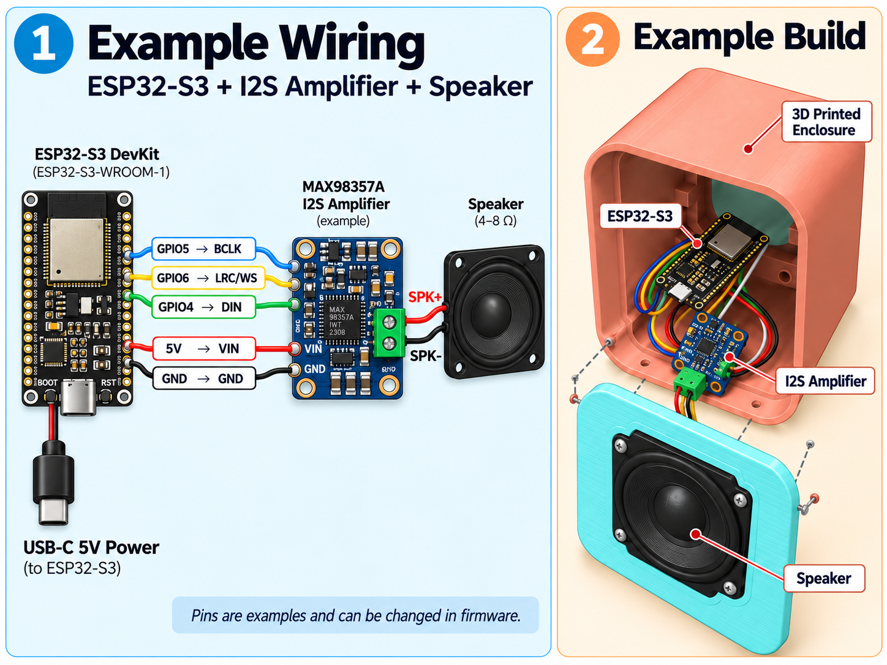
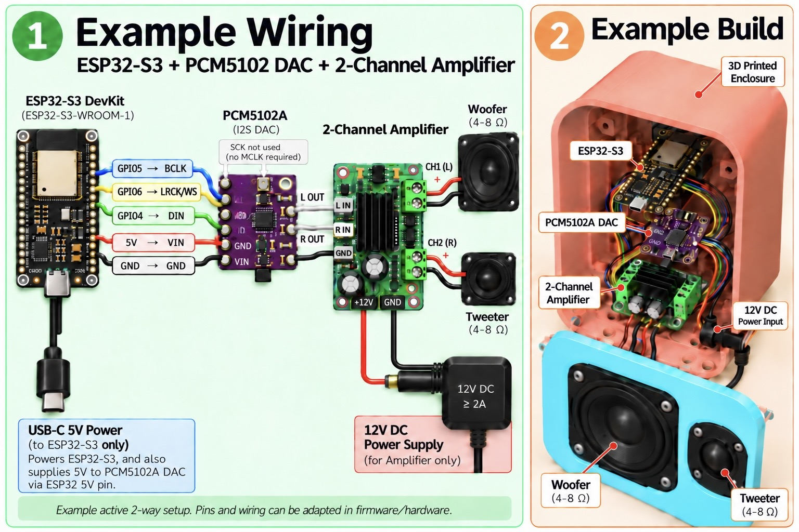

# Assembly and wiring

[← Back to the README](../README.md)

The Gateway needs no wiring (only the optional calibration microphone, see
[What you need](../README.md#the-gateway)). Everything below is for the speakers.

> [!NOTE]
> The GPIOs below are the defaults and can be changed in `menuconfig`
> (see [Installation](install.md#installation)). Wiring options may be extended in
> future versions; this section will be updated.

## Option A — I2S amplifier (MAX98357A)

| ESP32-S3 | MAX98357A |
|---|---|
| GPIO 5 | BCLK |
| GPIO 6 | LRC (WS) |
| GPIO 4 | DIN |
| 5V | VIN |
| GND | GND |

- Speaker to **SPK+ / SPK−** (4–8 Ω).
- Leave **SD** and **GAIN** unconnected (default: (L+R)/2 output, 9 dB gain).
  Because both I2S slots carry the same channel, the result is that channel
  at full level.
- At full volume the amplifier draws up to ~1 A from 5 V: use a good USB
  supply and short power wires.

 

## Option B — DAC + any amplifier

| ESP32-S3 | PCM5102A |
|---|---|
| GPIO 5 | BCK |
| GPIO 6 | LCK (LRCK / WS) |
| GPIO 4 | DIN |
| 5V | VIN |
| GND | GND |
| — | SCK: not used (connect to GND, or close the module's SCK bridge) |

On the common purple PCM5102A module check the solder jumpers on the back:
**FLT = L, DEMP = L, XSMT = H** (otherwise the DAC stays muted), **FMT = L**
(I2S).

The DAC's **L OUT** and **R OUT** carry the same speaker channel, which lets
you use **any amplifier, small or powerful, one- or two-channel**:

| Amplifier | Connection | Setup on the speaker's EQ page |
|---|---|---|
| **One channel** (mono amp, a single side of a stereo amp, a subwoofer plate amp) | L OUT → amp input | nothing; a subwoofer's low-pass is its **Crossover** on the Gateway's speakers page |
| **Two channels, one full-range speaker** | L OUT → amp, use one channel | nothing |
| **Two channels, active 2-way (woofer + tweeter)** | L OUT → CH1 → **woofer**, R OUT → CH2 → **tweeter** | **Bi-amp** mode, with its crossover |
| **Powered speaker / active subwoofer** | L/R OUT → its line input | nothing |

**Active 2-way speaker** (bi-amp):

1. Open `http://<speaker-ip>/eq` and tick **Enable EQ and preamp**.
2. Switch the output mode to **Bi-amp** and choose which output drives the
   tweeter (the other one drives the woofer).
3. Set the **crossover**: frequency 800–8000 Hz (2500 Hz by default) and
   slope **LR2**, **LR4** (24 dB/oct, the default) or **LR8**
   (48 dB/oct). The tweeter's output stays silent whenever its high-pass
   cannot run.
4. Per output: a **level** (tweeters are usually louder: turn it down until
   both drivers sound balanced), a **Delay** of up to 2 ms and **Invert
   polarity**, to make the two drivers add up at the crossover; then up to
   24 bands each to correct the driver, or let [Room EQ](calibration.md#room-eq) do it.
5. **Apply & Save**: the change is live and stored, no restart needed. A
   change of layout fades out and back in (about 25 ms).

> [!WARNING]
> Always set the tweeter's high-pass **before** playing loud. Full-range
> bass destroys a tweeter in seconds. The per-output **Mute** buttons on the
> EQ page help while setting up.

**Power:** the ESP32-S3 and the DAC run from USB 5 V; a larger amplifier gets
its own supply (e.g. 12 V ≥ 2 A). Connect the grounds of the DAC and the
amplifier (the signal ground), and keep the amplifier's power wires away
from the I2S wires.

 

## Optional extras (speakers)

| Function | Default GPIO | Notes |
|---|---|---|
| Amplifier enable / standby | 21 | switches the amplifier on while audio plays; active high or low |
| WS2812 RGB VU LED | 38 | the on-board LED of many DevKitC boards |
| Wired latency measurement (ADC loopback) | 7 | DAC output → coupling capacitor + bias divider → ADC pin |
| Sync test pulse (also on the Gateway) | 9 | for an oscilloscope, see [Measuring sync](calibration.md#measuring-sync) |
