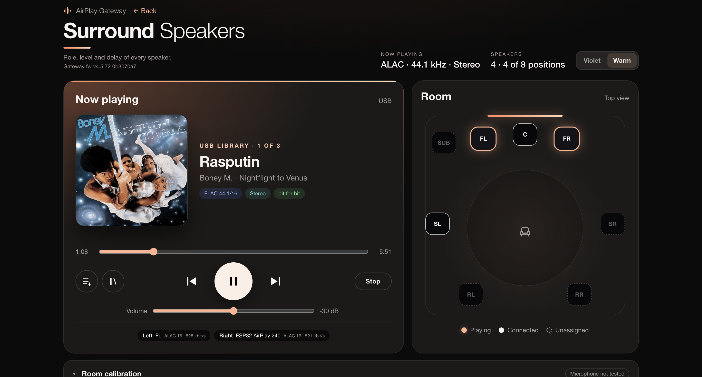
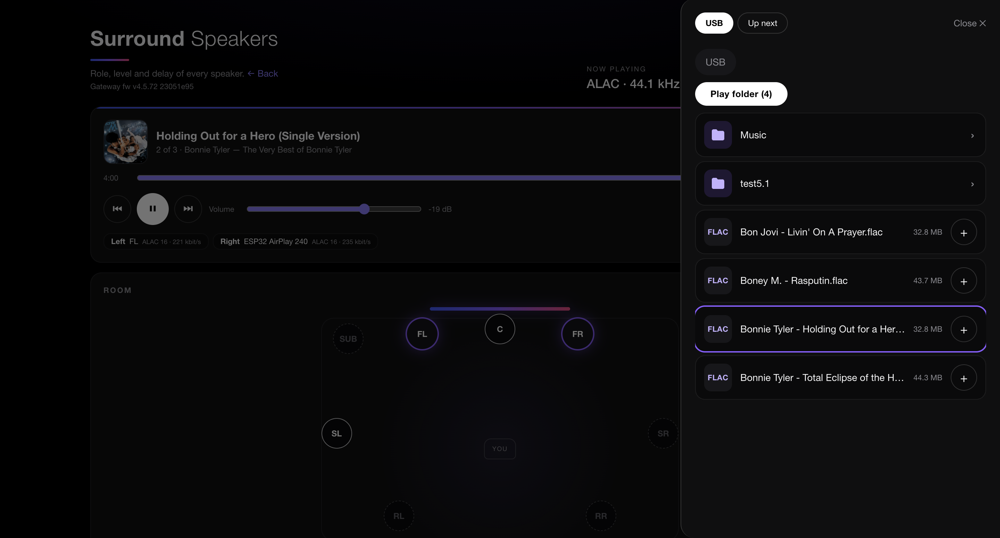

# USB player (experimental)

[← Back to the README](../README.md)

<table>
  <tr>
    <td width="50%"></td>
    <td width="50%"></td>
  </tr>
</table>

**Plug in a USB stick, open the page, press play.** No phone, no app, no
streaming service: the Gateway itself becomes a music player for the whole
surround system.

And it does not cut corners. A FLAC or WAV reaches every speaker **bit for
bit**, exactly as it is in the file: not squeezed into AAC on the way, as
many AirPlay streams are, and not mixed down. Every speaker gets **only its own channel**, so a 5.1
or 7.1 music file or film soundtrack plays the way it was mixed: centre in
the centre, surrounds around you, each from its own speaker. A stereo album
plays on the front pair with the subwoofer underneath, like on an AV
receiver.

**What you get**

- 🎵 **Lossless and then some:** FLAC, WAV and ALAC bit for bit, AAC and
  MP3 too. Hi-res files up to 192 kHz play as well (brought down to
  48 kHz / 24-bit, which the speakers play).
- 🖼️ **Covers and tags:** the album art, title, artist and album, from the
  file itself or a `cover.jpg` / `folder.jpg` next to it. Names in
  Cyrillic and any other script. The ESP32-P4 also makes small thumbnails
  of large covers and keeps them on the stick, so they show at once.
- 🔁 **Albums without gaps:** live albums and DJ mixes flow from track to
  track without a click or a pause.
- 📂 **A library on the page:** browse the stick's folders, play a whole
  folder, start from any song, add songs to the queue, see what comes next,
  or play your **m3u playlists**.
- ⏯️ **All the controls:** seek, pause, next, previous and volume (shared
  with the web radio and kept over a restart), from the page or the
  hardware buttons on the Gateway.
- 📊 **You see what plays where:** the format, a *bit for bit* badge, which
  speaker gets which channel, and the room map lighting up.
- 🔌 **Plug and play:** put the stick in and pull it out while the Gateway
  runs. AirPlay and the web radio still work as before; whoever starts
  playing takes the speakers.

**Which files**

| Plays | |
|---|---|
| FLAC, WAV, ALAC (`.m4a`) | lossless, bit for bit, 16 / 24-bit |
| AAC (`.m4a`, `.aac`), MP3 | including VBR and gapless albums |
| m3u / m3u8 playlists | from the stick or a web server |
| Mono, stereo, 5.1, 7.1 | 44.1 / 48 kHz, and hi-res 88.2 / 96 / 176.4 / 192 kHz |

Not played: 32-bit and floating-point WAV, Ogg, Opus, WMA and DSD. A file
the player cannot play just shows a message, and the next song starts.

**Which USB stick**

- **Any small USB 2.0 stick** is enough. On an **ESP32-S3** Gateway a USB 3
  stick works too but is not faster: the S3's USB port runs at USB 1.1
  speed (about 1 MB/s). The **ESP32-P4** has a high-speed USB 2.0 port.
- Format it **FAT32** with a **Master Boot Record** (on a Mac: Disk Utility →
  *MS-DOS (FAT)*, scheme *Master Boot Record*). exFAT, NTFS and APFS are
  not read.
- It is powered by the Gateway board, so pick one that draws little power;
  a hard disk needs a powered USB hub.
- **On an ESP32-S3, prefer FLAC to WAV.** FLAC is the same sound, bit for
  bit, at half the size. Stereo WAV plays fine, but a 5.1 / 7.1 WAV is too
  heavy for the S3's port and stops every few seconds to catch up (the
  player warns when it starts such a file). One command turns it into
  FLAC: `ffmpeg -i film.wav -c:a flac film.flac`.
- **7.1 at 24-bit is the S3's limit.** Eight channels of a dense film mix
  at 24-bit take more than the ESP32-S3 has to decode them and send every
  speaker its channel, so it stops now and then to catch up (5.1 at 24-bit
  plays fine). As a 16-bit FLAC the same 7.1 file plays without a stop:
  `ffmpeg -i film.wav -af aresample=osf=s16:dither_method=triangular -c:a flac film.flac`.
  The ESP32-P4 has a faster CPU and port for such files.
- On the ESP32-P4 the player writes cover thumbnails to the stick, in the
  folder `.airplay-covers-v1` (up to 128 of them); delete it any time.

The player can also play files from a web server on your network, through
the Gateway's `/api/player` (play, pause, seek, next, previous, queue,
volume, stop).

## Build

The player is **on by default** in both firmwares: a plain `idf.py build`
gives a Gateway with the player and the USB drive, and speakers that take
its streams. On an **ESP32-S3** the drive takes the Gateway's **native USB
port** (GPIO19/20), so the Gateway's **console, logs and flashing are on
its UART port** (UART0, GPIO43/44, 115200 baud; on a DevKitC the connector
marked *UART* or *COM*), or OTA from its page. The **ESP32-P4** has a
separate high-speed USB port for the drive. The speakers keep their USB
port as before.

To build a Gateway without the player (and with the console back on the
native USB port), turn off **USB Player (experimental) → Gateway player** in
`idf.py menuconfig`, and set **Component config → ESP System Settings →
Channel for console output** to **USB Serial/JTAG** (S3). The S3 Gateway
image with the player is about 2.1 MB and fits the 8 MB table (the P4's is
about 3.4 MB in a 6 MB slot); the speaker image with player streams still
fits the Gateway's copy of it.

> [!NOTE]
> An existing `sdkconfig` keeps the choices it already has: after an update
> from an older version, delete `sdkconfig` (or set the options above in
> `menuconfig`) to get the new defaults.
