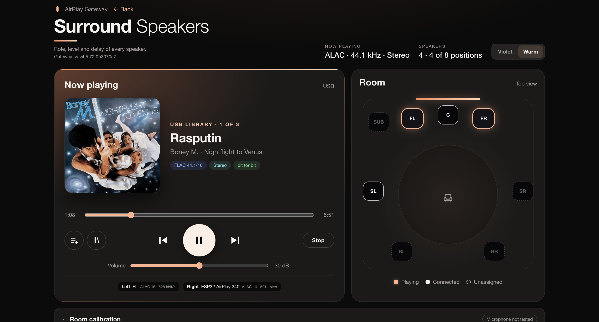
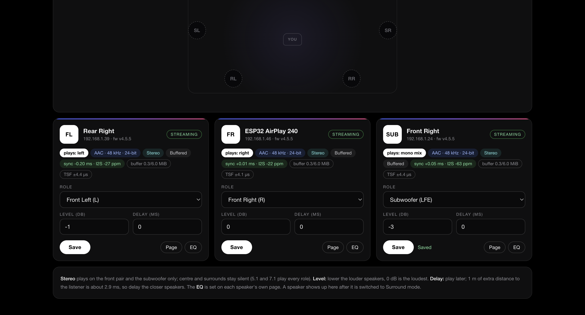

# Settings

[← Back to the README](../README.md)

Everything is configured in the browser. Every page comes in two colour
themes, **Warm** (the default) and **Violet**: the switch on the main page
and on the speakers page changes them, and the browser remembers the
choice.

## Gateway: main page (`http://<gateway-ip>/`)

| Card | What it does |
|---|---|
| **Surround Speakers** | opens the speakers page below |
| **Playback** | play/pause, next, previous and volume of the current AirPlay sender |
| **WiFi Network** | scan and change the network |
| **Device Settings** | the AirPlay name the Apple TV shows |
| **Firmware Update** | OTA update with a `.bin` file |
| **System** | IP, MAC, memory, firmware, uptime, reset reason, Wi-Fi signal and channel; restart |
| **System Logs / WiFi Speedtest** | links to the pages below |

The Gateway has no audio output, so it has no EQ or latency cards.

## Gateway: speakers page (`/speakers`)

At the top, **Now playing**: what the speakers play and where it comes
from. An AirPlay stream shows its format (and on an ESP32-P4 Gateway its
artwork), with play/pause,
skip and volume buttons that go to the Apple device; the **Music** and
**Radio** buttons
start the [USB player](usb-player.md#usb-player-experimental) or the web radio, which
then fill the card. Beside it, a **room map** seen from above: the screen at
the top, you in the middle and all eight positions around you. An empty
position is dashed, a position with a speaker is outlined, and a speaker
that is playing glows. Two speakers on the same position are marked orange.
Click a position to jump to its speaker. Above both: what is playing now
(`AAC · 48 kHz · Stereo`), how many positions are taken and the colour
switch.

Below it, one tile per connected speaker, side by side:

| Field | What it does |
|---|---|
| **Role** | which channel it plays: Front Left … Rear Right, or Mono mix |
| **Level (dB)** | trim from −30 to 0 dB; turn the louder speakers down, the quietest stays at 0 dB |
| **Delay (ms)** | 0–50 ms; about **2.9 ms per metre** a speaker is closer to the listener than the farthest one |
| **Crossover (low-pass)** | subwoofer only: Off, 80, 100, 120 (default) or 150 Hz, a 24 dB/oct Linkwitz-Riley low-pass for everything it plays |
| **LFE gain (5.1/7.1)** | subwoofer only: 0, +5 or +10 dB on the LFE channel of surround streams |
| **Live status** | coloured tags: format, rate and bits (`AAC · 48 kHz · 24-bit`), layout (`7.1`, `5.1`, `Stereo`), the channel actually played, buffered or realtime stream, playout sync and I2S correction, buffer fill, TSF quality |
| **Links** | the speaker's own page and its **EQ** |

Every speaker keeps its settings in its own flash and applies a change at
once, also while playing. A warning shows when two speakers have the same
role.

**Web radio.** The **Radio** button in the Now playing card opens the
stations: **Favourites**, your **country** (the browser's own at first, any
other to choose), **Search** and **URL** for any stream address. The station
lists come from [Radio Browser](https://www.radio-browser.info), straight
from your browser; the Gateway keeps only the favourites and the volume
(one volume for the radio and the USB player, kept over a restart).
While the radio plays, the Now playing card shows the station, the song
title, the format (`MP3 128 → ALAC 44.1/16`), the volume, **Stop** and your
favourite stations in a row, one tap to switch.
The Gateway reads the station (MP3 or AAC, HTTP or HTTPS), encodes it to
ALAC (48 kHz streams at 48 kHz / 24-bit, others at their own rate, 16-bit)
and plays it to the speakers as a buffered sender of its own, so they play
it like music from an iPhone (the front pair and the subwoofer). A station
started while AirPlay plays disconnects the AirPlay sender first; an AirPlay
sender that connects stops the radio. HLS streams are not supported yet.

## Speaker: main page (`http://<speaker-ip>/`)

| Card | What it does |
|---|---|
| **Surround Speaker** | a reminder that role, level and delay are set on the Gateway's page |
| **WiFi Network / Device Settings** | network, and the speaker's name shown on the Gateway's page |
| **Output Latency** | delay of your hardware after the ESP (DAC, DSP), so all speakers stay in sync; *Measure* runs a wired loopback test |
| **Firmware Update / System** | OTA update, board status, restart |
| **Audio EQ / System Logs / WiFi Speedtest** | links to the pages below |

## Speaker: Audio EQ page (`/eq`)

| Card | What it does |
|---|---|
| **Surround speaker (5.1 / 7.1)** | role of this speaker (the same setting as on the Gateway's page; a change here shows there too) |
| **Loudness** | ISO 226 loudness compensation: restores bass and treble at low volume |
| **Output mode** | **Mono**: both outputs play the speaker's channel full range. **Bi-amp**: one output the tweeter, the other the woofer, through an LR2 / LR4 / LR8 crossover at 800–8000 Hz, with a delay (up to 2 ms) and polarity per output (see [Option B](hardware.md#option-b--dac--any-amplifier)). A subwoofer is Mono only. |
| **Output filters** | per output a chain of up to **24 biquad filters**: peak, low-pass, high-pass, band-pass, notch, low shelf, high shelf; a curve and sliders with Hz / Q, a headroom check, a **preamp** and a **mute** button |
| **Apply & Save** | applies live and stores in flash |

## Other pages (every board)

- **`/logs`**: live log of the board over WebSocket.
- **`/speedtest`**: ping, download and upload between the browser and the
  board, to check Wi-Fi at the speaker's (or the Gateway's) position.

**Security:** with a **Web UI admin password** set in `menuconfig`, firmware
updates, restart, Wi-Fi and name changes and the latency test require the
user `admin` and that password.
